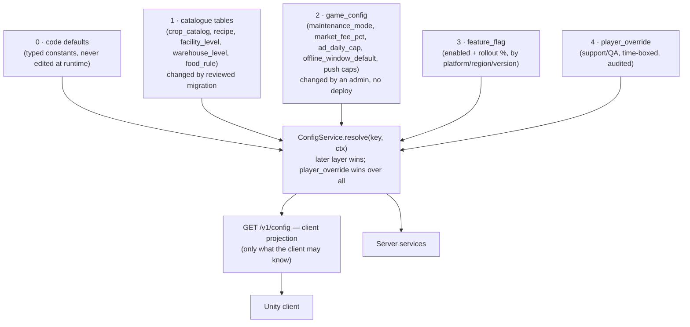
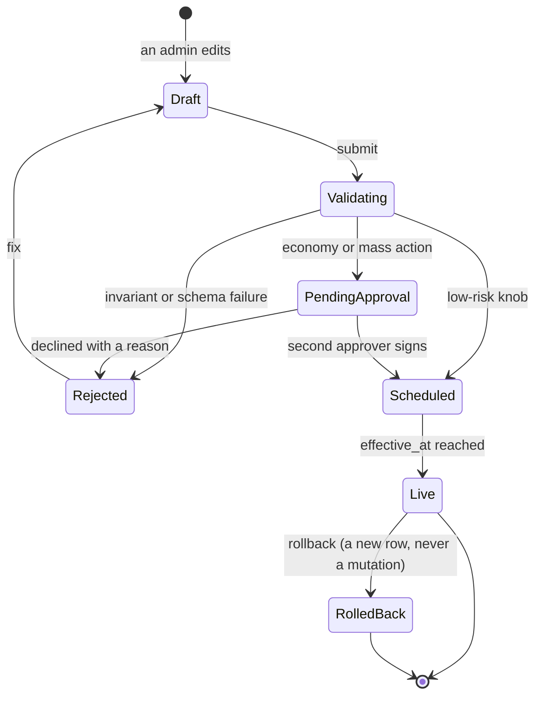
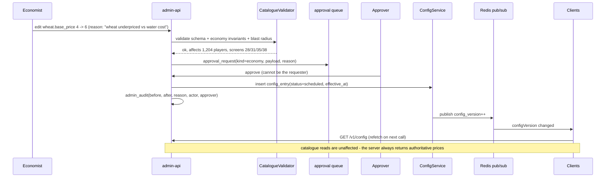
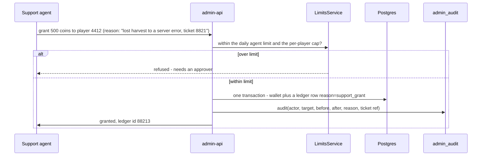

# Farmverse admin, configuration and live-ops

> **Superseded in part.** This document describes the NestJS + Prisma backend.
> The backend is now Firebase — see `firebase-backend.md` for what replaced what,
> where each golden rule is enforced, and the three design consequences. The
> reasoning below still holds; the mechanism does not.

**Related:** [`backend-architecture.md`](backend-architecture.md) · [`data-model.md`](data-model.md) · [`push-notifications.md`](push-notifications.md) · [`navigation.md`](navigation.md)

How the game is run after launch: layered configuration, the admin surface, the
approval and audit model, and the guardrails that stop a fat-fingered economy
edit from becoming a live incident.

Reads with `backend-architecture.md` (services, queues, Prisma) and
`push-notifications.md` (announcements, the ops status endpoint).

---

## 1. Configuration is layered, typed and versioned

The mistake to avoid is one `settings` table that code, admin and player all
read directly. Instead, four layers with explicit precedence:



**Why the split matters.** The economy numbers must change by *migration* —
reviewed, diffable, reversible, and seeded from one file per catalogue — because
they are the balance of the game. Runtime knobs must change *without* a deploy,
because a bad push cap at 2 a.m. should not wait for a release train. And the two
must never be confused, so a key lives in exactly one layer and the resolver
refuses a duplicate.

**Every entry is typed and validated.** `value_type` (`int/float/bool/enum/json`)
plus a Zod schema per key at the boundary, so `market_fee_pct` cannot become
`"5%"`. A bad write is rejected at the edge, not at read time in production.

**Effective time.** `config_entry` carries `effective_at`, `expires_at` and a
status. That is what makes "the plot price changed since you opened this screen"
(spec 77) and "any price change is shown as a plain number" (spec 27) honest: a
scheduled change is a row, and the client can be told its config version.

**Config epoch.** A monotonically increasing `config_version` is returned by
every response and by `GET /v1/config`. A change bumps it, is broadcast over
pub/sub, and clients refetch on the next call — no polling, no stale UI.

### The client projection

`GET /v1/config` returns **only** the keys a client may know: `market_fee_pct`,
`ad_daily_cap`, `offline_window_default`, the flags for *its* platform and
region, `min_client_version`, `maintenance` state, and the message strings. It
never returns catalogue tables, costs or drop rates — those leak the economy and
hurt cacheability. Anything a screen *displays as a value* still comes from the
server's response, never from client-side config (spec 6.1).

---

## 2. A configuration change has a lifecycle



Three rules make this trustworthy:

1. **Nothing is edited in place.** A change inserts a new row with `effective_at`
   and marks the old one superseded. History is the table, not a log beside it,
   so a rollback is a *new* row pointing at the old values.
2. **High-risk changes need two people.** Economy catalogue edits, mass grants,
   account deletions and flag flips that affect all players go through
   `approval_request`. The requester cannot approve their own.
3. **Every change names a reason.** `reason` is required and lands in
   `admin_audit` with a before/after diff.

### Economy invariants (the guardrail that matters)

A publish runs a validator before it can leave `Validating`. It fails on:

| Invariant | Why |
|---|---|
| no crop with a negative margin at its base price | stops an accidental money printer |
| no recipe whose output value exceeds its input value beyond a configured threshold | stops a conversion exploit |
| seed → produce → sale still nets a positive but bounded return | keeps the loop worth playing |
| upgrade costs and prices monotonic in level/tier | no level 3 cheaper than level 2 |
| every `stage_action` referencing an item that exists and is obtainable | no dead-end lifecycle |
| every `property_def` range non-empty and min < max | the UI renders bars from these |
| every `recipe.inputs_json` item is producible by some role | the cross-role loop stays closed |

Each is a unit test over the *catalogue tables*, run on publish and in CI. An
edit that breaks the economy cannot reach `Scheduled`.

---

## 3. The admin surface

Separate app, separate auth: **`apps/admin-api`** in the same monorepo, sharing
the domain layer and Prisma. A compromised admin token then cannot touch player
endpoints, and vice versa.

| Area | What it does |
|---|---|
| **Live-ops dashboard** | DAU/WAU, coins minted vs burned (from `currency_ledger`), trade volume, price index, queue depths, settle lag p95, push cohort open rates, error rate by endpoint |
| **Player lookup** | search by id, display name, email hash, device; view world, wallet + ledger, inventory, listings, facilities, sessions, notification history; **read-only by default** |
| **Support actions** | grant coins/items within limits, refund an order, force-settle a stuck timer, reset a stuck upgrade, reset a name, revoke a listing, unblock, re-issue a bonus — each with a required reason and a per-day limit |
| **Economy console** | browse and diff every catalogue table; edit with schema validation; a **simulation preview** ("wheat: 12 min, 10–14 yield, price 5 → 3.4 coins/min") before publishing; publish with `effective_at`; rollback |
| **Config and flags** | typed editing, scheduling, history, diff, rollback; flags with rollout % and platform/region targeting |
| **Moderation** | report queue, listing takedown, name changes, blocks, anti-abuse flags with the trade graph as evidence, appeals |
| **Support tickets** | the queue behind screen 54, with device, version and transaction already attached; canned replies; receipt lookup |
| **Announcements** | compose a push to the `announcements` topic, with the push policy applied (no urgency wording), a preview, a schedule and a cap |
| **Content and l10n** | `message_string` (shared by the inbox and push), loading `tip`s, `legal_document` versions and a "require re-consent" action |
| **Compliance** | data export jobs, deletion requests with grace period and typed confirmation, retention sweeps, consent version report, audit export |
| **Ops** | maintenance mode with the estimated return shown on screen 57, per-platform min version, force-logout, queue pause/drain, cache flush, kill switches |

### Blast radius, shown before you act

Every consequential screen leads with impact, computed from live data:

```
Economy change: crop_catalog.wheat.base_price  4 → 6
  Affects: 1,204 players holding wheat, 312 active listings at an old price
  Net effect: wheat income +50% · margin 3.4 → 5.1 coins/min
  Screens touched: 28, 31, 35, 38 (via the route table)
```

The "screens touched" line comes from `Docs/navigation.md`: the console knows
which routes read the table being changed, so the reviewer can see the player-
facing surface of a balance edit.

---

## 4. Two flows worth drawing

### 4.1 An economy change, end to end



### 4.2 A support grant, with limits



Grants always write a `currency_ledger` row with `reason='support_grant'`, so the
player's own transaction history (screen 42) shows it and the reconciliation job
accounts for it. Support never edits a balance directly.

---

## 5. Auth, roles and permissions

| Role | Can |
|---|---|
| `viewer` | read dashboards and player data |
| `support` | the support actions, within daily limits |
| `moderator` | reports, listings, names, blocks, appeals |
| `economist` | catalogue and config editing, **never** player data |
| `liveops` | flags, announcements, maintenance, queue control |
| `admin` | everything, including role assignment |
| `auditor` | read-only over `admin_audit` and `config_history` |

- **Separate identity.** `admin_user` with its own table, MFA (TOTP) required, and
  a JWT audience of `admin` so a player token is rejected outright.
- **Short sessions** (8 h) with revocation, an optional IP allowlist, and a
  re-auth prompt for economy and deletion actions.
- **Permissions, not roles, are checked** in the service layer via a
  `@RequirePermission('catalogue.write')` decorator, so a new role is data.
- **PII discipline.** Audit rows store ids and hashes, never emails or tokens;
  reading player PII writes its own audit row.

---

## 6. Data model additions

| Table | Fields |
|---|---|
| `admin_user` | `id` PK, `email`, `name`, `status`, `mfa_secret`, `last_login_at`, `created_at` |
| `admin_role` | `id` PK, `key`, `name` |
| `admin_permission` | `role_id` FK, `permission_key` |
| `admin_user_role` | `admin_user_id` FK, `role_id` FK |
| `admin_session` | `id` PK, `admin_user_id` FK, `token_hash`, `ip`, `user_agent`, `started_at`, `expires_at`, `revoked_at` |
| `admin_audit` | `id` PK, `admin_user_id` FK, `action`, `target_type`, `target_id`, `before_json`, `after_json`, `reason`, `ticket_ref`, `request_id`, `ip`, `at` |
| `config_entry` | `id` PK, `key`, `value_json`, `value_type`, `scope` (global/region/platform), `scope_value`, `effective_at`, `expires_at`, `status`, `created_by`, `approved_by`, `created_at` |
| `config_history` | `id` PK, `key`, `old_json`, `new_json`, `changed_by`, `approved_by`, `reason`, `at` |
| `feature_flag` | `id` PK, `key`, `enabled`, `rollout_pct`, `platform`, `region`, `min_version`, `expires_at`, `updated_by`, `updated_at` |
| `player_override` | `id` PK, `player_id` FK, `key`, `value_json`, `reason`, `expires_at`, `created_by` |
| `catalogue_change` | `id` PK, `table_name`, `row_id`, `kind` (insert/update/delete), `before_json`, `after_json`, `status`, `effective_at`, `created_by`, `approved_by` |
| `approval_request` | `id` PK, `kind`, `payload_json`, `reason`, `requested_by`, `approved_by`, `state`, `created_at`, `decided_at` |
| `announcement` | `id` PK, `title`, `body_json`, `topic`, `route`, `audience_json`, `scheduled_at`, `sent_at`, `created_by`, `approved_by`, `state` |
| `message_string` | `id` PK, `key`, `locale`, `text`, `updated_at` — shared by the inbox and push (spec 50) |
| `maintenance_window` | `id` PK, `starts_at`, `ends_at`, `message_key`, `platforms`, `state` |
| `player_note` | `id` PK, `player_id` FK, `admin_user_id` FK, `note`, `created_at` |
| `moderation_action` | `id` PK, `report_id` FK, `admin_user_id` FK, `action`, `reason`, `at` |

---

## 7. Queues

| Queue | Job | Trigger |
|---|---|---|
| `admin` | `mass-grant`, `data-export`, `purge-deleted`, `rebuild-player-cache` | admin action; batch with progress and a dry-run count |
| `config` | `publish-scheduled`, `invalidate-caches`, `broadcast-config-version`, `validate-catalogue` | scheduler + publish |
| `moderation` | `scan-self-trades`, `flag-multi-account`, `expire-listings` | on trade + repeatable |
| `push` | `announce` | announcement send (see `push-notifications.md`) |

A mass grant is **always** a job, never a request: 10k players is a batch with a
progress bar, a dry-run count, and an audit row per player. It is idempotent on
`(job_id, player_id)` so a retry cannot double-credit.

---

## 8. Guardrails, collected

1. **Typed keys with schemas** — a bad value is rejected at write time.
2. **Economy invariants** — an edit that breaks the balance cannot publish.
3. **Two-person approval** for economy, mass and destructive actions.
4. **Nothing edited in place** — every change is a new row with a history.
5. **Blast radius before commit** — affected players, listings and screens.
6. **Kill switches** for every flag *and* every subsystem: market writes, push,
   ads, registration, chat-free mentions, token settlement.
7. **Time-boxed overrides** that expire on their own.
8. **Audit completeness** — a test enumerates every admin route and fails if it
   lacks a permission decorator or an audit call.
9. **No direct balance writes** — grants go through the ledger.
10. **Maintenance is a flag, not a deploy** — and the server refuses trades while
    it is on, so balances stay safe (spec 57).

---

## 9. Testing

| Layer | Approach |
|---|---|
| Config resolution | precedence tests: default < catalogue < config < flag < override; duplicate keys refused |
| Validators | every economy invariant as a test over seeded catalogues, run in CI and on publish |
| Approval workflow | requester cannot approve; a declined request never takes effect |
| Audit completeness | route enumeration asserting a permission decorator + an audit write |
| Mass actions | dry-run count equals the applied count; idempotent on retry |
| Rollback | publish → rollback → assert the resolved value matches the original exactly |
| Time-boxing | an expired `player_override` stops applying without intervention |

---

## 10. Rollout

| Phase | Deliverable |
|---|---|
| 1 | `config_entry` + `ConfigService.resolve` + `GET /v1/config` projection + the client projection schema |
| 2 | `admin_user`/roles/permissions + MFA + `admin_audit` + the audit-completeness test |
| 3 | Live-ops dashboard and player lookup (read-only) |
| 4 | Config and flag editing with history, diff and rollback |
| 5 | Economy console with validators, simulation preview and blast radius |
| 6 | Support actions with limits, then moderation, then compliance |
| 7 | Approvals for high-risk actions, mass actions as jobs, announcements |

Phases 1–2 are the foundation and worth doing before any screen ships to real
players; the rest can follow the player-facing roadmap.

---

## 11. What this does not decide

- **The admin UI technology.** Options: a Next.js admin reusing the Farmverse
  tokens (so it looks like the game and can share the art pack), Retool/Appsmith
  for speed, or server-rendered htmx for a small surface. Recommendation:
  Next.js with the token palette as CSS variables, because the token file already
  exists and the console will be used daily.
- **Whether admin lives in this repo.** Recommended: yes, `apps/admin-api` in the
  monorepo, sharing the domain layer — the invariants must be the *same code* the
  game runs, not a copy.
- **The real economy numbers**, still pending the economy document. The
  validators above are precisely what will make seeding them safe.
