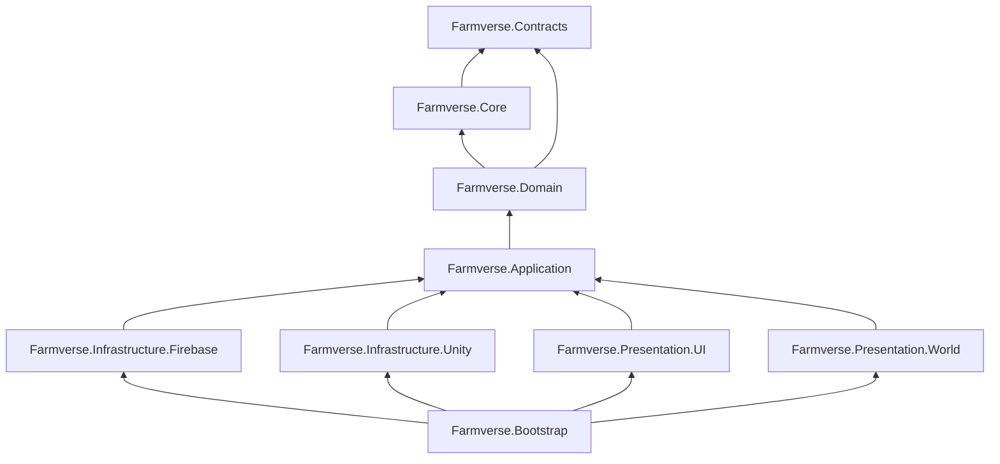

# 01 — Repository & module map

## 1. Top-level layout

The Unity project stays at the repository root (moving it would invalidate the
`Library/` cache and every editor path for no benefit). Everything that is not
Unity lives in clearly named sibling folders.

```
Farmverse/
├─ Assets/                       Unity project (see §2)
├─ Packages/                     Unity package manifest
├─ ProjectSettings/
│
├─ contracts/                    THE single source of truth shared by client and server
│  ├─ src/
│  │  ├─ common/                 ids, money, time, paging, errors, envelope
│  │  ├─ documents/              Firestore document schemas (what the client reads)
│  │  ├─ actions/                one file per action family: request + result schemas
│  │  ├─ queries/                list query schemas (filters, sorts, cursors)
│  │  └─ index.ts
│  ├─ economy/                   economy.json (+ schema + invariant checks)
│  ├─ vectors/                   conformance test vectors (JSON) run by C# AND TS tests
│  ├─ codegen/                   zod → JSON Schema → C# emitter
│  └─ package.json               published to the backend as @farmverse/contracts
│
├─ backend/
│  ├─ functions/                 Cloud Functions codebase (see §3)
│  ├─ firestore.rules
│  ├─ firestore.indexes.json
│  ├─ storage.rules
│  ├─ remoteconfig.template.json
│  └─ rules-tests/               @firebase/rules-unit-testing suites
│
├─ tools/
│  ├─ art/                       the UI art generator (moved from Tools/art_gen, scaffold scripts deleted)
│  ├─ catalogue/                 validate + publish the economy to a Firebase project
│  └─ ci/                        CI helper scripts
│
├─ Docs/
│  ├─ architecture/              these documents
│  ├─ adr/                       one file per architecture decision
│  └─ legacy/                    the previous design docs, kept for reference
│
│  (backend/firebase.json is the Firebase project root: run the CLI from backend/)
├─ .firebaserc                   dev / staging / prod aliases
├─ package.json                  npm workspaces: contracts, backend/functions, tools/*
└─ .github/workflows/            CI pipelines
```

**Rule:** a folder is a module boundary. Nothing reaches across a boundary
except through the module's public entry point (`index.ts` / an asmdef's public
types).

## 2. Unity: `Assets/`

```
Assets/
├─ Farmverse/
│  ├─ Runtime/
│  │  ├─ Core/                         Farmverse.Core                (no UnityEngine) — results, time, reactive, lists engine, search
│  │  ├─ Contracts/                    Farmverse.Contracts           (no UnityEngine, GENERATED)
│  │  ├─ Domain/                       Farmverse.Domain              (no UnityEngine)
│  │  │   ├─ Catalogue/                 immutable catalogue model + lookup
│  │  │   ├─ Economy/                   Money, Wallet, Ledger, NetWorth, Fees, Titles
│  │  │   ├─ Inventory/                 Inventory, capacity, reservations
│  │  │   ├─ Farming/                   Plot, Slot, Crop, Livestock, Tree, Well, growth rules
│  │  │   ├─ Production/                Machine, Recipe, ProductionJob, queue rules
│  │  │   ├─ Market/                    Listing view model, price bands, fee rules
│  │  │   ├─ Player/                    Role, Profile, permissions per role
│  │  │   └─ Actions/                   client-side validators + predictors per action
│  │  ├─ Application/                  Farmverse.Application         (no UnityEngine)
│  │  │   ├─ Ports/                     IAuthService, IActionGateway, I*Repository, IRemoteConfig, ...
│  │  │   ├─ Session/                   boot state machine, session lifecycle
│  │  │   ├─ State/                     reactive stores (PlayerStore, InventoryStore, PlotStore, ...)
│  │  │   ├─ Actions/                   ActionQueue (batching, retry, optimistic overlay, reconcile)
│  │  │   ├─ Features/                  use cases per feature: Farming, Production, Shop, Market, Social, Rewards
│  │  ├─ Infrastructure/
│  │  │   ├─ Firebase/                  Farmverse.Infrastructure.Firebase (Firebase SDK adapters)
│  │  │   └─ Unity/                     Farmverse.Infrastructure.Unity    (PlayerPrefs, connectivity, haptics, audio)
│  │  ├─ Presentation/
│  │  │   ├─ UI/                        Farmverse.Presentation.UI     (UI Toolkit: screens, presenters, components)
│  │  │   └─ World/                     Farmverse.Presentation.World  (3D: views, camera, input, VFX)
│  │  └─ Bootstrap/                    Farmverse.Bootstrap           (composition root, environment selection)
│  ├─ Editor/                          Farmverse.Editor              (build, setup, validators, capture)
│  ├─ Tests/
│  │  ├─ EditMode/                     Farmverse.Tests.EditMode      (Core, Domain, Application, vectors)
│  │  └─ PlayMode/                     Farmverse.Tests.PlayMode      (UI flows, world, boot against emulator)
│  └─ Content/                         assets only, no code
│      ├─ UI/  Screens/*.uxml  Styles/*.uss  Themes/*.tss  Art/  Fonts/
│      ├─ World/  Prefabs/  Materials/  Models/  VFX/
│      ├─ Audio/
│      ├─ Localization/              string tables (Unity Localization)
│      ├─ Config/                    EnvironmentConfig assets (dev/staging/prod), CatalogueSnapshot.json
│      └─ Scenes/                    Bootstrap.unity, World_Farm.unity, World_Visit.unity
├─ Firebase/  ExternalDependencyManager/  Plugins/   (third-party, untouched)
└─ AddressableAssetsData/
```

### 2.1 Assembly graph (enforced)



| Assembly | `noEngineReferences` | May reference | Must never reference |
|---|---|---|---|
| Contracts | ✅ | — (generated DTOs + the `Wire`/`WireJson` runtime) | anything |
| Core | ✅ | Contracts | Domain and up |
| Domain | ✅ | Core, Contracts | Application and up, any SDK |
| Application | ✅ | Domain, Contracts, Core | Firebase SDK, UnityEngine, Presentation |
| Infrastructure.Firebase | ❌ | Application (+ below), Firebase.*, Newtonsoft | Presentation |
| Infrastructure.Unity | ❌ | Application (+ below) | Presentation, Firebase |
| Presentation.UI | ❌ | Application (+ below), UnityEngine.UIElements | Infrastructure, World |
| Presentation.World | ❌ | Application (+ below), URP, Input System | Infrastructure, UI |
| Bootstrap | ❌ | everything | — (nothing references it) |
| Tests.EditMode | ✅ where possible | Core..Application + fakes | Infrastructure |

`noEngineReferences: true` on the bottom four means the whole game logic
compiles and tests under plain `dotnet test` in CI in seconds, without Unity.

`UI` and `World` never talk to each other directly. When the world is tapped,
`World` raises an intent on an Application service (`ISelectionService`), and
`UI` observes it. That is the only crossing.

### 2.2 Namespaces

Namespace = assembly + folder: `Farmverse.Domain.Farming`,
`Farmverse.Core.Lists`, `Farmverse.Presentation.UI.Screens.Market`.
One public type per file, file name = type name.

## 3. Backend: `backend/game/src`

```
src/
├─ index.ts                     exports only: api/*, jobs/*, triggers/*
├─ api/                         the HTTP surface (thin: parse → authorize → call a service)
│  ├─ actions.ts                actions-submit (batched game actions)
│  ├─ player.ts                 player-create, player-updateProfile
│  ├─ account.ts                account-delete, account-export
│  ├─ rewards.ts                rewards-adSsv (HTTPS webhook)
│  └─ admin.ts                  admin-* (custom claim required)
├─ core/                        framework-free building blocks
│  ├─ errors.ts                 AppError(code, params) → envelope / HttpsError
│  ├─ callable.ts               defineCallable(): auth, App Check, zod, rate limit, logging, error mapping
│  ├─ logger.ts                 structured logs with requestId / uid / action
│  ├─ clock.ts                  Clock interface (tests inject a fixed clock)
│  ├─ ids.ts                    id generation and validation
│  ├─ cursor.ts                 opaque, signed pagination cursors
│  └─ result.ts                 Result helpers
├─ domain/                      PURE rules — no firebase imports (lint-enforced). Mirror of Farmverse.Domain
│  ├─ catalogue/  economy/  inventory/  farming/  production/  market/  player/
├─ modules/                     application services, one folder per feature
│  ├─ player/  shop/  farming/  production/  market/  tradingPost/  orders/
│  ├─ rewards/  leaderboard/  notifications/  visits/  admin/
│  │   each: actions.ts (handlers registered in the action registry), service.ts, *.test.ts
├─ infra/
│  ├─ firestore.ts              db, typed converters built from contract schemas
│  ├─ paths.ts                  every document path, typed (no string paths elsewhere)
│  ├─ unitOfWork.ts             transaction wrapper: read set → decide → write set
│  ├─ repositories/             PlayerRepo, InventoryRepo, EstateRepo, PlotRepo, ListingRepo, LedgerRepo, ...
│  ├─ catalogueCache.ts         versioned in-memory catalogue per instance
│  └─ remoteConfig.ts           server-side Remote Config template
├─ jobs/                        onSchedule: market-expire, market-stats, leaderboard-reprice, reconcile-ledger
└─ triggers/                    onDocument*: player → leaderboard, trade → notification, notification → push
```

Import rules (eslint `import/no-restricted-paths`):

- `domain/**` imports only `domain/**` and `@farmverse/contracts`.
- `modules/**` imports `domain`, `infra`, `core`, contracts — never `api`.
- `api/**` imports `modules` and `core` — never `infra` directly.
- Nothing imports `firebase-admin` outside `infra/` and `core/callable.ts`.

## 4. What happened to the legacy folders (done, Oct 2026)

Executed by `tools/remove-legacy.ps1` (moves kept assets, sends the rest to the
Recycle Bin). The table records where each legacy folder went.

| Legacy | Fate |
|---|---|
| `Assets/Farmverse/Scripts/**`, `Scenes/Bootstrap.unity`, `Scenes/World_3D.unity` | Deleted; replaced by `Runtime/**` and `Scenes/Boot.unity` |
| `Assets/Farmverse/Art/UI`, `UI/Art`, `Resources/Farmverse/Fonts`, `UI/Styles/generated_art.uss` | Moved to `Content/UI/Art/Generated`, `Content/UI/Art/Painted`, `Content/UI/Fonts`, `Content/UI/Styles` |
| `Assets/Farmverse/UI/Styles/*` (other sheets), `FarmverseTheme.tss`, panel settings | Deleted; replaced by `Content/UI/Styles/{tokens,components}.uss` and `Content/UI/FarmverseTheme.tss` |
| `Assets/Farmverse/Resources/UI/Screens/*.uxml` | Deleted; views are built in code (`Presentation/UI/Views`) |
| `Assets/Farmverse/Editor/**` | Art importer and package installer kept in `Farmverse.Editor`; boot debug, capture and gameplay-test tools (bound to the old code) deleted |
| `functions/`, root `firebase.json`, `.firebaserc` | Deleted; `backend/` is the Firebase project root |
| `config/economy.json` | Moved to `contracts/economy/economy.json` |
| `Tools/art_gen` art scripts | Moved to `tools/art` (`Tools` renamed `tools`) |
| `Tools/art_gen/scaffold_*`, `wire_*`, `fix_*`, `rename_*`, `apply_*`, `patch_*`, `restructure_*`, `layer_scripts.py`, `sync_csproj.py`, `finish_literals.py` | **Deleted** — code generators that edit source are banned |
| `Tools/game_test` | Replaced by `dotnet test` over the engine-free assemblies |
| `firestore.rules`, indexes, `storage.rules`, `remoteconfig.template.json` (old economy-as-RC keys) | Deleted; rewritten in `backend/` (the RC template now holds only the switches in `RemoteKeys.cs`, checked by `tools/codegen/check_remote_config.py`) |
| root `*.csproj`, `Farmverse.slnx` | Deleted (stale; Unity regenerates them) |
