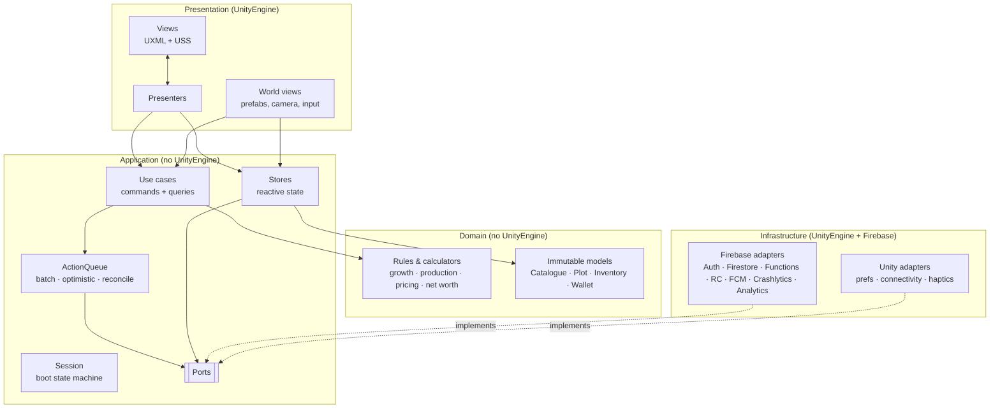
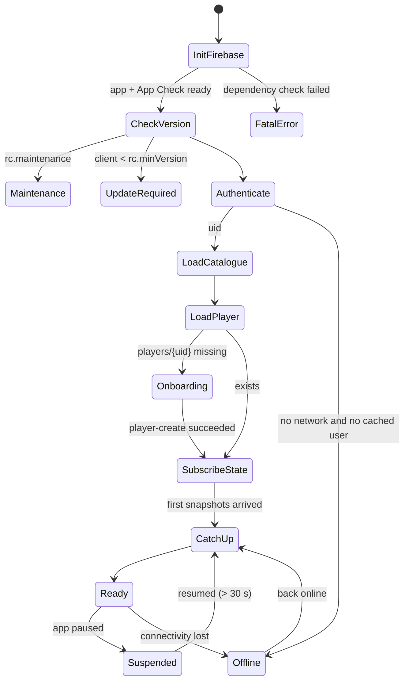
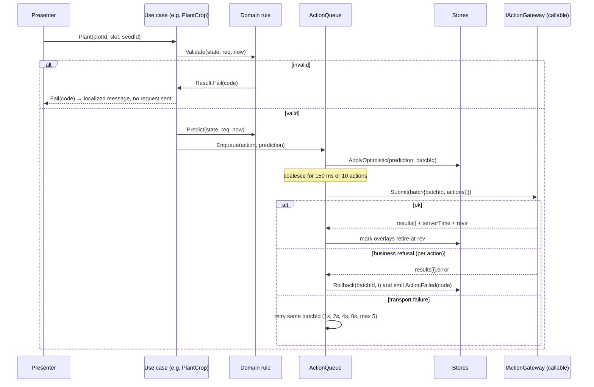

# 02 — Unity client architecture

Unity 6 (6000.6), URP, UI Toolkit, Input System, Addressables, Unity
Localization, Firebase Unity SDK 14. Portrait, 360×780 dp reference.

## 1. The shape in one picture



Data flows **one way**:

```
Firestore listener → Repository (maps contract DTO → domain model) → Store (immutable snapshot)
        → Presenter (maps to view model) → View (binds)
View event → Presenter → Use case → Domain validate+predict → ActionQueue
        → optimistic overlay on Store → Functions callable → server result
        → listener delivers authoritative doc → overlay retired
```

## 2. Core (`Farmverse.Core`)

Engine-free primitives used by every layer:

| Type | Purpose |
|---|---|
| `Result`, `Result<T>` | Success/failure without exceptions for expected outcomes |
| `AppError` | `ErrorCode` (generated enum) + `IReadOnlyDictionary<string,string> Params` + optional `Exception Cause` |
| `Guard` | Argument checks that throw `ArgumentException` for programmer errors only |
| `IClock` | `UtcNow` (`DateTimeOffset`) and `NowSeconds` (`long`) |
| `ILog` / `LogLevel` | Structured logging port; Unity adapter writes to console + Crashlytics breadcrumbs |
| `ReactiveProperty<T>` / `IReadOnlyReactiveProperty<T>` | Current value + change event; equality-checked; main-thread notification |
| `IEventBus` | Typed fire-and-forget app events (`PlotTapped`, `ActionFailed`, `Toast`) |
| `CompositeDisposable` | Lifecycle of subscriptions, cleared by presenters on hide |
| `PageRequest`, `Page<T>`, `PageCursor` | Pagination primitives (see 06) |
| `SortSpec`, `FilterSpec`, `TextQuery` | Query primitives (see 06) |
| `IScheduler` | Delays/timers without Unity (debounce, retry backoff); Unity adapter uses `Awaitable` |
| `RequestId` | UUID v4 generator for idempotency |

No singletons. Everything that has state is constructed by the composition root.

## 3. Domain (`Farmverse.Domain`)

Pure C#: immutable records + static rule functions. **Every function takes the
time as an argument** — the domain has no clock.

```csharp
public sealed record CropFacts(string CropType, int Slot, long PlantedAt,
    int WaterGiven, int FertilizerGiven, long LastHoedAt, long LastSprayedAt);

public static class CropGrowth
{
    // Same formula as backend/game/src/domain/farming/cropGrowth.ts,
    // proven by contracts/vectors/farming/crop-growth.json
    public static CropStatus Evaluate(CropFacts facts, CropRules rules, long now) { ... }
}

public sealed record CropStatus(CropStage Stage, double Progress, double Care,
    CropNeed[] Needs, bool IsRipe, long? RipeAt);
```

What lives here:

- **Catalogue** — `Catalogue` (immutable, versioned), `ItemDef`, `ObjectDef`,
  `LevelDef`, `RecipeDef`, `CropRules`, `AnimalRules`, typed property access.
- **Economy** — `Coins` (wrapper over `long`), `FeeRules`, `NetWorthCalculator`,
  `TitleLadder`.
- **Inventory** — `Inventory` (quantities, reservations, capacities per
  storage class), `CanAdd`, `CanRemove`.
- **Farming** — `Plot` aggregate with typed slots, `CropGrowth`,
  `LivestockGrowth`, `WellSupply`, `SoilRules`.
- **Production** — `Machine`, `ProductionQueue`, `JobProgress`.
- **Market** — `PriceBand` (min/max per item from reference price),
  `ListingRules` (max active listings by stall level), fee calculation.
- **Player** — `Role`, `RolePermissions` (which action kinds a role may do).
- **Actions** — one validator + predictor per action kind:

```csharp
public interface IActionRule<TRequest>
{
    // Same checks the server makes, in the same order, returning the same ErrorCode.
    Result Validate(GameState state, TRequest request, long now);
    // The state the server is expected to produce. Used for optimistic UI.
    GameState Predict(GameState state, TRequest request, long now);
}
```

`GameState` is an immutable snapshot composed of the player's aggregates
(`Player`, `Inventory`, `Estate`, `IReadOnlyList<Plot>`, `Production`) plus the
`Catalogue`. It is the input to every rule, so a test can build one in one line.

## 4. Application (`Farmverse.Application`)

### 4.1 Ports (implemented by Infrastructure)

```csharp
public interface IAuthService      { AuthState Current; IObservable<AuthState> Changes; Task<Result<AuthUser>> SignInAnonymously(CancellationToken ct); Task<Result> LinkGoogle(...); Task<Result> LinkApple(...); Task SignOut(); }
public interface IActionGateway    { Task<Result<ActionBatchResult>> Submit(ActionBatch batch, CancellationToken ct); }
public interface IPlayerRepository { IDisposable Watch(string uid, Action<Snapshot<PlayerDoc>> onNext); Task<Result<PlayerDoc>> Get(string uid, Freshness f, CancellationToken ct); }
public interface IInventoryRepository, IEstateRepository, IPlotRepository, IProductionRepository   // same shape
public interface IListingQueryService  { Task<Result<Page<ListingDoc>>> Query(ListingQuery q, PageRequest p, CancellationToken ct); IDisposable WatchPage(...); }
public interface ILeaderboardQueryService, ILedgerQueryService, INotificationQueryService
public interface ICatalogueSource  { Task<Result<Catalogue>> Load(CancellationToken ct); IObservable<Catalogue> Updates; }
public interface IRemoteConfig     { T Get<T>(RemoteKey<T> key); Task<Result> Refresh(CancellationToken ct); }
public interface IServerClock : IClock { void Observe(long serverEpochMs, TimeSpan roundTrip); bool IsSynced; }
public interface IConnectivity     { IReadOnlyReactiveProperty<bool> IsOnline; }
public interface IAnalytics, ICrashReporter, IPushService, ILocalStore, IAppLifecycle
```

### 4.2 Session — the boot state machine



`SessionService` owns this machine. The loading screen observes
`SessionService.State` and `Progress`; it never drives the boot. Each step has
a timeout and a retry policy; every failure maps to an `ErrorCode` and a screen
(56 connection lost, 57 maintenance/update, 58 generic error).

### 4.3 Stores — the single source of truth for the UI

One store per aggregate, each exposing an immutable snapshot:

| Store | Backed by | Holds |
|---|---|---|
| `PlayerStore` | `players/{uid}` | profile, role, coins, counters, rev |
| `InventoryStore` | `players/{uid}/state/inventory` | items, reservations, capacities |
| `EstateStore` | `players/{uid}/state/estate` | owned facilities/tools/machines + levels + durability |
| `PlotStore` | `players/{uid}/plots/*` | plots with embedded slots |
| `ProductionStore` | `players/{uid}/state/production` | machine queues and jobs |
| `CatalogueStore` | `catalogue/current` | the active catalogue version |
| `NotificationBadgeStore` | `players/{uid}` counters | unread counts |
| `ConfigStore` | Remote Config | knobs, flags, gates |

A store's value is `Authoritative ⊕ Overlay`:

```csharp
public sealed class Store<T> where T : class
{
    public IReadOnlyReactiveProperty<T> Value { get; }        // what the UI reads
    internal void ApplyServer(T doc, long rev);               // from the listener
    internal OverlayHandle ApplyOptimistic(Func<T,T> patch, string batchId, long expectedRev);
    internal void Retire(string batchId);                     // server caught up
    internal void Rollback(string batchId);                   // action failed
}
```

`Value` is recomputed as `server doc` with every still-pending overlay replayed
on top, so a listener update that arrives mid-flight never makes the UI flicker
back. An overlay is retired when the server doc's `rev` reaches the rev the
action result reported.

### 4.4 The action pipeline



Rules of the queue:

- **Batching:** actions coalesce for 150 ms (or 10 actions) into one batch. A
  batch is one callable, one transaction, one idempotency key (`batchId`).
- **Ordering:** batches are sent strictly in order; a later batch waits for the
  earlier one. Actions inside a batch execute in order on the server.
- **Idempotency:** a retry resends the identical batch with the same `batchId`.
  The server returns the stored result.
- **Persistence:** pending batches are written to `ILocalStore` before sending,
  so an app kill mid-request replays on next launch (same `batchId`, so it is
  safe).
- **Offline:** farming verbs may queue offline up to 30 actions / 10 minutes,
  shown as "pending" chips. Market, shop and anything that spends coins require
  connectivity and fail fast with `NETWORK_REQUIRED`.
- **Failure:** a business refusal rolls back only that action's overlay and the
  ones after it in the same batch, and raises `ActionFailed(code, params)`
  which the UI shows as a toast or dialog by code.
- **Telemetry:** if the server result differs from the prediction (e.g. a yield
  of 12 vs predicted 13), log `prediction_mismatch{action, field}` to
  Crashlytics as a non-fatal. This is how domain drift becomes visible.

### 4.5 Use cases (features)

One class per user intention, grouped by feature folder. Each is small: read
state, validate with the domain, enqueue, return a `Result`.

```
Features/
  Onboarding/   CreatePlayer, ChooseRole, CompleteTutorialStep
  Farming/      TillPlot, PlantCrops, WaterCrop, FertilizeCrop, TendCrop, HarvestCrop, HarvestAll,
                FetchWater, BuyAnimal, FeedAnimals, CollectAnimalProduce, PlantTree, FellTree
  Production/   StartJob, CollectJob, CancelJob, RepairMachine
  Shop/         BuyItem, UpgradeObject, RepairTool
  Market/       CreateListing, BuyListing, CancelListing, PromoteListing, BrowseListings, MyListings
  TradingPost/  SellToPost, BuyFromPost
  Orders/       FulfilOrder, BrowseOrders
  Rewards/      ClaimDailyBonus, StartRewardedAd
  Social/       Leaderboard, PlayerCard, VisitWorld, SetAllowVisitors
  Account/      LinkAccount, EditProfile, DeleteAccount, ExportData
  Notifications/ Inbox, MarkRead, RegisterPushToken
```

### 4.6 Server clock

`ServerClock` keeps `offset = serverTime - localMonotonicTime`, updated from
every callable envelope (`serverTimeMs`, corrected by half the round trip) and
smoothed (median of the last 5 samples). It uses
`Stopwatch` (monotonic) rather than `DateTime.UtcNow`, so changing the device
clock does nothing. All derived timers (`ripe in 3m 12s`) read `IServerClock`.
Until the first sync it uses the device clock and marks timers as estimates.

## 5. Infrastructure.Firebase

| Port | Adapter | Notes |
|---|---|---|
| bootstrap | `FirebaseInitializer` | `CheckAndFixDependenciesAsync` → App Check provider (Play Integrity / App Attest; debug in editor + dev) → `FirebaseApp` per environment → emulator wiring in dev |
| `IAuthService` | `FirebaseAuthService` | anonymous first, then link through an `ILinkFlow` per provider and platform (`PlatformLinkFlows`). Apple on Android: Firebase's own OAuth flow. Apple on iOS: native AuthenticationServices token + nonce. Google: Credential Manager (Android) or GoogleSignIn (iOS) ID token. The editor has no flows, so the buttons are hidden. A provider account already used by another farm → `ACCOUNT_IN_USE` |
| `IActionGateway` | `CallableActionGateway` | `FirebaseFunctions.GetInstance(app, region).GetHttpsCallable("actions-submit")`, timeout 15 s; DTO ↔ `Dictionary<string,object>` via Newtonsoft with the generated contract converters |
| repositories | `Firestore*Repository` | `ListenerRegistration` per aggregate; `[FirestoreData]` mirror types or dictionary mapping into contract DTOs; snapshot metadata (`IsFromCache`, `HasPendingWrites`) surfaced as `Freshness` |
| `IListingQueryService` etc. | `FirestoreQueryServices` | typed `ListingQuery` → `Query` builder that only emits index-backed shapes (see 06) |
| `ICatalogueSource` | `FirestoreCatalogueSource` | read `catalogue/current` from the Firestore cache, re-read from the server only when Remote Config `catalogue_version` differs; bundled snapshot for the first offline launch (11 §5.1) |
| `IRemoteConfig` | `RemoteConfigService` | defaults from generated `RemoteKeys`, `FetchAndActivateAsync` with 12 h min interval (5 min in dev), real-time updates listener |
| `IPushService` | `FcmPushService` | `PushPrompt` shows the game's explainer after `push_prompt_after_harvests` harvests (once per install), and the OS dialog only after a yes. The token is sent with the Firebase Installations id (`FirebaseInstallationId`) to `push-registerToken`, and again at every session start once granted. Only taps open a route (`DeepLinks`); a push received while playing just updates the inbox |
| `IShareSheet` | `NativeShareSheet` (Infrastructure.Unity) | the data export as a JSON file. Android: a FileProvider uri and an `ACTION_SEND` chooser. iOS: `UIActivityViewController`. Editor: a file under `persistentDataPath/exports` |
| `ICrashReporter` | `CrashlyticsReporter` | user id = uid (never email), custom keys: route, clientVersion, env, lastBatchId |
| `IAnalytics` | `FirebaseAnalyticsService` | typed events generated from the analytics taxonomy (requires adding `FirebaseAnalytics.unitypackage`) |
| avatars | `StorageAvatarService` | upload own avatar (requires adding `FirebaseStorage.unitypackage`) |

**Native plug-ins (in repo, no third-party Unity plug-ins).**

- **Android** (`Assets/Farmverse/Plugins/Android/`): `FarmverseShare.java`,
  `FarmverseGoogleSignIn.java`, and `FarmverseNative.androidlib`, which holds the
  FileProvider manifest and paths.
- **iOS** (`Plugins/iOS/`): `FarmverseShare.mm`, `FarmverseAppleSignIn.mm` and
  `FarmverseGoogleSignIn.mm`.
- **C# side:** `Infrastructure/Unity/Native/NativeBridge.cs` makes each call one
  task, completed on the main thread.
- **Native libraries:** `Editor/FarmverseDependencies.xml` declares them for the
  External Dependency Manager: androidx credentials, googleid and core on
  Android, and the GoogleSignIn pod on iOS.
- **Xcode setup:** `Editor/FarmverseIosBuild.cs` adds the Sign in with Apple
  capability, AuthenticationServices and Google's `REVERSED_CLIENT_ID` URL
  scheme to the generated project.

**Threading.** Firebase Task continuations are awaited from the main thread
(`UnitySynchronizationContext`), so stores are only mutated on the main
thread. Listener callbacks are marshalled through `IMainThreadDispatcher`
defensively.

**Listener lifecycle.** Each screen's presenter declares which watches it
needs; a `SubscriptionScope` opens them on show and closes them on hide. The
session-wide aggregates (player, inventory, estate, plots, production) stay
open while the app is foregrounded and are detached after 60 s in background
(the SDK cache keeps the last state, and resume does a catch-up).

## 6. Presentation.UI — UI Toolkit, MVP

### 6.1 One screen = three files

```
Content/UI/Screens/Market/MarketBrowse.uxml      layout (designer-owned)
Presentation/UI/Screens/Market/MarketBrowseView.cs       queries named elements, exposes events, renders a view model
Presentation/UI/Screens/Market/MarketBrowsePresenter.cs  subscribes to stores/lists, calls use cases, no VisualElement access
```

```csharp
public interface IScreen { RouteId Id { get; } ScreenKind Kind { get; } }   // Tab, Push, Modal, Sheet, Overlay
public abstract class ScreenView<TModel> : IDisposable { VisualElement Root; void Render(TModel m); }
public abstract class Presenter<TView, TArgs> { Task OnShow(TArgs args, CancellationToken ct); void OnHide(); }
```

Presenters are plain C# and are unit-tested against a fake view.

### 6.2 Navigation

`Navigator` (Application-facing interface, UI implementation) owns a stack of
screens, a modal stack and the tab root. Routes are typed:

```csharp
public static class Routes
{
    public static readonly Route<None>          Home         = new("home", ScreenKind.Tab);
    public static readonly Route<ListingArgs>   ListingDetail = new("market/listing", ScreenKind.Push);
    public static readonly Route<BuyConfirmArgs> BuyConfirm   = new("market/buy", ScreenKind.Modal);
}
navigator.Push(Routes.ListingDetail, new ListingArgs(listingId));
```

Deep links from push notifications resolve a string route + args through the
same table. Back: closes the top modal, then pops the stack, then asks before
quitting (Android back is wired through the Input System).

**As built (Phase C).**

- **Deep links.** `DeepLinks.Open(navigator, route, args)` is the one place a
  notification becomes navigation, for inbox rows (`routeArgs`) and push taps
  (FCM data, args as `arg_<name>`). The server's dotted ids
  (`market.myListings`) are aliases of the client ids. A listing id opens that
  listing over My listings. Unknown routes, missing args and system screens open
  nothing. A tap that launched the app waits until Home is showing.
- **Gates.** Presenters get a `GuardedNavigator` over the shell. A `RouteGate`
  closes a set of routes while a switch is off: `RouteGate.Market` covers all
  four market routes while `feature_market` is false, and shows the
  `market.closed` toast instead. The HUD hides its Market button from the same
  `FeatureFlags.MarketEnabled`, which re-reads Remote Config after the boot
  fetch and on every real-time update.
- **Visits.** `social/visit` (`VisitArgs`) opens from a leaderboard row. The
  screen is see-through: the shell hides the HUD layer under it, and
  `WorldPresenter` (as `IVisitWorld`) draws the host's `visits-getSnapshot` with
  `WorldModelBuilder.BuildVisit`, using keys prefixed `visit/`. Crops are drawn
  as well kept, and no needs are flagged. Taps and the expansion ring are off
  until the screen closes and the player's own farm comes back.

### 6.3 Component library (`Presentation/UI/Components`)

Custom `VisualElement`s with `[UxmlElement]` so designers place them in UXML:
`FvButton` (4 ramps, pressed/disabled/loading states), `CoinLabel`,
`ItemIcon` (Addressable sprite by item id), `QuantityStepper`, `PriceField`,
`ProgressBar`, `TimerLabel` (reads `IServerClock`, ticks once a second, no
allocation), `Badge`, `Chip`, `ChipGroup` (filters), `SortMenu`,
`SearchField` (debounced), `PagedListView` (wraps `ListView` virtualization +
empty/error/loading/end states + pull-to-refresh + infinite scroll), `Toast`,
`Dialog`, `Sheet`, `Tabs`, `Avatar`, `StatRow`.

### 6.4 Theme, localization, accessibility

- **Tokens** stay in `tokens.uss`; components never hard-code colours. Role
  accent is a USS class on the root (`.role-farmer`, `.role-manufacturer`).
- **Localization:** Unity Localization string tables. Every `ErrorCode` has a
  key `error.<CODE>` with smart-string params. Numbers, coins and durations use
  locale formatters in one `Formatters` class.
- **Accessibility:** 48 dp minimum targets, text scale setting, reduce-motion
  setting (disables tweening), colour never the only signal, screen-reader
  labels via the accessibility module where the platform supports it.

## 7. Presentation.World — the 3D farm

```
World_Farm.unity (additive, active scene for lighting)
├─ WorldRoot           (WorldPresenter: binds PlotStore → views)
├─ HexGrid             (HexLayout math in Domain; HexGridView builds ground meshes once)
├─ Plots/              (PlotView per plot; SlotView per occupant, pooled)
├─ CameraRig           (Cinemachine: orbit-locked 3/4 view, pan, pinch-zoom 0.7–1.6×, focus-on-plot)
├─ Lighting            (TimeOfDay: 4 palettes driven by IServerClock local hour)
└─ VFX                 (pooled: harvest pop, water splash, coin fly, sparkle)
```

- **Visual catalogue:** a ScriptableObject `WorldVisualCatalog` maps
  `itemId → stage → AssetReferenceGameObject`. The world never `switch`es on
  an id. New crops are a data row + a prefab.
- **Diff rendering:** `WorldPresenter` receives a new immutable plot snapshot,
  diffs by slot id, and only spawns/despawns/updates what changed. Stage
  changes play a transition; progress drives a shader parameter (no rebuild).
- **Input:** Input System touch → `WorldInput` raycasts against a single layer
  of slot colliders → raises `SelectionService.Select(SlotRef)`. Taps over UI
  are rejected via the UI panel's pick test (exposed as a port by
  Presentation.UI through Application's `IUiHitTest`).
- **Contextual actions:** the UI (not the world) shows the action ring for the
  selected slot, built from the domain (`SlotActions.For(slot, state, now)`), so
  the same list drives the 3D ring, the accessibility menu and tests.
- **Visit mode:** `World_Visit` loads a `WorldSnapshotDoc` (read-only DTO);
  the presenter is constructed with no action service, so it cannot act.
- **Performance budget (mid-range Android):** ≤ 120 draw calls, ≤ 150k tris,
  GPU instancing for crops/fences, SRP Batcher on, baked lighting for static
  props + one realtime directional light, ASTC textures, LOD on props, pooled
  objects, no per-frame allocations (verified by the Profiler in CI captures).

### 7.1 As built (Phase 6)

The plan above is the target; what exists today is deliberately simpler and
fully engine-free where it can be:

| Piece | Where | Notes |
|---|---|---|
| `HexGrid`, `Hex`, `PlotLayout` | `Presentation/Core/World/HexGrid.cs` | pointy-top axial maths, pick-by-ground-point, slot positions inside a plot; unit-tested |
| `WorldModelBuilder` → `SlotVisual`, `WorldDiff` | `Presentation/Core/World/WorldModel.cs` | snapshot from the stores (server ⊕ predictions, so a predicted plant shows at once with a `Pending` flag); stage + need flags from the Domain rules; diff by stable key |
| `WorldPresenter` | `Presentation/Core/World/WorldPresenter.cs` | rebuilds on store changes and once a second, sends only the diff, offers the expansion ring, frames the camera once, turns taps into `SlotActions` / `Machine` / `Shop` navigation |
| `WorldRoot` (`IWorldView`), `PrefabPool`, `WorldPickable`, `IVisualStateReceiver` | `Presentation/World` (Unity) | pooled prefabs per visual id + stage; prefabs animate themselves through `IVisualStateReceiver` |
| `WorldVisualCatalog` | ScriptableObject | id or `prefix_*` → prefab per stage, fallback prefab; direct references for now (Addressables when art lands) |
| `CameraRig`, `WorldInput`, `TimeOfDay` | `Presentation/World` | no Cinemachine: pivot rig with bounds and smoothing (off with reduce-motion); Input System touch/mouse pan, pinch/wheel zoom, tap-pick with UI rejection through `UiShell.IsOverUi`; cosmetic sun from local time |
| `PlaceholderVisual` + **Farmverse ▸ Set Up Boot Scene** | `Presentation/World`, `Assets/Farmverse/Editor` | grey-box prefabs (scale by stage, tint by need) and a one-click scene builder so the game is playable before art |

Not yet: VFX pools, visit mode in 3D (the `visits-getSnapshot` callable and
`VisitService` exist), Addressables for world art.

## 8. Composition root (`Farmverse.Bootstrap`)

**As built:** one `Boot.unity` scene with `GameRoot` (composes in `Start`, after
every `Awake`/`OnEnable`, so the UIDocument tree and the world grid exist),
`UI` (`UIDocument` + `UiShell`), `World` (`WorldRoot`, `WorldInput`,
`TimeOfDay`), `CameraRig` and a sun — built by **Farmverse ▸ Set Up Boot
Scene**. Firebase-backed ports (`IDocumentStore`, `IAuthService`,
`IRemoteConfig`) are handed to the application as *deferred* ports and bound by
`FirebaseComposition`, which is the session's platform step: App Check, the
dependency check and emulator wiring must happen before those SDK instances
exist. `RegisterScreens` maps every route to a view + presenter and logs any
route left without a screen.

`Bootstrap.unity` holds one `GameRoot : MonoBehaviour` with a reference to an
`EnvironmentConfig` asset (dev/staging/prod: project id, functions region,
emulator host, App Check mode, log level). `GameRoot.Awake`:

1. builds the `ServiceRegistry` (constructor injection, explicit order, no
   reflection),
2. creates Infrastructure adapters for the environment,
3. creates Application services and stores,
4. creates the UI shell (`UIDocument` + `Navigator`) and the world loader,
5. starts `SessionService`.

Tests build the same graph with fakes in one call
(`TestGame.Build(fakeGateway, fakeRepos)`).

## 9. App lifecycle

| Event | Behaviour |
|---|---|
| Pause | flush the action queue (best effort), persist pending batches, stop UI timers, detach listeners after 60 s |
| Resume < 30 s | nothing; listeners still attached |
| Resume ≥ 30 s | re-sync clock, reattach listeners, `CatchUp` → Welcome-back summary if anything happened |
| Low memory | release Addressables not on screen, clear icon cache |
| Network lost | `IConnectivity` → banner; actions queue or fail per 4.4 |
| Token revoked / account deleted elsewhere | sign out → boot from `Authenticate` |
