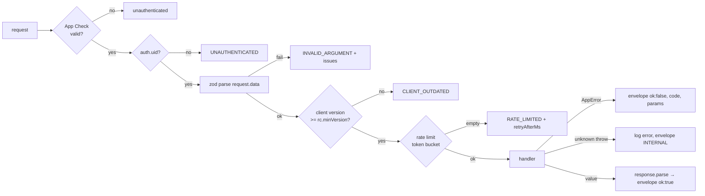

# 03 — Backend architecture (Firebase)

Cloud Functions v2 (Node 22, TypeScript strict, `firebase-functions` 7,
`firebase-admin` 14), Firestore (Native mode), Auth, App Check, Remote Config
(server templates), FCM, Cloud Scheduler, BigQuery export.

## 1. The function inventory

Every function is named `<area>-<verb>`. Region is one constant
(`europe-west1` proposed — see decision D1 in 10).

### 1.1 Callables (client → server)

| Function | Purpose | App Check | Min instances (prod) |
|---|---|---|---|
| `actions-submit` | **All game mutations**, batched (see §3) | enforced + replay-protected for market actions | 2 |
| `player-create` | Onboarding: create the player and starter state (idempotent per uid) | enforced | 0 |
| `player-updateProfile` | Display name (unique), avatar, frame, settings | enforced | 0 |
| `player-setRole` | Role change with cooldown | enforced | 0 |
| `session-catchUp` | Returns the welcome-back report; updates `lastSeenAt` | enforced | 1 |
| `push-registerToken` / `push-unregisterToken` | Device tokens | enforced | 0 |
| `visits-getSnapshot` | Sanitised world of another player (honours `allowVisitors`) | enforced | 0 |
| `account-delete` / `account-export` | Store-mandated account deletion, GDPR export | enforced | 0 |
| `admin-adjustCoins` / `admin-restrictTrading` | Support grants/clawbacks through the ledger and trading bans, each audited in `adminAudit` (requires the `admin` custom claim; catalogue publish stays a CLI, `npm run catalogue:publish`) | enforced | 0 |

### 1.2 HTTPS endpoints

| Function | Purpose |
|---|---|
| `rewards-adSsv` | Ad network server-side verification webhook (signature verified, keyed on txn id) |

### 1.3 Scheduled jobs (Cloud Scheduler)

| Function | Schedule | Purpose | Idempotent because |
|---|---|---|---|
| `market-expireListings` | every 5 min | Close expired active listings in pages of 200, return goods to sellers | each close is a transaction that re-checks `status == 'active' && expiresAt <= now` |
| `market-aggregateStats` | every 5 min | Fold new `trades` into `marketStats/{itemId}` (last, 24h avg/low/high/volume, 7-day buckets) | cursor stored in `system/marketStats` |
| `leaderboard-reprice` | on catalogue publish + daily 03:00 | Recompute net worth for all players after a price change (paged, 500/batch) | pure recompute |
| `ledger-reconcile` | daily 04:00 | Sum each active player's ledger vs balance; write mismatches to `system/reconcile/{date}` and alert | read-only |

### 1.4 Triggers

| Function | On | Purpose |
|---|---|---|
| `leaderboard-onPlayerChanged` | `players/{uid}` written, **only** when `netWorthDirty` flag set | recompute net worth from 3 docs in one transaction, write `leaderboards/global/entries/{uid}` + `publicProfiles/{uid}`, clear the flag |
| `push-onNotificationCreated` | `players/{uid}/notifications/{id}` created | policy check → FCM send (coalesced) |
| `auth-onUserDeleted` | Auth user deleted (v1 auth trigger) | recursive delete of the player's data (Phase 7; `account-delete` already deletes data then the Auth user) |

No other triggers. A trigger never mutates the document that fired it (loops).

**Phase 3 decisions (as built):**

- The NPC order board is **derived, not stored**: `orderBoard(catalogue, dayKey, uid, role)`
  is a pure, seeded function both sides compute (07 §8), so there is no
  `orders-rotate` job and no board document.
- "Listing sold" and "listing expired" inbox rows are written **in the same
  transaction** as the trade / the expiry (an effect), not by a trigger — one
  fewer function, and the row can never be missing. Unread counts are a
  `count()` query on `readAt == 0`, not a counter.
- Callables and jobs are thin: `src/api/*` adapts Firebase to application
  services in `src/game/*` (players, session, listings, marketStats,
  leaderboard, reconcile), which run on the `Store` port and are tested in
  memory; `test/emulator` runs the same game on the real SDK.

## 2. The callable pipeline (`core/callable.ts`)

Every callable is declared with `defineCallable`, which runs the same steps in
the same order. A handler only sees validated, typed input.

```ts
export const updateProfile = defineCallable({
  name: 'player-updateProfile',
  request: UpdateProfileRequest,      // zod schema from @farmverse/contracts
  response: UpdateProfileResponse,
  auth: 'required',                   // 'required' | 'admin' | 'none'
  rateLimit: { key: 'profile', perMinute: 10 },
  handler: async ({ uid, data, ctx }) => playerService.updateProfile(uid, data, ctx),
});
```



**Response envelope** (every callable, see 05):

```json
{ "ok": true,  "data": { ... }, "serverTimeMs": 1792500000000, "requestId": "…" }
{ "ok": false, "error": { "code": "INSUFFICIENT_COINS", "params": { "missing": "120" } }, "serverTimeMs": …, "requestId": "…" }
```

Business refusals are returned as `ok:false` (HTTP 200), so the Unity SDK does
not have to parse `FunctionsException` details. Only infrastructure failures
(App Check, unauthenticated, malformed JSON, internal crash) surface as
`HttpsError`.

The client sends `clientVersion` and `platform` in every request body
(`meta`), used for the version gate and logs.

## 3. `actions-submit` — the game's write path

### 3.1 Request

```json
{
  "meta": { "clientVersion": "1.4.0", "platform": "android" },
  "batchId": "6f0c…uuid-v4",
  "actions": [
    { "kind": "farming.plant",  "plotId": "p_7Hq…", "slot": 2, "seedId": "seed_wheat" },
    { "kind": "farming.water",  "plotId": "p_7Hq…", "slot": 2 },
    { "kind": "market.buyListing", "listingId": "l_93a…", "quantity": 5, "expectedUnitPrice": 14 }
  ]
}
```

`actions` is a zod **discriminated union on `kind`** (1–20 actions). A batch
may mix families, but market and shop actions are restricted to **one per
batch** (they touch other players' or global documents and must fail
independently).

### 3.2 Execution: read → decide → write

Firestore transactions require all reads before any write. The pipeline makes
that structural, not a convention:

```ts
await db.runTransaction(async (tx) => {
  const uow = new UnitOfWork(tx);

  // 1. idempotency: one read
  const prior = await uow.read(paths.request(uid, batchId));
  if (prior.exists) return prior.data().result;            // replay

  // 2. load: the union of aggregates every action in the batch declared it needs
  const needs = actions.flatMap(a => registry.get(a.kind).needs(a));   // e.g. ['player','inventory','plot:p_7Hq']
  const state = await loadGameState(uow, uid, needs, catalogue);       // ≤ 1 read per aggregate

  // 3. decide: pure domain functions, in order, on an in-memory copy
  const results: ActionResult[] = [];
  let working = state;
  for (const action of actions) {
    const rule = registry.get(action.kind);
    const outcome = rule.execute(working, action, now);   // returns {ok, state', effects[], result} | AppError
    if (!outcome.ok) { results.push(failure(outcome.error)); break; }   // stop at first failure
    working = outcome.state;
    results.push(outcome.result);
    effects.push(...outcome.effects);                     // ledger rows, trades, notifications
  }

  // 4. write: only aggregates that changed, each with rev+1, plus effects
  uow.writeChanged(state, working);       // bumps rev, sets netWorthDirty when holdings changed
  uow.writeEffects(effects);              // ledger rows, trades/{id}, notifications
  const response = { results, revs: working.revs };
  uow.set(paths.request(uid, batchId), { result: response, expireAt: now + 72h });
  return response;
});
```

Properties this gives us:

- **Atomic:** a batch is all-or-prefix — actions before the first failure are
  committed, the failing one and those after are not, and the client is told
  exactly which index failed.
- **Exactly-once:** the request document is written in the same transaction.
  Firestore retries the transaction function on contention; the replay check
  makes that safe.
- **Bounded cost:** a farming batch of 10 actions on one plot = 1 (request) + 3
  (player, inventory, plot) reads and ≤ 5 writes.
- **Same rules as the client:** `rule.execute` calls the same domain functions
  the C# `IActionRule.Predict` mirrors, validated by shared vectors.

### 3.3 The action registry

```ts
registry.add({
  kind: 'farming.plant',
  schema: PlantAction,                    // from contracts
  role: 'farmer',                         // role gate, checked before execute
  needs: (a) => ['player', 'inventory', `plot:${a.plotId}`],
  execute: (state, a, now) => farming.plant(state, a, now),   // pure, in domain/
});
```

Adding a verb = a contract schema + a domain function + one `registry.add`
line + vectors + an emulator test. There is no switch statement.

### 3.4 Cross-player actions (market)

`market.buyListing` additionally loads `listings/{id}` and the seller's
`players/{sellerId}` + `state/inventory`. It writes both players' aggregates,
the listing, a `trades/{id}` receipt, two ledger rows (buyer −, seller + net of
fee) and a fee row to `system/economy` counters (sharded, see 04). Contention
on a hot listing is handled by Firestore's optimistic retry (up to 5
attempts); the client passes `expectedUnitPrice` so a price change between
viewing and buying is refused with `PRICE_CHANGED`, never silently charged.

### 3.5 Time

`now` is read once per transaction attempt from `Clock` (injected; tests use a
fixed clock) as epoch milliseconds. Documents store **epoch ms as numbers**
for every game timestamp (`plantedAt`, `expiresAt`) — one representation on
both sides, comparable without conversion. Firestore `Timestamp` is used only
for audit fields written with `serverTimestamp()` (`createdAt` on ledger rows).

## 4. Infrastructure layer

- **`infra/paths.ts`** — every path is a function: `paths.plot(uid, plotId)`.
  A string literal path anywhere else fails lint.
- **Typed converters** — each document type has a `FirestoreDataConverter`
  built from its contract zod schema. Reading a malformed document throws
  `DATA_CORRUPT` with the path, logged at `error` — never a silent default.
- **`UnitOfWork`** — tracks reads and writes for a transaction, refuses a read
  after the first write (programmer error), and writes each aggregate once.
- **Repositories** — load/save an aggregate inside a `UnitOfWork`, mapping
  documents ↔ domain state. Domain code never sees Firestore types.
- **`catalogueCache`** — loads `catalogue/current` once per instance, keeps it
  keyed by `version`, and re-checks the version doc every 60 s. Actions record
  the catalogue version they ran against in the ledger row.

## 5. Ledger and money

- `players/{uid}.coins` is the balance; every change writes
  `players/{uid}/ledger/{autoId}` **in the same transaction** with `amount`,
  `balanceAfter`, `reason` (enum), `ref` (`{type, id}`), `counterpartyUid`,
  `catalogueVersion`, `batchId`, `createdAt`.
- The domain refuses any operation that would make the balance negative; the
  infra layer asserts `balanceAfter >= 0` again before writing (defence in
  depth).
- `ledger-reconcile` proves `sum(amount) == coins` nightly for players active
  that day.

## 6. Rate limiting

A token bucket per `uid` per bucket key (`actions`, `market`, `profile`),
stored as a small map on `players/{uid}/private/limits` and read and written
inside the action transaction (one extra read and write per batch — the reason
batching matters). A refused batch writes nothing. Defaults: 60
actions/min sustained, burst 30; market writes 10/min; profile 10/min. Limits
come from Remote Config so live-ops can tighten them without a deploy.

## 7. Logging & errors

- `logger.info|warn|error` with `{ requestId, uid, fn, batchId, kinds, durationMs, reads, writes }`.
- Every `AppError` is logged at `info` (expected); unknown exceptions at
  `error` with stack (→ Error Reporting alert).
- No PII in logs: uid only; display names never.

## 8. Deploy configuration

```json
// firebase.json (excerpt)
{
  "functions": [{ "source": "backend/functions", "codebase": "game", "runtime": "nodejs22",
                  "predeploy": ["npm --prefix backend/functions run build"] }],
  "firestore": { "rules": "backend/firestore.rules", "indexes": "backend/firestore.indexes.json" },
  "storage":   { "rules": "backend/storage.rules" },
  "remoteconfig": { "template": "backend/remoteconfig.template.json" },
  "emulators": { "auth": {"port": 9099}, "functions": {"port": 5001}, "firestore": {"port": 8080},
                 "storage": {"port": 9199}, "ui": {"enabled": true}, "singleProjectMode": true }
}
```

Per-function options are set in code from one `runtimeOptions` table
(`memory: '512MiB'`, `concurrency: 40`, `timeoutSeconds: 30`, `minInstances`
from env), so prod and staging differ only by environment parameters
(`defineInt('ACTIONS_MIN_INSTANCES')`).
