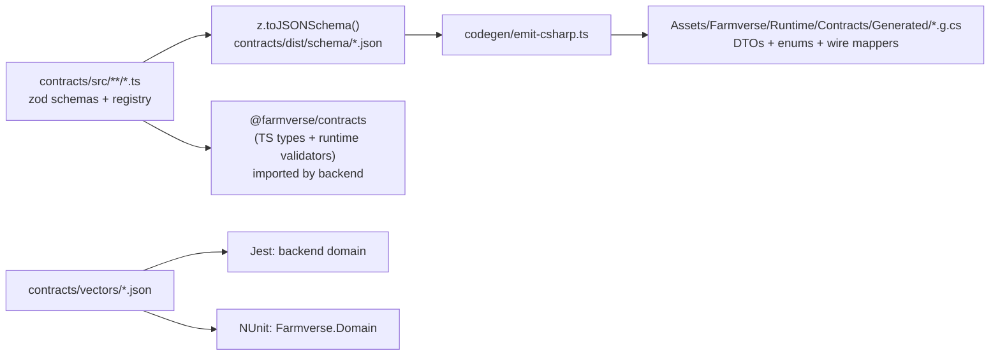

# 05 — The API contract

The contract is the only thing the client and the server share. It is defined
**once**, in TypeScript with zod, in `contracts/src`, and the C# side is
generated from it. CI fails if the generated C# is out of date.

## 1. Pipeline



- `npm run contracts:gen` writes both outputs. `npm run contracts:check`
  regenerates into a temp dir and diffs — that is the CI gate.
- The generated C# has **no reflection**: every DTO gets explicit
  `ToWire()` → `Dictionary<string, object>` and `FromWire(object)` methods.
  This is deliberate: IL2CPP strips and breaks reflection-based JSON, and the
  Firebase Unity SDK already speaks `Dictionary<string, object>` for both
  callables and Firestore snapshots (`DocumentSnapshot.ToDictionary()`).
- String enums become C# enums plus a generated `ToWire/FromWire` table; an
  unknown wire value maps to `Unknown = 0`, so an old client survives a new
  enum value.
- A zod discriminated union (the actions) becomes an abstract C# base class with
  one sealed subclass per variant and a generated `kind → factory` table.

## 2. The envelope

### Request (every callable)

```ts
const RequestMeta = z.object({
  clientVersion: SemVer,            // "1.4.0"
  platform: z.enum(['android', 'ios', 'editor']),
  locale: z.string().max(16).optional(),
});
```

### Response (every callable)

```ts
const Envelope = <T>(data: T) => z.discriminatedUnion('ok', [
  z.object({ ok: z.literal(true),  data,              serverTimeMs: z.number().int(), requestId: z.string() }),
  z.object({ ok: z.literal(false), error: ErrorBody,  serverTimeMs: z.number().int(), requestId: z.string() }),
]);
const ErrorBody = z.object({
  code: ErrorCode,                               // enum, §4
  params: z.record(z.string(), z.string()).default({}),   // localization arguments, always strings
  retryAfterMs: z.number().int().optional(),     // RATE_LIMITED, MAINTENANCE
  issues: z.array(z.object({ path: z.string(), message: z.string() })).optional(),  // INVALID_ARGUMENT (dev builds only)
});
```

## 3. Callables

| Name | Request | Response data |
|---|---|---|
| `actions-submit` | `{ meta, batchId: uuid, actions: GameAction[1..20] }` | `{ results: ActionOutcome[], revs: Revisions }` |
| `player-create` | `{ meta, displayName, role, avatarId }` | `{ player: PlayerDoc }` |
| `player-updateProfile` | `{ meta, displayName?, avatarId?, frameId?, settings?: Partial<Settings> }` | `{ player: PlayerDoc }` |
| `player-setRole` | `{ meta, role }` | `{ role, nextChangeAt }` |
| `session-catchUp` | `{ meta }` | `{ report: OfflineReport }` |
| `visits-getSnapshot` | `{ meta, uid }` | `{ profile, plots: VisitPlot[], takenAt }` |
| `push-registerToken` | `{ meta, installationId, token, platform }` | `{}` |
| `account-delete` | `{ meta, confirm: "DELETE" }` | `{ deletedAt }` |
| `account-export` | `{ meta }` | `{ json, exportedAt, truncated }` |
| `admin-adjustCoins` | `{ meta, uid, delta, reason }` (claim `admin`) | `{ balanceAfter, auditId }` |
| `admin-restrictTrading` | `{ meta, uid, until, reason }` (claim `admin`) | `{ until, auditId }` |

`ActionOutcome = { index, ok: true, result: <per-kind result> } | { index, ok: false, error: ErrorBody }`.
`Revisions = { player?, inventory?, estate?, production?, plots?: Record<plotId, rev> }`.

## 4. Error codes

One enum shared by both sides. Each has a localization key `error.<CODE>` and
a documented set of `params`.

| Group | Codes |
|---|---|
| Transport / platform | `UNAUTHENTICATED`, `PERMISSION_DENIED`, `INVALID_ARGUMENT`, `NOT_FOUND`, `RATE_LIMITED`, `CLIENT_OUTDATED`, `MAINTENANCE`, `INTERNAL`, `DATA_CORRUPT`, `CONFLICT` |
| Client-only (never sent by the server) | `NETWORK_REQUIRED`, `TIMEOUT`, `CANCELLED` |
| Player | `PLAYER_EXISTS`, `PLAYER_NOT_FOUND`, `NAME_TAKEN`, `NAME_INVALID`, `ROLE_REQUIRED` {role}, `ROLE_CHANGE_COOLDOWN` {availableAt} |
| Coins & goods | `INSUFFICIENT_COINS` {required, missing}, `INSUFFICIENT_ITEMS` {itemId, required, available}, `STORAGE_FULL` {storageClass, capacity} |
| Objects & shop | `ITEM_NOT_FOR_SALE`, `ALREADY_OWNED`, `NOT_OWNED` {objectId}, `MAX_LEVEL`, `REQUIREMENT_NOT_MET` {requirement, required, current}, `TOOL_REQUIRED` {toolId}, `TOOL_BROKEN` {toolId} |
| Farming | `PLOT_NOT_FOUND`, `NOT_TILLED`, `ALREADY_TILLED`, `NO_FREE_SLOT`, `SLOT_OCCUPIED`, `SLOT_EMPTY`, `OUT_OF_SEASON` {season}, `NOT_READY` {readyAt}, `ALREADY_SATISFIED` {need}, `WELL_EMPTY` {nextBucketAt} |
| Production | `MACHINE_NOT_FOUND`, `RECIPE_LOCKED` {level}, `QUEUE_FULL` {capacity}, `JOB_NOT_FINISHED` {finishAt}, `JOB_NOT_FOUND` |
| Market | `LISTING_NOT_FOUND`, `LISTING_CLOSED`, `LISTING_EXPIRED`, `OWN_LISTING`, `NOT_LISTING_OWNER`, `PRICE_OUT_OF_BAND` {min, max}, `PRICE_CHANGED` {unitPrice}, `QUANTITY_UNAVAILABLE` {remaining}, `LISTING_LIMIT_REACHED` {limit}, `ITEM_NOT_TRADEABLE`, `TRADE_RESTRICTED` {until} |
| Rewards & orders | `BONUS_ALREADY_CLAIMED` {nextAt}, `ORDER_NOT_AVAILABLE`, `ORDER_ALREADY_FILLED`, `AD_CAP_REACHED` {nextAt} |
| Social | `VISITS_DISABLED` |

## 5. Game actions (`actions-submit`)

Discriminated on `kind`. Every id is validated by format (`plotId:
/^p_[A-Za-z0-9]{8,24}$/`), every quantity is a positive bounded integer.
"Role" = the role required (blank = any).

### Farming (role: farmer)

| kind | Payload | Result |
|---|---|---|
| `farming.till` | `plotId` | `{ tilledAt }` |
| `farming.plant` | `plotId, seedId, slot?` | `{ slot, cropType }` |
| `farming.water` | `plotId, slot` | `{ water, bucketsLeft }` |
| `farming.fertilize` | `plotId, slot` | `{ fertilizer }` |
| `farming.weed` | `plotId, slot` | `{ lastHoedAt }` |
| `farming.spray` | `plotId, slot` | `{ lastSprayedAt }` |
| `farming.harvest` | `plotId, slot` | `{ itemId, quantity, quality, seedsReturned, held }` |
| `farming.harvestAll` | `plotId` | `{ harvests: HarvestResult[] }` |
| `farming.clear` | `plotId, slot` | `{}` |
| `farming.collectHeld` | `plotId, slot` | `{ itemId, quantity, held }` |
| `farming.amendSoil` | `plotId` | `{ soil }` |
| `livestock.feed` | `plotId, animalId?, feedId` (all hungry if omitted; settles first) | `{ affected }` |
| `livestock.collect` | `plotId, slot?` | `{ items: ItemQuantity[] }` |
| `trees.plant` | `plotId, treeType` | `{ slot }` |
| `trees.fell` | `plotId, slot` | `{ itemId, quantity }` |

### Production (role: manufacturer)

| kind | Payload | Result |
|---|---|---|
| `production.start` | `machineId, recipeId, batches` | `{ jobId, startedAt, finishAt }` |
| `production.collect` | `machineId` (all finished jobs) | `{ items: ItemQuantity[], held }` |
| `production.cancel` | `machineId, jobId` (only not-yet-started jobs; inputs refunded) | `{ refunded: ItemQuantity[] }` |
| `production.repair` | `machineId` | `{ condition, cost }` |

### Shop (any role)

| kind | Payload | Result |
|---|---|---|
| `shop.buy` | `itemId, quantity, expectedUnitPrice` | `{ itemId, quantity, cost, placement? }` (a plot gets a server-chosen hex cell; a machine/animal may require `plotId`) |
| `shop.upgrade` | `objectId, instanceId?, expectedPrice` | `{ level, cost }` |
| `shop.repair` | `objectId \| machineId` | `{ cost }` |

`expected*` price fields exist so the client never pays a price it did not
display: a mismatch returns `PRICE_CHANGED` with the current price.

### Market (any role; one per batch)

| kind | Payload | Result |
|---|---|---|
| `market.createListing` | `itemId, quality, quantity, unitPrice` | `{ listingId, expiresAt, fee }` |
| `market.buyListing` | `listingId, quantity, expectedUnitPrice` | `{ tradeId, itemId, quantity, total }` |
| `market.cancelListing` | `listingId` | `{ returned }` |
| `market.promoteListing` | `listingId` | `{ promotedUntil, cost }` |
| `post.sell` | `itemId, quantity, expectedUnitPrice` | `{ coins }` |
| `post.buy` | `itemId, quantity, expectedUnitPrice` | `{ cost }` |

### Progression & rewards

| kind | Payload | Result |
|---|---|---|
| `orders.fulfil` | `orderId` | `{ reward }` |
| `rewards.claimDaily` | — | `{ day, reward: Reward }` |
| `tutorial.advance` | `step` | `{ step }` |
| `plots.rename` | `plotId, name` | `{}` |

## 6. Compatibility rules

1. Within a contract major version, changes are **additive only**: new
   optional fields, new enum values, new action kinds.
2. The client ignores unknown fields and maps unknown enum values to `Unknown`.
3. The server accepts requests from any client `>= rc.minClientVersion`.
   Removing or renaming a field = bump `minClientVersion` first, ship, then
   remove after adoption > 98%.
4. Every contract change updates `contracts/CHANGELOG.md`.

## 7. Example: the generated C#

```csharp
// <auto-generated> by contracts/codegen. Do not edit. </auto-generated>
public sealed partial class FarmingPlantAction : GameAction
{
    public const string WireKind = "farming.plant";
    public override string Kind => WireKind;
    public string PlotId { get; set; }
    public string SeedId { get; set; }
    public int? Slot { get; set; }

    public override Dictionary<string, object> ToWire()
    {
        var map = new Dictionary<string, object>(4) { ["kind"] = WireKind, ["plotId"] = PlotId, ["seedId"] = SeedId };
        if (Slot.HasValue) map["slot"] = Slot.Value;
        return map;
    }

    public static FarmingPlantAction FromWire(object value)
    {
        var map = Wire.Map(value, "FarmingPlantAction");
        return new FarmingPlantAction
        {
            PlotId = Wire.RequiredString(map, "plotId"),
            SeedId = Wire.RequiredString(map, "seedId"),
            Slot   = Wire.OptionalInt(map, "slot"),
        };
    }
}
```
