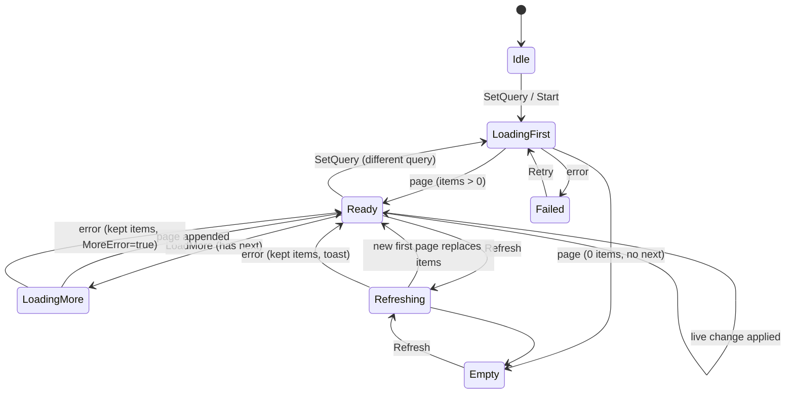

# 06 — Lists: paging, filtering, sorting, searching, refreshing

Every list in the game goes through **one engine** with one set of states, so
pagination, pull-to-refresh, empty/error states, search debounce, stale-request
cancellation and live updates behave identically everywhere and are tested
once.

## 1. Every list in the game, classified

| List | Screen(s) | Size | Source | Strategy |
|---|---|---|---|---|
| Shop items | 27–30, 75 | < 200 | catalogue | **Local**: filter by tab/category/role, sort, search |
| Inventory | 18, 65, 69, 70 | < 200 | `state/inventory` | **Local**: filter by storage class, sort by name/qty/value, search |
| Seed / recipe / animal pickers | 12, 23, 21 | < 50 | catalogue × inventory | **Local** |
| Plots | 72, 73 | < 50 | `plots/*` | **Local** |
| Machines & jobs | 23, 24 | < 30 | `state/production` | **Local** |
| NPC orders | orders board | < 20 | derived (date, uid) | **Local** |
| **Marketplace browse** | 33, 34 | 10⁵–10⁶ | `listings` | **Remote paged** + server sort/filter, client search → itemIds |
| My listings | 39, 68 | < 50 active, history unbounded | `listings` by seller | **Remote paged** (active tab live) |
| Seller profile listings | 40 | unbounded | `listings` by seller | **Remote paged** |
| Trade history | 42 | unbounded | `trades` | **Remote paged**, filter bought/sold |
| Wallet ledger | 42, 51 | unbounded | `ledger` | **Remote paged**, filter by reason group, date |
| Notifications | 50 | ≤ 30 days | `notifications` | **Remote paged**, unread first, live head |
| Leaderboard | 44 | 10⁵–10⁷ | `leaderboards/*/entries` | **Remote paged** + "my rank" + "around me" |
| Price history | 19, 35 | 7 points | `marketStats/{item}` | single document |

Rule of thumb: **< 500 items that already live in a document we hold → local.
Anything else → remote paged with a declared index.**

## 2. The engine (`Farmverse.Core.Lists`)

```csharp
public interface IListSource<TItem, TQuery>
{
    // Loads one page. 'cursor' is null for the first page. Must honour 'ct'.
    Task<Result<Page<TItem>>> LoadPage(TQuery query, PageCursor cursor, int pageSize,
                                       Freshness freshness, CancellationToken ct);
}

public sealed class Page<TItem>
{
    public IReadOnlyList<TItem> Items { get; }
    public PageCursor Next { get; }          // null => end of list
    public bool FromCache { get; }
}

public interface ILiveListSource<TItem, TQuery> : IListSource<TItem, TQuery>
{
    // Optional: live changes for the first page (inserts, updates, removals).
    IDisposable WatchHead(TQuery query, int count, Action<ListChange<TItem>> onChange);
}
```

`PagedCollection<TItem, TQuery>` owns the state for one list on screen:



Behaviour it guarantees:

| Concern | Rule |
|---|---|
| **Stale responses** | Every load carries a generation number; a response for an older generation (the query changed, the user refreshed) is dropped. The previous request's `CancellationToken` is cancelled. |
| **Search debounce** | `SetQuery` with a text change waits 300 ms (`IScheduler`) and coalesces keystrokes; < 2 characters means "no text filter". |
| **Duplicates** | Items are keyed (`Func<TItem, string> key`); a page that repeats a key updates in place instead of appending. |
| **Load more** | Triggered by the view when the last visible index is within 5 items of the end; at most one in flight; ignored at end of list. |
| **Refresh** | Pull-to-refresh fetches the first page from the server (`Freshness.Server`) **while keeping the current items on screen**, then swaps atomically (no flash). |
| **Auto-refresh** | When a screen is shown again and its data is older than `staleAfter` (default 60 s; market 30 s), refresh silently. |
| **Live head** | If the source is live, the first page is watched: updates patch in place, removals mark rows as gone (greyed "Sold"/"Expired") rather than shifting the list under the finger, inserts above the viewport raise a "N new" pill instead of jumping. |
| **Memory** | Holds at most `MaxItems` (default 500). At the cap the list stops paging and sets `IsTruncated`, and the view suggests narrowing the search — nobody scrolls 500 listings, and a bounded list keeps memory and bind cost flat. |
| **Errors** | First-page failure → full error state with Retry; load-more failure → inline row with Retry; refresh failure → toast, items kept. Offline + cached data → items shown with an "offline" badge. |
| **Restoration** | The collection (items, cursor, scroll index) is cached per route for 5 minutes, so Back returns to the same scroll position without a reload. |

`ListState<TItem>` is the immutable snapshot the presenter maps to the view:
`Status`, `Items`, `HasMore`, `IsLoadingMore`, `IsRefreshing`, `Error`,
`MoreError`, `RefreshError`, `IsFromCache`, `IsTruncated`, `NewItemsAvailable`,
`RemovedKeys`, `LoadedAtMs`. **Implemented in Phase 1:** `Assets/Farmverse/Runtime/Core/Lists`.

The UI side is one component, `PagedListView`, wrapping UI Toolkit's
virtualized `ListView` (fixed item height, `makeItem`/`bindItem` with pooled
row views) plus the empty / error / skeleton / end-of-list / pull-to-refresh
decorations.

## 3. Local lists: filter, sort, search

`LocalListSource<TItem, TQuery>` adapts an in-memory snapshot (from a store) to
the same interface, so a local list gets the same view and states.

```csharp
public sealed class ListQuery<TItem>
{
    public IReadOnlyList<IFilter<TItem>> Filters { get; }   // AND-combined
    public SortSpec Sort { get; }                            // key + direction (+ stable tie-breaker = id)
    public string Text { get; }                              // search text
}
```

- **Filtering:** typed predicates per list (`StorageClassFilter`,
  `CategoryFilter`, `RoleFilter`, `AffordableFilter`, `OwnedFilter`), AND
  between groups, OR within a chip group.
- **Sorting:** declared per list as a small table of named sort keys
  (`price↑`, `price↓`, `name`, `quantity`, `value`, `newest`), always with the
  item id as the final tie-breaker so the order is deterministic.
- **Search** (`TextSearch` in Core):
  1. normalise: lower-case, strip diacritics (`NFD` + remove marks), collapse
     whitespace;
  2. match against the item's **localized** name plus its search aliases from
     the catalogue (`"corn"` → maize);
  3. score: exact > prefix of a word > substring > fuzzy (Damerau–Levenshtein
     ≤ 1 for tokens ≥ 5 chars);
  4. with a text query, results are ordered by score, then by the selected sort.

## 4. Remote lists: the marketplace

### 4.1 The query object

```csharp
public sealed record ListingQuery(
    ListingScope Scope,               // All | Category | Items
    string Category,                  // when Scope == Category
    IReadOnlyList<string> ItemIds,    // when Scope == Items (1..10)
    int MinQuality,                   // 1..3 (1 = any)
    ListingSort Sort,                 // PriceAsc | PriceDesc | Newest | EndingSoon
    string SearchText);               // UI only; resolved before querying (4.3)
```

### 4.2 Allowed shapes → indexes

The query builder can only produce these shapes; each maps to one index in
`firestore.indexes.json` (04 §8). Anything else is a compile-time impossibility,
not a runtime "index missing" error.

| Scope | Quality | Sort | Firestore query |
|---|---|---|---|
| All | any | Newest | `status=='active'` · orderBy `createdAt` desc |
| All | any | EndingSoon | `status=='active'` · orderBy `expiresAt` asc |
| Category | any | Newest / PriceAsc | `status=='active'` · `itemCategory==c` · orderBy `createdAt` desc / `unitPrice` asc |
| Items (1) | any | PriceAsc / PriceDesc / Newest / EndingSoon | `status=='active'` · `itemId==i` · orderBy … |
| Items (1) | ≥ q | PriceAsc | `status=='active'` · `itemId==i` · `quality>=q` · orderBy `quality` desc, `unitPrice` asc |
| Items (2–10) | any | PriceAsc / Newest | `status=='active'` · `itemId in [...]` · orderBy … |

Every query ends with `orderBy(__name__)` implicitly (Firestore adds it) so
cursors are stable. Page size 20 (rules reject `limit > 50`).

Price **cannot be edited** on a live listing (cancel and relist instead), so a
cursor positioned on `(unitPrice, id)` never skips or repeats items when other
listings sell. Sold/expired listings simply leave the result set.

### 4.3 Search on the marketplace

Firestore has no full-text search, and it does not need one here: listings are
of catalogue items. Typing "tom" runs the **local catalogue search** (§3) and
resolves to item ids:

- 1 item matches → `Scope = Items([id])` (the best case: every sort available).
- 2–10 match → `Scope = Items(ids)` (price/newest sorts).
- more than 10 → the top 10 by score, with a "refine your search" hint.
- the text equals a category name ("vegetables") → `Scope = Category`.
- the text matches a player name (prefix, ≥ 3 chars) → a "Sellers" section
  queries `publicProfiles` with `displayNameLower >= t && < t + ''`
  (limit 5) and links to their profile.

This gives instant, typo-tolerant, localized search with zero extra
infrastructure. If player-generated text (e.g. listing notes) is ever added,
the Firestore → Typesense extension is the upgrade path; the `IListSource`
interface does not change.

### 4.4 Cursors

- **Client-side Firestore queries** use the SDK's
  `StartAfter(DocumentSnapshot)`. `PageCursor` wraps the last snapshot
  (opaque to the Application layer).
- **Callable-backed lists** (admin tools, visits) use an opaque cursor:
  `base64url(JSON [sortValue, docId]) + "." + HMAC-SHA256` signed with a
  function secret, so a client cannot forge a position.

### 4.5 Promoted listings

Not mixed into the sort (it would need an index per sort and break cursors).
The browse screen shows a separate **promoted carousel**: `status=='active'`
· `promotedUntil > now` · orderBy `promotedUntil` desc · limit 6, optionally
filtered by the same category. Fair and cheap.

### 4.6 Live updates on the marketplace

- **Listing detail (35):** document listener — "Sold" / remaining quantity
  update instantly.
- **Browse, first page:** a query listener with the same query and `limit 20`
  (the live head, §2). Later pages are static; their rows are re-validated when
  opened.
- **Buy confirm (36):** always sends `expectedUnitPrice` and the quantity; the
  server is the final check (`QUANTITY_UNAVAILABLE`, `LISTING_CLOSED`,
  `PRICE_CHANGED`).
- Own listings are visually tagged and the Buy button disabled (the server
  also refuses `OWN_LISTING`).

## 5. Remote lists: the rest

| List | Query | Filters | Sorts | Live |
|---|---|---|---|---|
| My listings — Active | `sellerUid==me` · `status=='active'` · `createdAt` desc | — | newest | yes (≤ stall limit, small) |
| My listings — History | `sellerUid==me` · `status in [sold, cancelled, expired]` · `createdAt` desc | status chip | newest | no |
| Seller profile | `sellerUid==x` · `status=='active'` · `createdAt` desc | — | newest | no |
| Trades | `buyerUid==me` or `sellerUid==me` (two tabs) · `createdAt` desc | item (client-side on page) | newest | head |
| Ledger | `createdAt` desc, optional `reason in group` | Income / Spending / Market / Rewards | newest | head |
| Notifications | `createdAt` desc (+ unread pinned via `readAt==null` first query, limit 20) | All / Unread | newest | head |
| Leaderboard | `netWorth` desc | Global / This week | — | no (refresh every 2 min) |

### Leaderboard specifics

- **Pages:** `orderBy netWorth desc, __name__` · limit 25 · `startAfter`.
- **My rank:** `count()` aggregation of `netWorth > myNetWorth`, + 1 (ties
  share a rank). Cost: 1 read per 1,000 entries counted — cached for 2 min.
- **Around me:** two queries of 5 (`< mine` desc, `> mine` asc, reversed) and a
  pinned "You" row.

## 6. Security rules for queries

```
match /listings/{id} {
  allow get: if true;
  allow list: if request.query.limit <= 50;
}
match /leaderboards/{board}/entries/{uid} { allow list: if request.query.limit <= 50; allow get: if true; }
match /players/{uid}/ledger/{id} { allow list: if isSelf(uid) && request.query.limit <= 50; }
match /trades/{id} {
  allow get: if signedIn() && (resource.data.buyerUid == request.auth.uid || resource.data.sellerUid == request.auth.uid);
  allow list: if signedIn() && request.query.limit <= 50 &&
    (resource.data.buyerUid == request.auth.uid || resource.data.sellerUid == request.auth.uid);
}
```

## 7. Tests

- `PagedCollection` state machine: every transition, cancellation, stale
  generation drop, dedupe, refresh-keeps-items, load-more error, memory window
  (EditMode, fake source with controllable latency).
- `TextSearch`: normalisation, aliases, scoring order, fuzzy threshold, locale
  names (EditMode).
- `ListingQueryBuilder`: every allowed shape produces the expected Firestore
  query description; disallowed shapes are not constructible (EditMode).
- Index coverage: a script enumerates every builder shape and asserts a
  matching index exists in `firestore.indexes.json` (CI).
- Emulator: 1,000 seeded listings, page through every sort, assert no
  duplicates/skips while concurrent buys run (backend integration).
