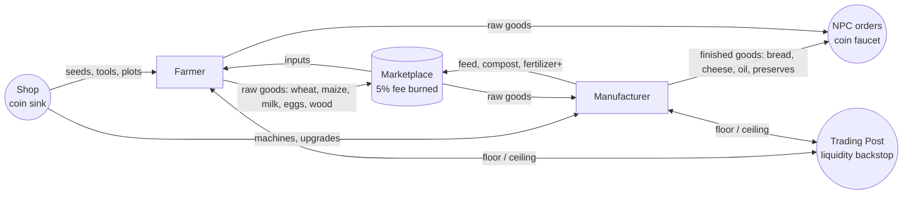

# 07 — Game systems & economy

Numbers in this document are **initial tuning values**, owned by the
economy file (`contracts/economy/economy.json`), never by code. What code owns
is the *formulas*, and those are defined here precisely enough to implement
twice and prove identical.

## 1. Roles

| | Farmer | Manufacturer |
|---|---|---|
| Works | plots: crops, animals, trees, wells, fences | machines: mills, ovens, presses, dairy, feed mill, compost bin, packer |
| Buys in the shop | seeds, fertilizer, tools, animals, plots, farm facilities | machines, machine upgrades, workshop facilities, plots (workshop pads) |
| Buys on the market | feed, premium fertilizer, other farmers' goods | raw crops, milk, eggs, wood |
| Sells | raw goods → manufacturers, NPC orders, Trading Post | intermediates (feed, compost) → farmers; finished goods → NPC orders, players, Trading Post |
| Shared | shop, marketplace, Trading Post, orders board, leaderboard, daily bonus, visits, profile |

Permissions are data: each action kind declares its role (05 §5); the server
gate and the client's disabled buttons read the same table.

**Role change:** free, at most once per 14 days (`player-setRole`). Objects of
the other role stay owned but inactive; nothing is refunded or lost.

## 2. The economy loop (interdependence by design)



The two roles need each other in **both directions**: manufacturers need raw
goods, farmers need feed for animals and premium fertilizer for 3-star crops.
Coins enter mainly through **NPC orders** (scaled to finished goods, so
manufacturing is the high-value path) and leave through the **shop**, upgrades,
repairs and the **market fee**.

## 3. Deterministic arithmetic rule

Both implementations use **integer arithmetic only** for anything that becomes
a stored number:

- ratios are **basis points** (0–10,000): `bp(a, b) = b <= 0 ? 10000 : min(10000, floor(a * 10000 / b))`;
- elapsed time is clamped before multiplying, so no intermediate exceeds
  2⁵³ (`min(now - t0, durationMs) * 10000`);
- division is `floor` unless a formula says `ceil`;
- no floating point in any stored or compared value.

This makes C# (`long`) and TypeScript (`number`, safe integers) bit-identical.
The test vectors in `contracts/vectors/` assert it.

## 4. Farming

### 4.1 Plot

A plot is a hex cell with slots from `plotRules` (`maxCrops` 6, `maxLivestock`
3, `maxTrees` 2, `maxWells` 1, `maxMachines` 1). A plot must be tilled once
before the first planting (`tool_hoe`, 1 use). Soil fertility `soil` (bp)
drops by `soilDepletionBp` per harvest, recovers `soilRecoveryBpPerHour` while
the slot rests, and is restored by `farming.amendSoil` (1 fertilizer →
+`amendBp`).

### 4.2 Crop growth

Inputs: `plantedAt`, `water`, `fertilizer`, `lastHoedAt`, `lastSprayedAt`, the
crop's rules, `now`.

```
progressBp   = bp(min(now - plantedAt, growMs), growMs)
waterBp      = bp(water, waterRequired)
fertBp       = bp(fertilizer, fertilizerRequired)
weedsBp      = bp(max(0, now - max(lastHoedAt, plantedAt) - weedsGraceMs), weedsGraceMs)   // 0 = clean
pestsBp      = bp(max(0, now - max(lastSprayedAt, plantedAt) - pestsGraceMs), pestsGraceMs)
growthCareBp = min(waterBp, fertBp)                                        // only ever rises
careBp       = min(growthCareBp, 10000 - weedsBp, 10000 - pestsBp)         // weakest link: scales yield

stage = Ripe       if progressBp == 10000 and growthCareBp >= 8000
        Adult      if progressBp >= adultAtBp and growthCareBp >= 5000
        Infant     if progressBp >= infantAtBp
        Germinated if progressBp >= germinateAtBp
        Seeded     otherwise
```

Weeds and pests are evaluated at `min(now, plantedAt + growMs)`: they keep
growing during the grow time and then freeze, and they only lower `careBp`
(the yield), never the stage. Because the stage depends only on time, water and
fertilizer — all monotonic — **a neglected crop never dies and never regresses**: it stalls at the stage its
care allows, and resumes the moment it is looked after (golden rule "never
punish being offline").

### 4.3 Harvest

```
yield   = yieldMin + floor((yieldMax - yieldMin) * careBp * soilBp / 100_000_000)
quality = 3 if careBp == 10000 and fertBp == 10000
          2 if careBp >= 9000
          1 otherwise
seeds   = seedReturn (catalogue, usually 1)
stored  = min(yield, free capacity of the produce class); held = yield - stored
```

`held` stays on the slot ("collect when you have room") — a full warehouse
never destroys a harvest.

### 4.4 Water

Each plot's well holds `capacity` buckets and refills one every `refillMs`
(both from the well's level). `available = min(capacity, buckets + floor((now - bucketsAt) / refillMs))`.
Watering a crop uses one bucket and adds one `water`. Watering does not need a
tool at launch (the can is implicit) — fewer taps, same decision.

### 4.5 Animals

Each animal stores `bornAt`, `fedUntil`, `held` and `countedAt`. It matures
after `matureMs` and produces one unit every `produceMs` **while fed**
(`now < fedUntil`):

```
from     = max(countedAt, bornAt + matureMs)
to       = min(now, fedUntil)
produced = min(holdMax, held + floor(max(0, to - from) / produceMs))
```

`holdMax` is what bounds offline production without punishing absence. Every
feed or collect first **settles** (`held = produced`; `countedAt` keeps the
time already served toward the next unit while fed, otherwise restarts at
`now`, so an unfed gap is never credited). Feeding sets `fedUntil = now +
feedMs`. Water and cleaning were dropped (fewer chores, same decisions). Feeding consumes `feedItem` (manufacturer-made
`good_feed`) or grazing on a meadow plot (free, slower).

### 4.6 Trees

Planted with coins, mature after `matureMs`, felled for `wood` (yield by age
bp), leaving the slot empty. Wood is the manufacturer's input for charcoal and
crates.

## 5. Production (manufacturers)

- A **machine** (shop object) is placed on a plot's machine pad. Level (1–5)
  sets `speedBp` (cycle time multiplier), `queueSlots` (1–5), and unlocks
  recipes (`recipe.minLevel`).
- A **recipe**: `inputs: ItemQuantity[]`, `output: ItemQuantity`,
  `cycleMs`. A job of `batches` consumes `inputs × batches` at queue time.
- Queue is sequential: `startedAt = max(now, previous.finishAt)`,
  `finishAt = startedAt + floor(cycleMs * speedBp / 10000) * batches`.
- `production.collect` adds every finished job's output (respecting capacity;
  overflow is held on the machine, like crops). Cancelling a job that has not
  started refunds its inputs; a started job cannot be cancelled.
- Machines lose condition over **cycles run** (not wall time); below 50%
  condition speed drops by half; repair costs coins (`repairCostPct` of the
  machine's level price).

Launch value chain (initial):

| Machine | Recipe | Inputs → Output |
|---|---|---|
| Mill | Flour | 3 wheat → 2 flour |
| Bakery oven | Bread | 2 flour + 1 egg → 2 bread |
| Feed mill | Feed | 2 maize → 4 feed (sold to farmers) |
| Compost bin | Fertilizer+ | 3 any crop waste/produce → 2 fertilizer+ |
| Oil press | Oil | 4 sunflower → 1 oil |
| Dairy | Cheese | 3 milk → 1 cheese |
| Preserves kettle | Preserves | 3 tomato → 2 preserves |
| Sawmill | Planks / Charcoal | 2 wood → 3 planks |

## 6. Marketplace

| Rule | Value (initial) | Why |
|---|---|---|
| Listing slots | stall level 1–5: 5 / 8 / 12 / 16 / 20 | progression; bounds listing spam |
| Duration | 24 h / 48 h / 72 h (player picks) | expiry sweep returns goods automatically |
| Price band | `[referencePrice × 50%, referencePrice × 200%]`, integers | **blocks coin laundering** between accounts and price-griefing |
| Reference price | 7-day volume-weighted average from trades, clamped to the catalogue base ± 50%; base price until enough volume | stable, manipulation-resistant |
| Sales fee | `ceil(gross × 5%)`, min 1, **burned** | the main inflation sink |
| Listing fee | none | keeps listing friction-free for new players |
| Partial buys | yes | |
| Price edit | not allowed (cancel + relist) | stable cursors (06 §4.2) |
| Promotion | 50 coins → 6 h in the promoted carousel | coin sink, fair visibility |
| New accounts | first 24 h or before tutorial completion: may buy, may not list | anti-alt farming |
| Self-trade | refused (`OWN_LISTING`); same-device pairs flagged for review | anti-laundering |

Settlement (one transaction): buyer pays `gross`; seller receives
`gross - fee`; goods move from the seller's reservation to the buyer; trade
receipt, two ledger rows and the fee counter are written; seller is notified.

## 7. Trading Post (NPC backstop)

For **essentials** only (raw crops, flour, feed, fertilizer): the Post always
**buys** at `floor = base × 60%` and always **sells** at `ceiling = base × 150%`,
with a per-player daily volume cap per item. It guarantees a new farmer can
always sell and a new manufacturer can always source, while leaving the
marketplace the better deal on both sides.

## 8. NPC orders (main coin faucet)

Each player sees an **orders board** of 6 orders per day, generated
deterministically from `(utcDate, uid, catalogue.orderTable)` — no document
needed, both sides compute it. Each order asks for `quantity` of an item and
pays `reward = floor(quantity × base × multiplier)` where the multiplier is
1.1–1.3 for raw goods and 1.4–1.8 for finished goods. Fills are recorded in
`private/meta.orders`. Orders are role-weighted (farmers see more raw-goods
orders, manufacturers more finished goods), and the daily faucet per player is
bounded by the board.

## 9. Progression

| System | Rule |
|---|---|
| Facilities | well, warehouse, barn, workshop, stall, farmhouse — 5 levels each; price + requirements from the catalogue; upgrades are instant (no timer for sale, nothing to skip) |
| Plots | bought in the shop; price rises per plot owned (catalogue ladder); the server assigns the next hex cell in a spiral |
| Net worth | `coins + Σ inventory qty × referencePrice + Σ objects invested(level)` |
| Titles | net-worth ladder (Settler → Homesteader → Landholder → Manor lord → Golden barn) |
| Leaderboards | global net worth; weekly net-worth gain (resets ISO-weekly, so new players can top a board) |
| Daily bonus | 7-day streak; missing a day pauses the streak, never resets it |
| Rewarded ads | optional, ≤ 5/day, verified by SSV webhook, small coin reward; never interrupting, never required |

## 10. Monetization (fair by design)

No coins, timers, plots or upgrades are sold for money. Revenue comes from
**cosmetics** (avatars, frames, farm themes, decorations), a cosmetic **season
pass**, and optional rewarded ads. Purchases go through Unity IAP with
**server-side receipt validation** (`iap-validate` callable, Phase 8). The B3TR
token layer stays behind the `feature_b3tr` flag, off at launch.

## 11. Economy health (watched daily)

| Metric | Healthy |
|---|---|
| Coins minted / burned per day | ratio 1.0–1.15 |
| Median coins per active player | rising slowly (≤ +3%/week) |
| Market fee burn share of all sinks | 15–30% |
| Listings active / sold within duration | sell-through ≥ 60% |
| Price vs reference per item | inside band, low variance |
| Trading Post share of volume | < 20% (the market is the better deal) |
| Farmer : Manufacturer ratio | 45:55 – 65:35; outside → adjust order multipliers |

Source: `system/economy` counters + BigQuery export of ledger and trades.

## 12. Catalogue validation (CI)

`tools/catalogue validate` fails the build if any invariant breaks:

- every seed's `plantsAs` is a crop, every recipe input/output is an item;
- level ladders are contiguous from 1 and prices are non-decreasing;
- a crop's expected harvest value at base price ≥ 1.3 × seed cost;
- a recipe's output value at base ≥ 1.2 × input value (manufacturing pays);
- Trading Post floor < base < ceiling for every essential;
- price bands contain the Trading Post floor and ceiling;
- no unreachable item (everything is producible or sold in the shop);
- every item has a localization key and an icon id.

## 13. Launch scope vs later

| Launch (v1.0) | Later (live-ops) |
|---|---|
| 2 roles, 7 crops, 3 animals, 2 trees, 8 machines | more crops/recipes per season |
| Shop, market, Trading Post, orders, daily bonus | seasons & weather, events, contracts with other players |
| Global + weekly leaderboard | friends, co-ops, guilds |
| Read-only visits | gifting, comments |
| Facilities 5 levels, multiple plots | decorations, farm themes (cosmetic IAP) |
| — | food/larder pacing, breeding, butchering (re-evaluate with data) |
