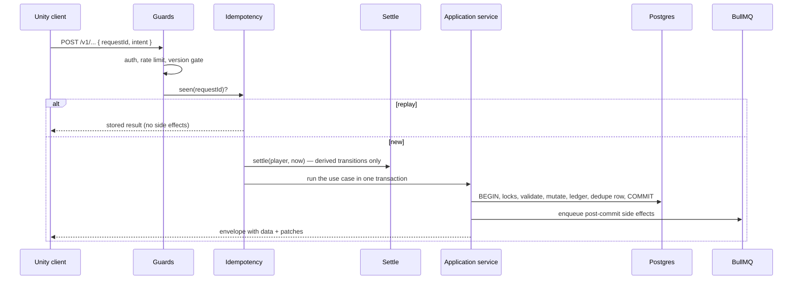
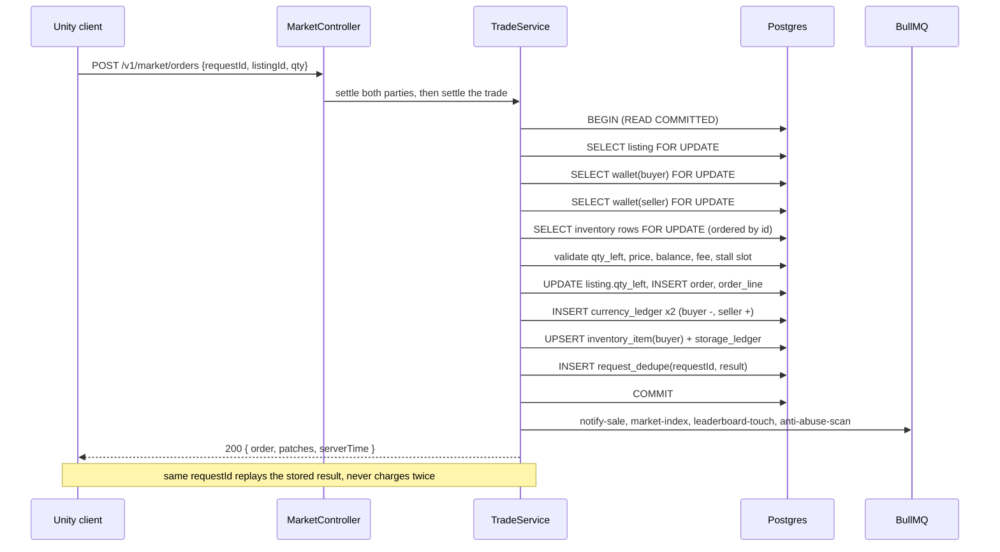
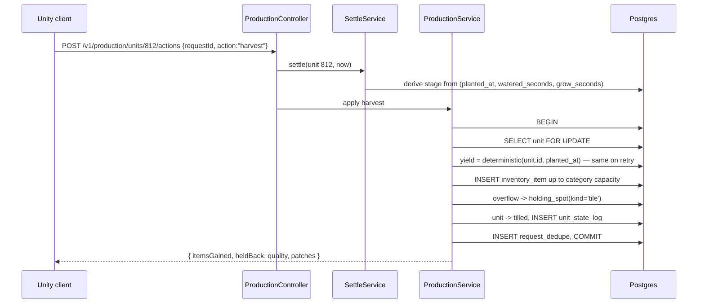
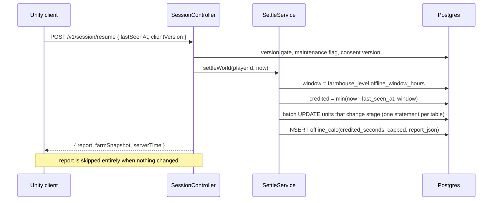
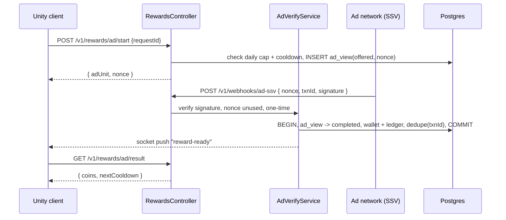

# Farmverse backend architecture — NestJS, Prisma, Postgres, Redis, BullMQ

> **Superseded in part.** This document describes the NestJS + Prisma backend.
> The backend is now Firebase — see `firebase-backend.md` for what replaced what,
> where each golden rule is enforced, and the three design consequences. The
> reasoning below still holds; the mechanism does not.

**Related:** [`data-model.md`](data-model.md) · [`production-model.md`](production-model.md) · [`push-notifications.md`](push-notifications.md) · [`realtime.md`](realtime.md) · [`admin-and-config.md`](admin-and-config.md) · [`navigation.md`](navigation.md)

A design for the service that owns every value the player sees. It is written
against the specification's server-authority rules (6.1) and the schema in
`data-model.md` / `production-model.md`.

Stack: **NestJS 11**, **Prisma** over **Postgres 16**, **Redis 7** (cache, queue
backing, pub/sub, rate limits), **BullMQ** (delayed timers, sweeps, fan-out),
**socket.io** for live pushes, **OpenTelemetry** for traces.

---

## 1. Five principles

1. **The database is the only source of truth for time.** Every timer is a stored
   timestamp (`planted_at`, `finish_at`, `next_refill_at`, `fed_until`,
   `upgrading_until`). Correctness is derived from those columns on read. BullMQ
   jobs are an *optimisation* for push notifications and leaderboard freshness —
   if Redis is wiped, the game is still correct; timers only lose their pushes
   until the next sweep. This is the single most important decision here.
2. **No per-entity tick, ever.** A player with 8 plots × 36 tiles = 288 units.
   Ticking those每秒 is 288 writes per player per second. Instead a `Settle`
   step computes transitions in one pass from timestamps, and only writes when a
   stage actually changes.
3. **Every mutation is an intent with a request id.** The client never sends a
   computed value; it sends *what it wants to do*. `request_dedupe` returns the
   original result on replay, so a double-tap or a network retry cannot pay twice
   (spec 6.1, 17, 31, 36, 48, 77).
4. **The client predicts, the server decides.** The Unity client runs the same
   rules for instant feedback, then accepts the server's `patches` as truth. The
   server never trusts a client number.
5. **Catalogues are data, not code.** Crop times, recipe inputs, facility costs,
   food decay and property definitions live in seeded tables, so the economy
   document's numbers ship as a migration — not as a redeploy of game logic.

---

## 2. Module map

One Nest module per bounded context, each with the same four layers. Controllers
never touch Prisma; the domain never touches Nest.

```
apps/api/src/
  main.ts                      # bootstrap, global pipes, OTel
  app.module.ts
  common/
    envelope.interceptor.ts     # { ok, data, patches, serverTime, requestId }
    idempotency.interceptor.ts  # request_dedupe fast path + replay
    server-time.service.ts      # monotonic clock, epoch seconds
    rate-limit.guard.ts         # per-player action budgets (Redis)
    otel.ts
  domain/                       # PURE TypeScript, no Prisma, no Nest
    production/settle.ts        # timestamp -> stage transitions
    production/yield.ts         # deterministic yield + quality roll
    economy/pricing.ts          # fees, averages, sparkline buckets
    economy/ledger.ts           # double-entry helpers
    rules/*.ts                  # mirrors FarmSelfTest.ts on the client
  modules/
    identity/     auth, providers, guest->link, deletion
    session/      version gate, maintenance, resume + offline report
    player/       profile, cosmetics, settings, blocks, reports
    world/        world, plots, tiles, land sites, plot setup
    production/   units, stages, stage actions, machines, pens, packing
    inventory/    items, storage caps, holding spots, spoilage
    economy/      wallet, ledger, shop purchases, price references
    market/       listings, orders, promotions, search/filter
    facilities/   hub, levels, upgrade jobs, construction timers
    ranking/      farm rating, leaderboard snapshots, titles
    rewards/      daily bonus, rewarded ads + SSV webhook, notifications
    support/      tickets, data export, deletion
    ops/          config, feature flags, maintenance, admin tooling
  workers/                      # same image, different entrypoint
    worker.ts                   # BullMQ WorkerHost registrations
    queues/*.ts
prisma/
  schema.prisma
  migrations/
  seed/
    01_roles.ts                # roles, world archetypes, plot types
    02_production.ts           # models, stages, actions, transitions, effects
    03_properties.ts           # property_def for plots and units
    04_items.ts                # item catalog, crops, recipes, pack specs
    05_facilities.ts           # facility levels, costs, requirements
    06_balance.ts              # the economy numbers, one file to review
```

---

## 3. Request lifecycle

Every response carries the same envelope, so the client can patch its model
instead of refetching, and can correct its clock:

```json
{
  "ok": true,
  "requestId": "01HQ...",
  "serverTime": 1767225600,
  "data": { "itemsGained": 11, "quality": 2 },
  "patches": [
    { "t": "unit", "id": 812, "set": { "stage": "tilled", "growth": 0 } },
    { "t": "inventory", "id": 55, "set": { "qty": 11 } },
    { "t": "wallet", "set": { "coins": 548 } }
  ],
  "error": null
}
```



Post-commit only: notifications, leaderboard touch, price index, push. If the
queue is down, the *transaction* still succeeds — side effects retry.

---

## 4. The four hardest flows

### 4.1 A market trade (screen 36) — atomic, locked, idempotent



**Lock order is fixed** — listing → buyer wallet → seller wallet → inventory by
ascending id — so two buyers racing on the same listing queue instead of
deadlocking. `SERIALIZABLE` is not needed and would cost throughput; explicit row
locks plus the fixed order are enough.

### 4.2 Harvest with a full warehouse (screens 14, 66)



The yield is a pure function of `(unit_id, planted_at)`, so a retried harvest
returns the identical number — that is how "a retried tap never duplicates items"
is true rather than hoped for.

### 4.3 Offline resume (screens 2, 26, 67)



`settleWorld` is a **set-based** operation: one `UPDATE ... WHERE` per table, not
a loop per unit. That is what makes a 30-day absence cost the same as a 30-second
one.

### 4.4 Rewarded ad (screens 48, 49) — verified server-side, once



The reward is credited from the **network's callback**, never from the client, and
`request_dedupe` keys on the network transaction id — so a replayed callback
cannot pay twice (spec 48, 49).

---

## 5. Queues (BullMQ)

| Queue | Job | Trigger | Retry | Notes |
|---|---|---|---|---|
| `settle` | `sweep-player` | repeatable 5 s, per active player shard | 3, backoff 2/4/8 s | set-based settle; catches timers whose delayed job was lost |
| `settle` | `settle-player` | after any mutation | 3 | keeps the cached snapshot warm |
| `timers` | `unit-ripe`, `job-finished`, `upgrade-complete`, `well-refilled`, `pen-collectable` | delayed job scheduled at `finish_at` | 5, backoff 5 s | `jobId = "{kind}:{entityId}:{finishAt}"` so rescheduling is idempotent |
| `notify` | `push-notification` | on the events above | 5 | reuse the same strings as the in-app inbox (spec 50) |
| `market` | `reindex-item`, `recompute-price-reference`, `expire-listings` | trade, sale, repeatable 60 s | 3 | feeds the sparkline and "market average" (19, 35) |
| `ranking` | `snapshot-leaderboard`, `recompute-rating` | repeatable 2 min, and on trade/upgrade | 3 | world/local/week/all snapshots (44) |
| `rewards` | `daily-bonus-reset` | repeatable daily at local midnight per region | 3 | streak pause, never reset (47) |
| `abuse` | `scan-self-trades`, `flag-multi-account` | on trade, repeatable 15 min | 2 | excluded from rating (71) |
| `compliance` | `data-export`, `purge-deleted`, `retention-sweep` | request, repeatable daily | 2 | deletes accounts after the grace period |
| `maintenance` | `partition-roll`, `vacuum-hot`, `rebuild-caches` | cron | 1 | monthly partitions for logs |

Rules that make this safe:

- **Deterministic `jobId`s.** Re-enqueueing the same timer is a no-op, so a
  worker restart cannot double-schedule a completion.
- **No correctness in jobs.** Every job recomputes from the database. A job that
  arrives late, twice or never is a *latency* problem, not a *state* problem.
- **Reconciliation is built in.** The `sweep-player` job exists precisely to find
  entities whose `finish_at` has passed with no pending job — the recovery path
  if Redis is flushed.
- **Rate limiting per queue**, so a leaderboard snapshot storm cannot starve
  trade notifications.

---

## 6. Cache (Redis)

| Key | Value | TTL | Invalidation |
|---|---|---|---|
| `farm:{playerId}` | the client's cold-start snapshot (JSON) | 60 s | on any mutation of that player |
| `lb:{scope}:{period}:{page}` | a leaderboard page | 120 s | by the ranking worker, not by request |
| `mkt:{category}:{sort}:{page}` | a browse page | 30 s | by `reindex-item` after a trade |
| `price:{itemId}` | average, low, high + 7-day buckets | 5 min | by `recompute-price-reference` |
| `cfg:game` | the `game_config` map | 30 s | on admin write, broadcast over pub/sub |
| `idem:{requestId}` | hot idempotency result | 24 h | mirrors `request_dedupe` (durable copy) |
| `rl:{playerId}:{bucket}` | rate-limit counter | 1 s buckets | natural expiry |
| `lock:settle:{shard}` | distributed lock | 10 s | prevents two sweeps on one shard |
| `pubsub:player:{id}` | socket push channel | — | notifications, market ticks, reward-ready |

**Cache is never authoritative.** Every read path falls back to Postgres, and a
cold cache is a slow request, not a wrong answer. The client's own prediction
plus `patches` means it rarely needs a full refetch anyway.

---

## 7. Prisma and Postgres specifics

**Types.** Coins are `BigInt` — never `Float`. Timestamps are `BigInt` epoch
seconds (matching `serverTime`), so there is no timezone ambiguity between the
server, the client and the offline window. Fractions like growth are `Decimal(6,4)`
or derived, never `Float` where they feed a yield.

**Hot-path indexes.**

```prisma
model ProductionUnit {
  id             BigInt   @id @default(autoincrement())
  plotId         BigInt
  tileId         BigInt   @unique
  modelId        Int
  currentStageId Int
  finishAt       BigInt?          // the timer column
  paused         Boolean  @default(false)
  @@index([plotId, currentStageId])
  @@index([finishAt])             // the sweep scans this
  @@index([modelId, currentStageId])
}

model Listing {
  id             BigInt   @id @default(autoincrement())
  sellerPlayerId BigInt
  itemId         Int
  status         ListingStatus
  unitPrice      Int
  qtyLeft        Int
  expiresAt      BigInt
  promotedUntil  BigInt?
  @@index([status, itemId, unitPrice])   // browse, lowest price first
  @@index([sellerPlayerId, status])
  @@index([expiresAt])                   // expire-listings
}

model CurrencyLedger {
  id           BigInt @id @default(autoincrement())
  playerId     BigInt
  delta        BigInt
  reason       String
  balanceAfter BigInt
  at           BigInt
  @@index([playerId, at(sort: Desc)])
}
```

**JSONB** for `stage_action.consumes_json` / `produces_json`,
`recipe.inputs_json`, `facility_level.stat_json`, `*_property.json_value` — with
a GIN index only where queried, and a Prisma `Json` type plus a Zod schema at the
boundary so the shape is validated on write.

**Partitioning.** `currency_ledger`, `action_log`, `unit_state_log`,
`notification` and `storage_ledger` are append-only and unbounded. Partition
monthly (`PARTITION BY RANGE (at)`), keep 13 months hot, archive the rest. The
`partition-roll` maintenance job creates next month's partition ahead of time.

**Retention.** `request_dedupe` 24 h; `notification` 30 days (spec 50);
`ad_view` 90 days for reconciliation; `session` 30 days.

**Raw SQL where Prisma is the wrong tool:** the set-based settle
(`UPDATE ... FROM (VALUES ...)`), the leaderboard aggregate, the price index, and
`SELECT ... FOR UPDATE` in the trade path. Everything else goes through Prisma.

**Isolation.** Default `READ COMMITTED` + explicit locks. No `SERIALIZABLE`
anywhere; the trade path's fixed lock order is the correctness argument.

---

## 8. Concurrency and correctness, per use case

| Use case | Transaction | Locks | Idempotency |
|---|---|---|---|
| Harvest | single | unit | `requestId` + deterministic yield |
| Plant / water / fertilize | single | unit, inventory | `requestId` |
| Shop purchase | single | wallet, shop_owned | `requestId` |
| Market trade | single | listing → wallets → inventory (fixed order) | `requestId`, dedupe on order |
| Create / cancel listing | single | listing, inventory | `requestId` |
| Upgrade start / cancel | single | facility, wallet | `requestId` |
| Daily bonus claim | single | bonus state | `requestId` + unique `(player, day)` |
| Ad reward | single (on SSV) | ad_view | network `txnId` unique |
| Plot purchase | single | land_site, wallet, world | `requestId` |
| Feed / collect | single | pen, inventory | `requestId` |
| Settle sweep | per-shard | advisory lock | derived from timestamps, so replay is a no-op |
| Leaderboard snapshot | none (read-only aggregate) | — | last-writer-wins per snapshot |

---

## 9. Security and anti-abuse

- **Auth**: JWT access (short) + refresh, provider identities via
  `account_identity`; guests get a device-bound token and are refused market
  writes until linked (spec 4).
- **Server authority**: a mutation endpoint never accepts a price, a yield, a
  balance or a timer. It accepts ids, quantities and an action key.
- **Rate limits**: per-player action buckets (plant/water cheap, trade/listing
  expensive), plus a per-IP guard on auth and SSV endpoints.
- **Self-trade and wash-trade detection** (`anti_abuse_flag`): same-device or
  same-account trades are excluded from rating and can be reversed; the rating
  worker already ignores them (spec 71).
- **Listing caps** from `stall_level.listing_slots`, enforced in the transaction
  so two concurrent listings cannot both take the last slot.
- **SSV signature verification** with a replay window, keyed on the network
  transaction id.
- **Ops endpoints** behind a separate admin auth, with every admin action written
  to `action_log`.

---

## 10. Observability and ops

- **OpenTelemetry** spans per request, propagated through the queue so a trade's
  notification is traceable back to its order.
- **Metrics**: settle lag p95, sweep batch size, queue depth per queue, trade
  failure rate by reason, idempotent replay rate, ad verification success rate,
  ledger/balance mismatch counter (should always be zero).
- **A daily reconciliation job** that re-derives every wallet from
  `currency_ledger` and pages if any `balance_after` disagrees — the ledger is the
  audit trail support sees, so it must be provably consistent.
- **Health**: `/healthz` (process), `/readyz` (Postgres + Redis + queue), plus a
  `/v1/ops/status` that reports maintenance mode and min client version.

---

## 11. Deployment topology

```
        ┌──────────────┐        ┌──────────────┐
        │  api (N×)    │        │ worker (M×)  │
        │  REST + WS   │        │ BullMQ only  │
        └──────┬───────┘        └──────┬───────┘
               │                       │
        ┌──────▼───────┐        ┌──────▼───────┐
        │ Postgres 16  │        │ Redis 7      │
        │ primary      │◄───────┤ cache+queue  │
        │ + 1 read     │  reads │ + pubsub     │
        │   replica    │        └──────────────┘
        └──────────────┘
```

- **api** handles REST and WebSocket; **worker** is the same image with a
  different entrypoint, scaled independently. A trade storm scales workers, not
  API pods.
- **Read replica** serves leaderboard, market browse and profile reads; the trade
  and settle paths always use the primary.
- **Sharding the sweep** by `player_id % N` lets `settle` scale horizontally with
  an advisory lock per shard.
- **Blue/green with a version gate**: the client already handles
  `maintenance`/`update required` (57), so a rollout is a `game_config` write.

---

## 12. Testing

| Layer | Approach |
|---|---|
| Domain rules | pure unit tests, the same cases as `FarmSelfTest.cs` — **the two must agree** |
| Use cases | integration tests against a real Postgres in a container, asserting ledger balance and dedupe replay |
| Idempotency | every mutating endpoint gets a "call it twice, assert one effect" test |
| Concurrency | two parallel trades on one listing; two listings on one stall slot; assert exactly one wins |
| Settle | property-style: random timestamps, assert derived stage equals the ticked reference implementation |
| Contract | a generated OpenAPI schema the Unity client compiles its DTOs from |
| Load | 10k players settling every 5 s, 200 trades/s, with the queue paused to prove correctness survives Redis loss |

---

## 13. The one risk worth naming

The economy now exists twice: `FarmSimulation.cs` on the client and
`domain/rules/*.ts` on the server. Two implementations of the same rules will
drift, and the drift will look like a bug the player can see.

Three options, best first:

1. **Server decides, client predicts and reconciles.** Keep both, but make the
   client's rules *advisory only*: every mutation returns authoritative
   `patches`, and a mismatch is logged with both values. A drift becomes a metric
   (`prediction_mismatch_total`) instead of a silent bug.
2. **One implementation, generated.** Write the rules once (a small DSL or a
   shared spec) and generate both TypeScript and C#. Higher up-front cost, no
   drift.
3. **Client sends intent, never prediction.** Simplest and safest, but every tap
   waits for a round trip — which the spec's motion timings (1.7) do not allow.

Recommendation: option 1 now (it is a day's work and it makes drift visible),
with a path to option 2 if the mismatch metric ever matters.

---

## 14. Build order

| Phase | Deliverable |
|---|---|
| 1 | Prisma schema from `data-model.md` + `production-model.md`, migrations, seeds for roles/stages/actions/properties |
| 2 | Domain layer (`settle`, `yield`, `pricing`) with tests that mirror `FarmSelfTest` |
| 3 | Session, world, production, inventory modules — the single-player loop end to end |
| 4 | Economy + market with the locked trade path and idempotency interceptor |
| 5 | Workers: settle sweep, timers, notifications, price index, leaderboard |
| 6 | Facilities, rewards (incl. SSV), ranking, support |
| 7 | Observability, load tests, reconciliation job, admin tooling |

Phases 1–3 make the game playable against a real server; 4 makes it a game with
other people in it; 5 makes it feel alive when the player is away.
