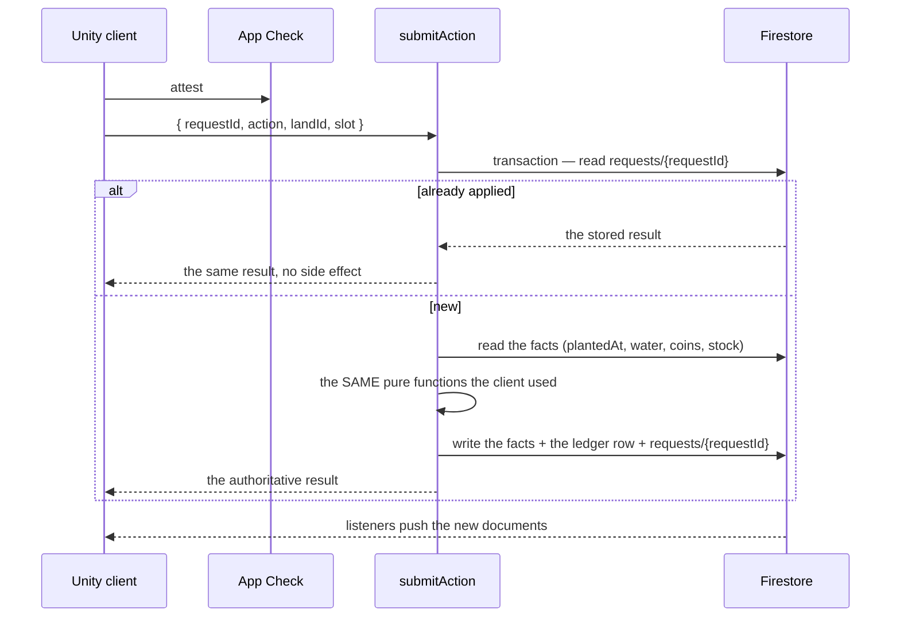

# The backend: facts on the server, arithmetic on the client

> The backend holds **what happened and when**. The client computes **what that
> implies now** — growth, ripeness, refills, completion, expiry. There is no
> scheduler for anything a player can settle by returning, and no timer in the
> database.

**Related:** [`world-model.md`](world-model.md) · [`firebase-backend.md`](firebase-backend.md) · [`firebase-integration-plan.md`](firebase-integration-plan.md)

---

## 1. The principle

Every value in the game is one of two things:

| | | |
|---|---|---|
| **Fact** | something that happened, and when | `plantedAt`, `wateredAt`, `boughtAt`, `soldAt`, `fedAt`, `lastSeenAt` |
| **Derived** | what those facts imply at a given moment | age, growth, ripeness, buckets, cycle %, expired, offline report |

**The client stores facts (read from Firestore) and computes every derived value
itself.** No timers in the database, no sweeps, no per-frame writes.

When an action *creates* a fact — a harvest adds grain, a trade moves coins — the
client sends the action and a Cloud Function **re-runs the same deterministic
function** over the same facts to compute the amount. That is not a second source
of truth; it is the same function on the same data.

> **The client computes for display. The server recomputes for writes. Both run
> the same pure function over the same facts.**

This is what lets "compute on the client" and *CLAUDE.md*'s "the server is
authoritative" both be true: the client owns the **arithmetic**, the server owns
the **record**.

## 2. The split, in full

| Value | Computed on the client | The fact it comes from |
|---|---|---|
| Crop age, stage, ripeness | `now - plantedAt` | `crops/{id}.plantedAt` |
| Weeds / pests | `(now - lastHoedAt) / weedsAfterSeconds` | `lastHoedAt`, `lastSprayedAt` |
| Water a crop still has | `wateredAt` + the crop's own requirement | `wateredAt` |
| Livestock maturity | `now - bornAt` | `bornAt` |
| An animal's hunger | `now > fedAt + feedSeconds` | `fedAt` |
| Pen cleanliness | `now - lastCleanedAt` | `lastCleanedAt` |
| Machine cycle progress | `(now - startedAt) / cycleSeconds` | `startedAt`, `fuel` |
| Well buckets | `floor((now - lastRefillAt) / refillSeconds)` | `lastRefillAt` |
| Construction | `now >= startedAt + buildSeconds` | `startedAt` |
| Listing expired | `now > expiresAt` | `expiresAt` |
| Offline report | `now - lastSeenAt`, bounded by the larder | `lastSeenAt` |
| Net worth **for the player's own screen** | over their own facts | their own documents |
| **Leaderboard rank** | *server* — it needs every player | `leaderboard/{uid}` |
| **The amount a harvest grants** | recomputed by the function | the same crop facts |

The backend is first-hand data. It is not a game engine.

## 3. No cron — what replaces each job

| Would have been scheduled | Instead |
|---|---|
| **Expire a listing** | it reads as `expired` when `now > expiresAt`. The seller **reclaims the goods when they return** (one call). If a buyer taps it first, the buy function sees the expiry and refuses. |
| **Refill the well** | arithmetic on `lastRefillAt`. Fetching water is a write. |
| **Ripen crops** | `now - plantedAt`. Harvesting is a write. |
| **Feed decays** | `now > fedAt + feedSeconds`. Feeding is a write. |
| **Construction finishes** | `now >= startedAt + buildSeconds`. Collecting is a write. |
| **Leaderboard refresh** | recomputed inside the function that changed a player's holdings. Optional nightly pass for dormant players. |
| **Daily bonus reset** | the claim checks `lastBonusDay != today`. Nothing to reset. |
| **Prune push tokens** | on the FCM error that reports it. |
| **Analytics rollup** | a BigQuery scheduled query — optional, not gameplay, allowed to be late. |

**Nothing in the game depends on a job having run.** A job that never fires costs
freshness, never state.

### The one job worth having: net worth

Net worth is the exception, and it is a deliberate one.

A player's net worth is `balance + inventory x price + objects invested`, and the
**prices come from the catalogue**. So an admin price change moves every holder's
worth *without any player doing anything* — and a player who has not logged in for
a week still has a rank. Neither can be settled by a write the player makes,
because the player did not make one.

So there is exactly one scheduled function:

| Function | Runs | Why a job and not a read |
|---|---|---|
| `refreshNetWorth` | every 30 minutes | prices change globally; dormant players' ranks must not go stale |

It writes the `leaderboard/{uid}` projection. It is **idempotent** and
**recomputable from facts**, so a missed run costs a stale rank, never a wrong one
— and running it twice is a no-op. Everything else in this document settles on the
player's own action; this one settles on the world's.

## 4. What is genuinely server-side

Only where two parties, coins, or trust are involved.

| Callable | Why |
|---|---|
| `submitAction` | the write path: idempotent, atomic, revalidates against the facts |
| ↳ harvest, plant, till, water, tend | recomputes the yield and the cost from the facts |
| ↳ trade, buy/sell listing | **two players' documents in one transaction** |
| ↳ buy level, build, upgrade | spends coins, so balance and ledger move together |
| ↳ process, breed, butcher | creates goods from a recipe |
| ↳ reclaimExpired | releases the reservation exactly once |
| `refreshRating` | cross-player; a client cannot see the others |
| `visitorSnapshot` | sanitises the visit, honouring `allowVisitors` |
| `adminPatch` | the catalogue and the rules |
| `onUserDeleted` | compliance |
| `refreshNetWorth` | **scheduled** — the only job; it keeps ranks fresh when prices change or a player is away |

One callable for the game, four small ones around it — not a service.

### The verbs, grouped by where they live

```
functions/src/actions/
  shop/         buySeeds · buyPlot · buyObject · upgradeItem
  marketplace/  sell · createListing · buyListing · cancelListing · promoteListing · reclaimExpired
  farm/         plant · harvest
```

- **shop** mints a new item at level 1 and takes an owned one to the next level.
  No other player is involved, so every verb is a spend plus a write.
- **marketplace** is where a farmer and a manufacturer meet. Every verb here
  either touches **another player's documents** or ends a listing - which is why
  these are the actions that most need a transaction and an idempotency key.
- **farm** is the land itself.

A new verb is a file in one of those folders and a line in its `index.ts`.


## 5. Firestore: the facts

```
players/{uid}
  coins, lastSeenAt, allowVisitors, settings, lastBonusDay

  lands/{landId}
    q, r, terrain, tilledAt, soil, water, lastCrop, restingSince

    crops/{cropId}
      type, slot, plantedAt, wateredAt, fertilizedAt,
      lastHoedAt, lastSprayedAt, held

    livestock/{id}
      type, slot, bornAt, fedAt, lastCleanedAt, health

    machines/{id}
      type, level, startedAt, fuel

    well/{id}          lastRefillAt, capacity
    fence/{id}         durability, lastRepairedAt

  inventory/{itemId}   qty, storedAt
  ledger/{entryId}     amount, reason, reference, at
  requests/{requestId} the idempotency key

listings/{id}          sellerId, itemId, qty, price, expiresAt, status
leaderboard/{uid}      rating, updatedAt
worldSnapshots/{uid}   the sanitised visit projection
catalogue/{…}          the rules and prices, read-only
```

**Every field is a fact or a timestamp.** Nothing in Firestore is a "current
value" that a timer would have to maintain. `inventory.qty` is a fact because a
transaction wrote it; `crops.age` does not exist at all.

Three deliberate choices:

- **No `age`, no `growth`, no `progress`, no `status` for time-driven things.**
  If a field would need a job to keep it true, it is not a field.
- **`expiresAt` instead of `expired`.** A listing's status is derived; the only
  stored `status` is the terminal one (`sold`, `cancelled`, `reclaimed`).
- **`requests/{requestId}` is a document**, so idempotency is a property of the
  database, not of a handler remembering to check.

## 6. The write path



The client's predicted value and the function's result are the same number when
both are right. A mismatch is logged as a non-fatal — which is how drift becomes
visible rather than silent.

## 7. The client's api layer

The interfaces already exist; this is the second implementation behind them.

| Interface | Firebase implementation |
|---|---|
| `IFarmApi` | reads `players/{uid}` + subcollections; `Submit(action)` → `submitAction` |
| `ICatalogueApi` | `catalogue/*` + Remote Config |
| `ILeaderboardApi` | reads `leaderboard/*` (a projection, not a computation) |
| `ITradingPostApi` | reads the band from config; a trade is `submitAction` |
| `IVisitorApi` | `visitorSnapshot` |
| `IClockApi` | the server's time, cached and corrected; **the only clock that matters** |

`ClientApis.Mock()` stays as the offline build. The swap is one line in
`FarmverseApp` — the seam that was built for exactly this.

## 8. The rules

```
players/{uid}          read: own only        write: false
  lands/{…}            read: own only        write: false
  crops, livestock, machines, well, fence, inventory, ledger
                       read: own only        write: false
listings               read: public          write: false
leaderboard            read: public          write: false
worldSnapshots/{uid}   read: allowVisitors   write: false
catalogue, config      read: public          write: false
```

There is no rule that accepts a client write of a coin, a crop, a listing or a
rank. **That is the whole authority model** — the backend holding data is what
makes it true, not a promise in a document.

## 9. The one change this forces in the client

The world model currently **accumulates** time:

```csharp
public void Advance(double seconds) { _data.Age += seconds; }   // stored state
```

It must **derive** it:

```csharp
public double Age => _clock.NowSeconds - _data.PlantedAt;       // a fact and a clock
```

Same for `Weeds` (`now - lastHoedAt`), `Cleanliness` (`now - lastCleanedAt`) and
`Machine.Progress` (`now - startedAt`). `Advance(now)` becomes "set the clock",
never "add to a value".

**This is phase 1, and it is the foundation.** Everything else in this document
is trivial once the model has no accumulated counters, because there is nothing
left for a server to maintain.

## 10. Phases, with a gate each

| # | Build | Gate |
|---|---|---|
| **1** | Derived age, weeds, cleanliness, cycle progress | 423 checks pass; no accumulated timer remains in `Logic/World` |
| **2** | Firestore shape + rules + indexes | a client reads its own facts and writes nothing |
| **3** | Auth + App Check + Remote Config | sign-in, attestation, the rules delivered |
| **4** | `submitAction` with the dedupe document | plant → harvest round-trips; a retry pays once |
| **5** | Trades, ledger, `reclaimExpired` | a two-party trade is atomic; a reclaim releases once |
| **6** | The leaderboard projection + `refreshNetWorth` | ranks that survive a price change and a dormant player |
| **7** | `visitorSnapshot` + FCM | a read-only visit; push on your own farm |
| **8** | `adminPatch` + catalogue seed | every number changeable from the console |

Phase 1 is testable headlessly today. Phases 2–8 need a Firebase project; the
emulator suite covers 4–6 without one.

## 11. The honest costs

- **A client can cheat its own clock.** It can *see* a ripe farm early, but the
  harvest function recomputes from `plantedAt`, so it cannot *take* it early.
  Cosmetic cheating is possible; material cheating is not.
- **No scheduled push.** A ripe crop does not wake the phone by itself unless a
  push is triggered when the player leaves or by a low-frequency job. The bell is
  correct on return regardless — which is the rule the push document already sets.
- **Reporting needs BigQuery.** With no SQL, the economist's queries become an
  export. That is a separate, optional pipeline.
- **The leaderboard is the one place the client cannot compute.** It is a
  projection, and it must be written by a function.

## 12. What this buys

A backend you can reason about in one sentence:

> **It records what happened; the client works out what that means; the server
> only intervenes where two people or a coin are involved.**

That is small enough to deploy without ceremony, cheap enough to run on the
Firebase free tier for a long time, and honest about where trust actually lives.
