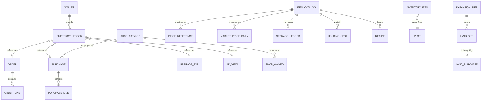
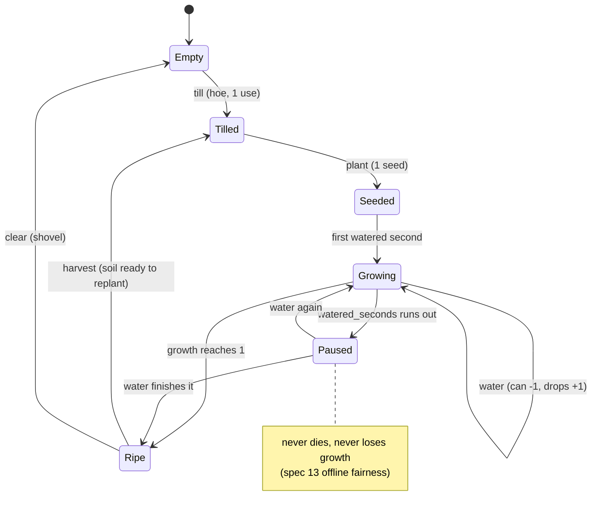
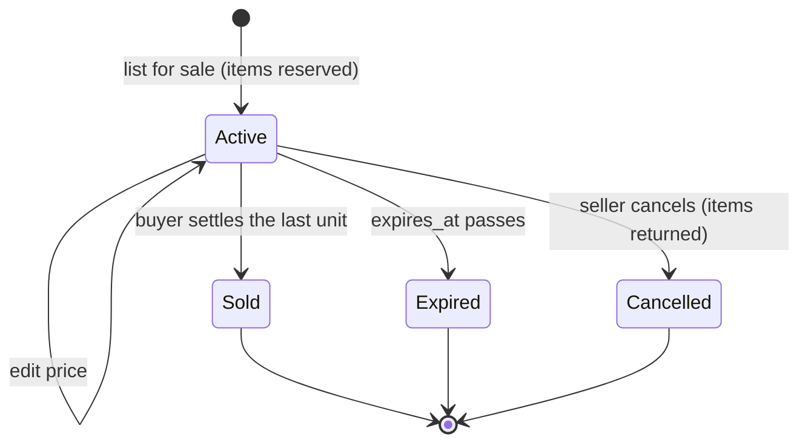
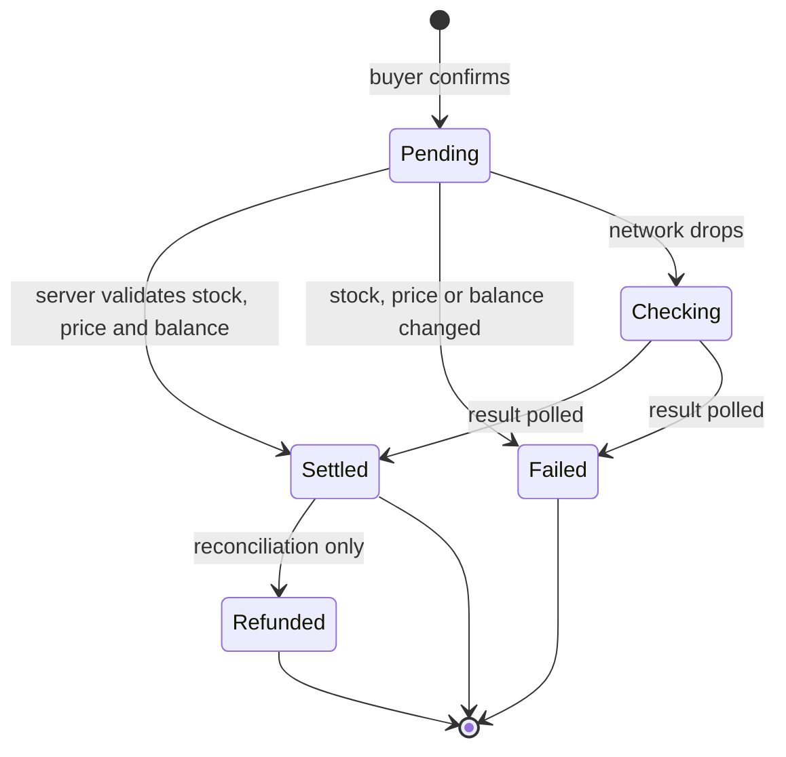
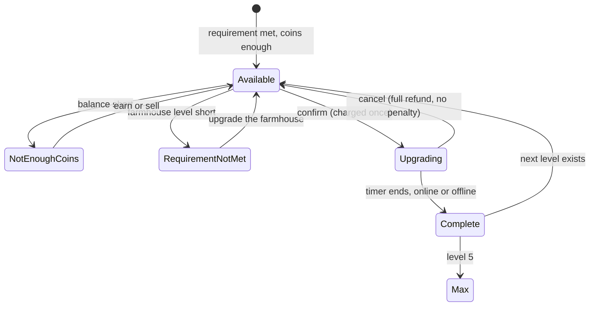
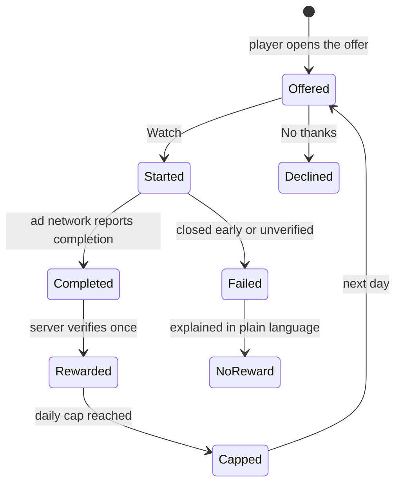
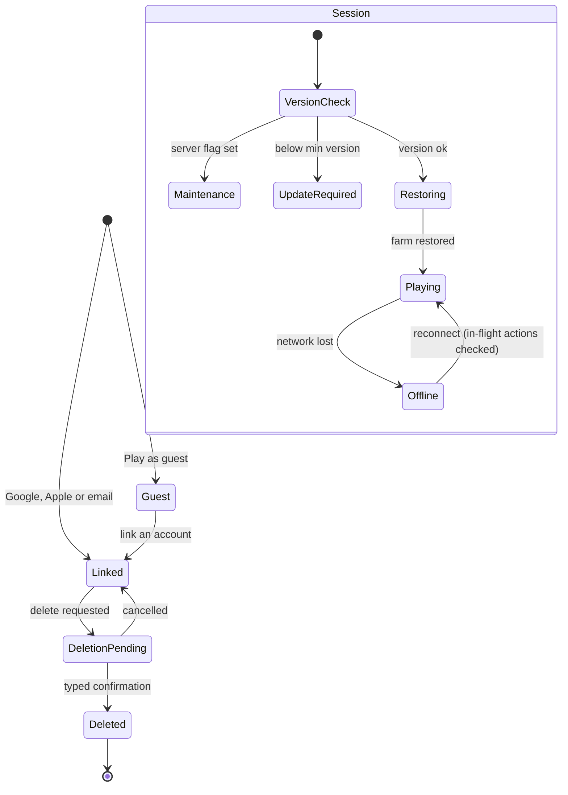
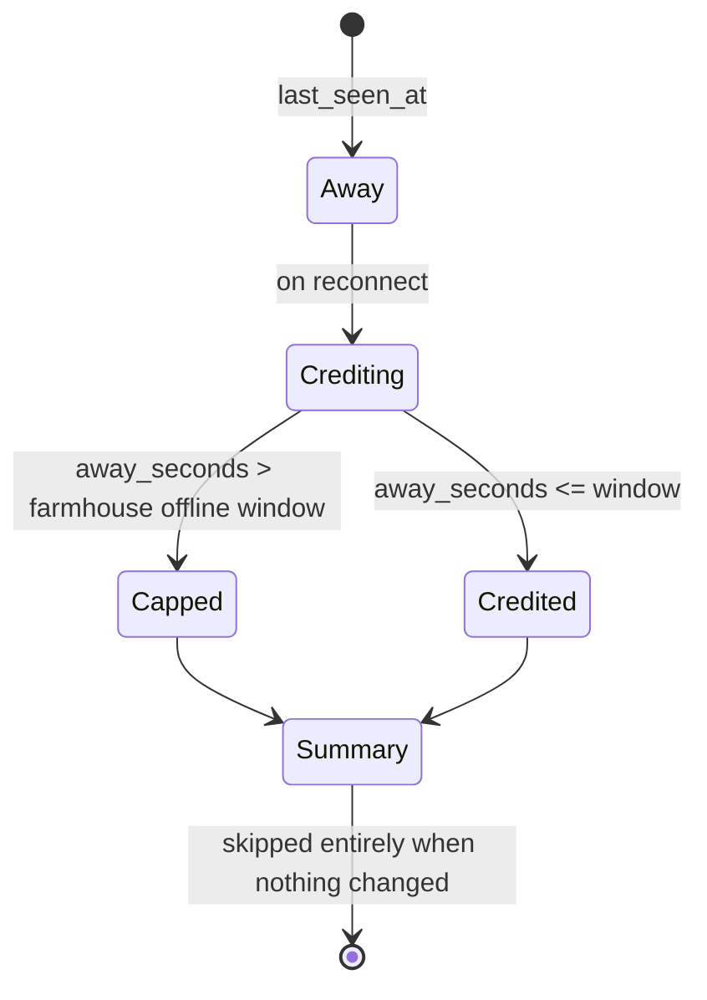

# Farmverse data model

**Related:** [`production-model.md`](production-model.md) · [`backend-architecture.md`](backend-architecture.md)

The tables, fields and relationships needed to power every screen in
`navigation.md` and every game state behind them. Derived from the specification
(economy rules, screen list, Part 6 server-authority rules) and from the domain
layer in `Assets/Farmverse/Scripts/Game/`, which is already the client-side
shape of this model.

> **Revised:** the plot and tile tables below are superseded by
> [`production-model.md`](production-model.md). A tile is now a *slot* and a
> `production_unit` holds its lifecycle, because the stages differ per role
> (a farmer tills and waters, a seed miner installs a machine and fuels it, a
> manufacturer supplies a factory and packs). Read that document for plots,
> units, machines and properties; everything else here still stands.

## Three decisions that shape everything

1. **Growth is derived, never ticked.** A tile stores `planted_at`,
   `grow_seconds` and `watered_seconds_total`; growth is
   `credited_water_seconds / grow_seconds`. There is no per-second write, which
   is what lets the server credit an absence of any length in one calculation
   (spec 26, 67) and lets a retried harvest return the same yield (6.1).
2. **Money is an integer, always.** `wallet.coins` is a 64-bit integer and every
   movement writes a `currency_ledger` row with `balance_after`. No floats near
   currency, and the ledger is the same data support sees (spec 42).
3. **Every mutation carries a request id.** `request_dedupe` makes any action
   replay-safe, which is what the spec means by "a retried request never pays
   twice" (6.1, 17, 31, 36, 48, 77).

Conventions: ids are `bigint` surrogate keys; time is server epoch **seconds**
(`bigint`); a client never sends a timestamp it expects to be trusted; soft
delete is `status` + `deleted_at`; all prices are integers in coins.

---

## 1. Core relationships

```mermaid
erDiagram
    ACCOUNT ||--o| PLAYER : "owns"
    ACCOUNT ||--o{ ACCOUNT_IDENTITY : "signs in with"
    ACCOUNT ||--o{ SESSION : "opens"
    ACCOUNT ||--o{ CONSENT : "agrees to"
    PLAYER ||--|| WALLET : "has"
    PLAYER ||--|| ONBOARDING_STATE : "is in"
    PLAYER ||--|| FOOD_METER : "has"
    PLAYER ||--|| DAILY_BONUS_STATE : "has"
    PLAYER ||--|| REWARDED_AD_STATE : "has"
    PLAYER ||--|| PLAYER_FARMHOUSE : "owns"
    PLAYER ||--|| PLAYER_WAREHOUSE : "owns"
    PLAYER ||--|| PLAYER_STALL : "owns"
    PLAYER ||--|| FARM_RATING : "is scored by"
    PLAYER ||--o{ PLAYER_ROLE : "chose"
    PLAYER ||--o{ PLAYER_COSMETIC : "unlocked"
    PLAYER ||--o{ PLAYER_TOOL : "owns"
    PLAYER ||--o{ INVENTORY_ITEM : "stores"
    PLAYER ||--o{ CURRENCY_LEDGER : "moved"
    PLAYER ||--o| WORLD : "plays in"
    WORLD ||--o{ PLOT : "contains"
    PLOT ||--o{ PLOT_TILE : "is tiled by"
    PLOT ||--|| WELL_STATE : "has a well"
    PLOT ||--o{ PEN : "has pens"
    PLOT ||--o{ PLAYER_MACHINE : "has machines"
    PLOT ||--o{ PLAYER_FACILITY : "has facilities"
    CROP_CATALOG ||--o{ PLOT_TILE : "grows in"
    ITEM_CATALOG ||--o{ INVENTORY_ITEM : "is stocked as"
    ITEM_CATALOG ||--o{ LISTING : "is sold as"
    TOOL_CATALOG ||--o{ PLAYER_TOOL : "is owned as"
    FACILITY_CATALOG ||--o{ FACILITY_LEVEL : "levels up through"
    FACILITY_CATALOG ||--o{ PLAYER_FACILITY : "is built as"
    PLAYER_FACILITY ||--o{ UPGRADE_JOB : "is upgraded by"
    MACHINE_CATALOG ||--o{ RECIPE : "runs"
    RECIPE ||--o{ PRODUCTION_JOB : "is queued as"
    PEN ||--o{ PEN_ANIMAL : "holds"
    PEN_ANIMAL ||--o{ COLLECTABLE : "produces"
    ANIMAL_CATALOG ||--o{ PEN_ANIMAL : "is raised as"
    LISTING ||--o{ ORDER : "is bought by"
    LISTING ||--o{ LISTING_EVENT : "logs"
    LISTING ||--o| PROMOTION : "is promoted by"
    PLAYER ||--o{ ORDER : "buys"
    PLAYER ||--o{ REPORT : "files"
    PLAYER ||--o{ NOTIFICATION : "receives"
    PLAYER ||--o{ SUPPORT_TICKET : "opens"
    PLAYER ||--o{ REQUEST_DEDUPE : "submits"
    TITLE_LADDER ||--o{ PLAYER_TITLE : "is reached as"
    DAILY_BONUS_DAY ||--o{ DAILY_BONUS_STATE : "advances through"
    WAREHOUSE_LEVEL ||--o{ PLAYER_WAREHOUSE : "levels up through"
    FARMHOUSE_LEVEL ||--o{ PLAYER_FARMHOUSE : "levels up through"
    STALL_LEVEL ||--o{ PLAYER_STALL : "levels up through"
```

## 2. Economy and trade relationships

## 3. State machines

### Tile and crop (spec 11, 13, 14)

### Listing (spec 33, 38, 39)

### Order / trade (spec 36, 37)

### Shop purchase and upgrade (spec 31, 60-63)

### Rewarded ad (spec 48, 49)

### Account and session (spec 4, 55, 56, 57)

### Offline catch-up (spec 26, 67)

---

## 4. Table reference

### Identity, session, consent

| Table | Fields |
|---|---|
| `account` | `id` PK, `status` (active/deleted_pending/deleted), `region`, `age_confirmed`, `created_at`, `deleted_at` |
| `account_identity` | `id` PK, `account_id` FK, `provider` (google/apple/email/guest), `provider_uid`, `email_hash`, `is_primary`, `linked_at` |
| `email_code` | `id` PK, `email_hash`, `code_hash`, `expires_at`, `consumed_at`, `attempts` |
| `session` | `id` PK, `account_id` FK, `device_id` FK, `started_at`, `last_seen_at`, `client_version`, `ended_reason` |
| `device` | `id` PK, `account_id` FK, `platform`, `model`, `os_version`, `locale`, `timezone`, `push_token`, `notifications_enabled` |
| `consent` | `id` PK, `account_id` FK, `document` (terms/privacy/ads/tracking), `version`, `granted`, `granted_at`, `method`, `ip_hash` |
| `legal_document` | `id` PK, `kind`, `version`, `effective_at`, `body_url`, `requires_reconsent` |

### Profile and social

| Table | Fields |
|---|---|
| `player` | `id` PK, `account_id` FK, `display_name` UNIQUE, `name_set_at`, `avatar_id` FK, `frame_id` FK, `role_id` FK, `allow_visitors`, `created_at`, `last_active_at` |
| `name_history` | `id` PK, `player_id` FK, `old_name`, `changed_at` (one change per 7 days, spec 46) |
| `avatar_catalog` | `id` PK, `key`, `tile_color`, `unlock_kind`, `unlock_value` |
| `frame_catalog` | `id` PK, `key`, `art_key`, `unlock_kind` (plain/leaf/wheat/gold/rank), `unlock_value` |
| `player_cosmetic` | `player_id` FK, `cosmetic_id` FK, `kind` (avatar/frame), `unlocked_at`, `is_selected` |
| `block` | `blocker_player_id` FK, `blocked_player_id` FK, `created_at` |
| `report` | `id` PK, `reporter_id` FK, `subject_id` FK, `reason` (spam/scam/name), `note`, `listing_id`, `state`, `created_at` |

### World, plots, land

| Table | Fields |
|---|---|
| `world` | `id` PK, `owner_player_id` FK, `empire_title_id` FK, `plot_cap`, `created_at` |
| `plot` | `id` PK, `world_id` FK, `name`, `type` (home/field/pasture/workshop), `ground_variant`, `tile_cap`, `setup_state` (purchased/named/active), `is_home`, `created_at` |
| `plot_tile` | `id` PK, `plot_id` FK, `x`, `y`, `slot_kind` (soil/machine_pad/factory_pad/pasture/water/storage), `terrain_key`, `is_locked`, `unit_id` FK NULL, UNIQUE(`plot_id`,`x`,`y`) — **see `production-model.md`**: the lifecycle moved to `production_unit` + `unit_property` |
| `land_site` | `id` PK, `world_id` FK, `x`, `y`, `fertility` 1-5, `water` 1-5, `roads` 1-5, `price`, `tier`, `state`, `farmhouse_level_required` |
| `land_purchase` | `id` PK, `world_id` FK, `site_id` FK, `price_paid`, `balance_after`, `request_id` UNIQUE, `created_at` |
| `expansion_tier` | `tier` PK, `price_per_tile`, `tile_count` |

### Crops, tools, water

| Table | Fields |
|---|---|
| `crop_catalog` | `id` PK, `key`, `name`, `icon`, `grow_seconds`, `seed_cost`, `yield_min`, `yield_max`, `base_price`, `water_needed`, `seed_return`, `unlock_kind` |
| `crop_stage` | `stage` PK, `name`, `growth_min`, `growth_max` (the four growth thumbnails, spec 13) |
| `tool_catalog` | `id` PK, `key`, `name`, `uses`, `buy_cost`, `repair_cost`, `tiles_per_use`, `can_capacity` |
| `player_tool` | `id` PK, `player_id` FK, `tool_id` FK, `uses_left`, `acquired_at`, `broken_at` |
| `tool_event` | `id` PK, `player_tool_id` FK, `kind` (use/repair/buy), `uses_delta`, `coins_delta`, `at` |
| `well_state` | `id` PK, `plot_id` FK UNIQUE, `capacity`, `refill_seconds`, `buckets`, `next_refill_at` |
| `water_event` | `id` PK, `plot_id` FK, `kind` (fetch/refill/water_tile), `buckets_delta`, `tile_id`, `at` |
| `can_state` | `player_id` PK, `capacity`, `water` |

### Inventory and storage

| Table | Fields |
|---|---|
| `item_catalog` | `id` PK, `key`, `name`, `icon`, `category` (seeds/fertilizer/produce/animal_goods/processed/tools/materials), `base_price`, `spoils_days`, `used_in_recipe_id` |
| `inventory_item` | `id` PK, `player_id` FK, `item_id` FK, `qty`, `reserved_qty`, `plot_of_origin` FK, `freshness`, `updated_at`, UNIQUE(`player_id`,`item_id`) |
| `storage_ledger` | `id` PK, `player_id` FK, `item_id` FK, `qty_delta`, `reason`, `ref_type`, `ref_id`, `at` |
| `holding_spot` | `id` PK, `kind` (tile/machine_output/buyer_cart), `ref_id`, `player_id` FK, `item_id` FK, `qty`, `created_at` (spec 66) |
| `warehouse_level` | `level` PK, `seeds_cap`, `fertilizer_cap`, `produce_cap`, `animal_cap`, `processed_cap`, `upgrade_cost`, `upgrade_seconds` |
| `player_warehouse` | `player_id` PK, `level`, `upgrading_until` |

### Economy

| Table | Fields |
|---|---|
| `wallet` | `player_id` PK, `coins` bigint, `lifetime_earned`, `lifetime_spent`, `updated_at` |
| `currency_ledger` | `id` PK, `player_id` FK, `delta`, `reason`, `counterparty_player_id`, `ref_type`, `ref_id`, `balance_after`, `at` |
| `shop_catalog` | `id` PK, `kind` (tool/machine/structure/land/plot), `key`, `name`, `price`, `published_at`, `retired_at` |
| `purchase` | `id` PK, `player_id` FK, `shop_item_id` FK, `qty`, `unit_price`, `total`, `balance_after`, `request_id` UNIQUE, `state`, `created_at` |
| `purchase_line` | `id` PK, `purchase_id` FK, `shop_item_id` FK, `qty`, `unit_price` |
| `shop_owned` | `player_id` FK, `shop_item_id` FK, `qty`, `first_bought_at` |
| `price_reference` | `item_id` FK, `window_days`, `avg_price`, `low_price`, `high_price`, `computed_at` |
| `market_price_daily` | `item_id` FK, `day`, `avg_price`, `volume` (the 7-day sparkline, spec 19, 35) |

### Marketplace

| Table | Fields |
|---|---|
| `listing` | `id` PK, `seller_player_id` FK, `item_id` FK, `qty_total`, `qty_left`, `unit_price`, `fee`, `duration_days`, `status`, `plot_id` FK, `created_at`, `expires_at`, `promoted_until` |
| `listing_event` | `id` PK, `listing_id` FK, `kind` (created/price_changed/sold/expired/cancelled), `qty`, `price`, `at` |
| `order` | `id` PK, `listing_id` FK, `buyer_player_id` FK, `seller_player_id` FK, `qty`, `unit_price`, `total`, `fee`, `status`, `request_id` UNIQUE, `created_at`, `settled_at` |
| `order_line` | `id` PK, `order_id` FK, `item_id` FK, `qty`, `unit_price` |
| `promotion` | `id` PK, `listing_id` FK, `player_id` FK, `days`, `price`, `starts_at`, `ends_at`, `slot_index`, `status` |

### Production, animals, food

| Table | Fields |
|---|---|
| `machine_catalog` | `id` PK, `key`, `name`, `throughput_seconds`, `batches_per_repair`, `buy_cost`, `repair_cost`, `plot_type_required` |
| `recipe` | `id` PK, `key`, `machine_id` FK, `name`, `batch_seconds`, `input_item_id` FK, `input_qty`, `output_item_id` FK, `output_qty`, `unlock_level` |
| `player_machine` | `id` PK, `player_id` FK, `plot_id` FK, `machine_id` FK, `level`, `batches_since_repair`, `durability_pct`, `state` (idle/running/blocked/stopped), `output_item_id`, `output_qty` |
| `production_job` | `id` PK, `machine_id` FK, `recipe_id` FK, `qty_batches`, `started_at`, `finish_at`, `status` (queued/running/done/collected), `input_consumed`, `output_qty`, `queue_index` |
| `pen` | `id` PK, `plot_id` FK, `kind` (chicken/cattle/sheep), `capacity`, `level` |
| `pen_animal` | `id` PK, `pen_id` FK, `animal_catalog_id` FK, `name`, `hunger` 0-100, `happiness` 0-100, `fed_until`, `state`, `acquired_at` |
| `animal_catalog` | `id` PK, `key`, `kind`, `feed_per_day`, `produce_item_id` FK, `produce_seconds`, `young_variant_item_id` |
| `feed_catalog` | `id` PK, `item_id` FK, `nutrition`, `hours_per_unit` |
| `feeding` | `id` PK, `pen_id` FK, `feed_item_id` FK, `qty`, `feeds_for_hours`, `at` |
| `collectable` | `id` PK, `pen_animal_id` FK, `item_id` FK, `qty`, `ready_at`, `collected_at` |
| `food_meter` | `player_id` PK, `value` 0-100, `reserve_meals`, `penalty_pct`, `updated_at` |
| `food_item` | `item_id` PK, `points`, `category` |
| `eat_log` | `id` PK, `player_id` FK, `item_id` FK, `qty`, `points`, `at` |
| `food_rule` | `id` PK, `decay_per_hour`, `warning_threshold`, `grace_hours` |

### Facilities and upgrades

| Table | Fields |
|---|---|
| `facility_catalog` | `id` PK, `key`, `name`, `family` (shared/farmer/rearer/maker), `role_required`, `benefit_line`, `icon` |
| `facility_level` | `facility_id` FK, `level` 1-5, `model_key`, `stat_json`, `upgrade_cost`, `upgrade_seconds`, `farmhouse_level_required`, PRIMARY KEY(`facility_id`,`level`) |
| `player_facility` | `id` PK, `player_id` FK, `plot_id` FK, `facility_id` FK, `level`, `state` (active/upgrading/max), `upgrading_until`, `scaffold_key` |
| `upgrade_job` | `id` PK, `player_facility_id` FK, `from_level`, `to_level`, `cost`, `started_at`, `finish_at`, `status` (running/cancelled/complete), `refund_amount`, `request_id` UNIQUE |
| `facility_requirement` | `facility_id` FK, `level`, `kind` (farmhouse_level/coins/item), `value` |
| `farmhouse_level` | `level` PK, `offline_window_hours`, `facility_cap_level`, `food_reserve_meals`, `upgrade_cost`, `upgrade_seconds` |
| `player_farmhouse` | `player_id` PK, `level`, `upgrading_until` |
| `stall_level` | `level` PK, `listing_slots`, `upgrade_cost`, `upgrade_seconds` |
| `player_stall` | `player_id` PK, `level`, `upgrading_until` |
| `store_catalog` | `id` PK, `key`, `kind` (silo/storehouse/cellar), `role_required` |
| `store_level` | `store_id` FK, `level`, `capacity`, `spoilage_reduction_pct`, `upgrade_cost` |
| `player_store` | `id` PK, `player_id` FK, `store_id` FK, `level` |
| `store_row` | `id` PK, `store_id` FK, `category`, `item_id` FK, `capacity` |

### Rating, ranks, titles

| Table | Fields |
|---|---|
| `rating_rule` | `component` PK (facilities/land/production/trading), `weight`, `cap`, `window_days` |
| `farm_rating` | `player_id` PK, `score`, `facilities_points`, `land_points`, `production_points`, `trading_points`, `computed_at` |
| `leaderboard_snapshot` | `id` PK, `scope` (world/local/plot), `metric`, `period` (week/all), `player_id` FK, `score`, `rank`, `computed_at` |
| `rank_change` | `id` PK, `player_id` FK, `old_rank`, `new_rank`, `at`, `notified` |
| `title_ladder` | `id` PK, `key`, `name`, `crest_key`, `requirement_json`, `order_index` |
| `player_title` | `player_id` PK, `title_id` FK, `reached_at` |

### Rewards and engagement

| Table | Fields |
|---|---|
| `daily_bonus_state` | `player_id` PK, `streak_day` 1-7, `last_claim_day`, `paused`, `claimed_count` |
| `daily_bonus_day` | `day` PK, `reward_json`, `is_big` |
| `rewarded_ad_state` | `player_id` PK, `views_today`, `day`, `cap`, `cooldown_until`, `last_view_at` |
| `ad_view` | `id` PK, `player_id` FK, `network`, `network_txn_id`, `state` (offered/started/completed/failed), `reward_coins`, `verified_at`, `request_id` UNIQUE |
| `notification` | `id` PK, `player_id` FK, `kind` (sale/crop/batch/reward/system/rank/upgrade), `title`, `body`, `ref_route`, `read_at`, `created_at`, `expires_at` |
| `push_token` | `device_id` PK, `token`, `platform`, `enabled` |

### Onboarding and config

| Table | Fields |
|---|---|
| `role_catalog` | `id` PK, `key` (farmer/rearer/maker), `name`, `description`, `unlock_state` (available/coming_soon), `starter_json` |
| `player_role` | `player_id` FK, `role_id` FK, `is_primary`, `chosen_at` |
| `onboarding_state` | `player_id` PK, `tutorial_step`, `tutorial_completed_at`, `starter_pack_claimed_at`, `welcome_story_seen`, `role_chosen_at`, `profile_set_at` |
| `tutorial_step` | `step` PK, `target_route`, `instruction`, `reward_json` |
| `starter_pack` | `id` PK, `version`, `reward_json` |
| `game_config` | `key` PK, `value`, `updated_at` (maintenance_mode, min_client_version, market_fee_pct, ad_daily_cap, offline_window_default) |
| `client_version` | `version` PK, `platform`, `min_supported`, `released_at`, `store_url` |
| `tip` | `id` PK, `text`, `icon`, `order_index` (loading tips, spec 2) |
| `feature_flag` | `key` PK, `enabled`, `rollout_pct` |

### Support, compliance, idempotency

| Table | Fields |
|---|---|
| `support_ticket` | `id` PK, `player_id` FK, `category`, `message`, `attach_url`, `device_json`, `client_version`, `txn_ref`, `state`, `created_at` |
| `data_export_request` | `id` PK, `player_id` FK, `state`, `requested_at`, `ready_at`, `url` |
| `deletion_request` | `id` PK, `player_id` FK, `state` (pending/confirmed/done), `requested_at`, `confirm_word_ok`, `completed_at` |
| `anti_abuse_flag` | `id` PK, `player_id` FK, `kind` (self_trade/wash_trade/multi_account), `ref_type`, `ref_id`, `at`, `action` |
| `request_dedupe` | `request_id` PK, `player_id` FK, `action`, `result_json`, `created_at`, `expires_at` |
| `action_log` | `id` PK, `player_id` FK, `action`, `target_type`, `target_id`, `params_json`, `result`, `at` |
| `offline_calc` | `id` PK, `player_id` FK, `from_at`, `to_at`, `credited_seconds`, `capped`, `report_json` |

---

## 5. Screen → data (all 81)

`R` = reads, `W` = writes. Every screen is covered; the client never invents a
value it displays (spec 6.1).

| # | Screen | R | W |
|---|---|---|---|
| 1 | Splash | `game_config` | — |
| 2 | Loading and update check | `client_version`, `tip`, `session` | `session`, `offline_calc` |
| 3 | Legal and consent gate | `legal_document` | `consent` |
| 4 | Sign in / create account | `account_identity`, `account` | `account`, `account_identity`, `email_code`, `player`, `wallet`, `onboarding_state` |
| 5 | Welcome story | `onboarding_state` | `onboarding_state` |
| 6 | Role selection | `role_catalog` | `player_role`, `onboarding_state`, `inventory_item`, `player_tool` |
| 7 | Profile setup | `avatar_catalog`, `frame_catalog` | `player`, `player_cosmetic`, `onboarding_state`, `name_history` |
| 8 | Guided tutorial overlay | `tutorial_step` | `onboarding_state` |
| 9 | Starter pack reward | `starter_pack` | `onboarding_state`, `wallet`, `inventory_item`, `currency_ledger`, `request_dedupe` |
| 10 | Home: personal farm | `plot`, `plot_tile`, `crop_catalog`, `well_state`, `can_state`, `wallet`, `player_tool`, `farm_rating` | `session`, `offline_calc` |
| 11 | Tile action menu | `plot_tile`, `player_tool`, `inventory_item` | `plot_tile`, `tool_event`, `action_log`, `request_dedupe` |
| 12 | Seed picker | `inventory_item`, `crop_catalog` | `plot_tile`, `inventory_item`, `storage_ledger` |
| 13 | Crop progress popup | `plot_tile`, `crop_catalog`, `well_state` | `plot_tile`, `water_event`, `tool_event` |
| 14 | Harvest result | `plot_tile`, `crop_catalog` | `plot_tile`, `inventory_item`, `storage_ledger`, `holding_spot`, `request_dedupe` |
| 15 | Build mode | `shop_owned`, `plot`, `land_site` | `plot`, `action_log` |
| 16 | Land expansion map | `land_site`, `expansion_tier`, `plot_tile`, `wallet` | — |
| 17 | Expansion confirm | `land_site`, `wallet` | `land_site`, `land_purchase`, `wallet`, `currency_ledger`, `request_dedupe` |
| 18 | Inventory and storage | `inventory_item`, `item_catalog`, `warehouse_level`, `player_warehouse` | — |
| 19 | Item detail | `item_catalog`, `inventory_item`, `price_reference`, `market_price_daily`, `listing` | — |
| 20 | Tool durability and repair | `player_tool`, `tool_catalog`, `wallet` | `player_tool`, `tool_event`, `wallet`, `currency_ledger`, `request_dedupe` |
| 21 | Animal pen view | `pen`, `pen_animal`, `collectable`, `animal_catalog` | `collectable`, `inventory_item`, `storage_ledger` |
| 22 | Feed and care | `pen`, `pen_animal`, `feed_catalog`, `inventory_item` | `feeding`, `pen_animal`, `inventory_item`, `storage_ledger` |
| 23 | Processing station | `player_machine`, `recipe`, `production_job`, `inventory_item` | `production_job`, `inventory_item`, `storage_ledger` |
| 24 | Production complete | `production_job`, `player_machine`, `price_reference` | `production_job`, `inventory_item`, `holding_spot`, `storage_ledger` |
| 25 | Food need / eat | `food_meter`, `food_item`, `inventory_item` | `food_meter`, `eat_log`, `inventory_item`, `storage_ledger` |
| 26 | Welcome back summary | `offline_calc`, `plot_tile`, `production_job`, `order`, `collectable` | `offline_calc`, `plot_tile` |
| 27 | Shop home | `shop_catalog`, `shop_owned`, `wallet`, `role_catalog` | — |
| 28 | Shop: tools | `shop_catalog`, `shop_owned`, `player_tool` | — |
| 29 | Shop: machinery | `shop_catalog`, `recipe`, `plot` | — |
| 30 | Shop: structures and land | `shop_catalog`, `facility_catalog`, `land_site`, `player_farmhouse` | — |
| 31 | Purchase confirm | `shop_catalog`, `wallet` | `purchase`, `purchase_line`, `wallet`, `currency_ledger`, `shop_owned`, `request_dedupe` |
| 32 | Not enough coins | `wallet`, `listing`, `rewarded_ad_state` | — |
| 33 | Marketplace browse | `listing`, `price_reference`, `player`, `promotion` | — |
| 34 | Search and filter | `listing`, `price_reference` | — |
| 35 | Listing detail | `listing`, `price_reference`, `market_price_daily`, `player`, `farm_rating` | — |
| 36 | Buy confirm | `listing`, `wallet`, `game_config` | `order`, `order_line`, `listing`, `wallet`, `currency_ledger`, `inventory_item`, `storage_ledger`, `notification`, `request_dedupe` |
| 37 | Purchase success | `order`, `inventory_item` | — |
| 38 | Create listing | `inventory_item`, `price_reference`, `player_stall`, `stall_level` | `listing`, `inventory_item`, `listing_event`, `request_dedupe` |
| 39 | My listings | `listing`, `listing_event`, `order` | `listing`, `inventory_item`, `listing_event` |
| 40 | Seller profile | `player`, `farm_rating`, `leaderboard_snapshot`, `listing`, `player_title`, `plot`, `report` | `report`, `block` |
| 41 | Visit world (read-only) | `world`, `plot`, `plot_tile`, `player_facility`, `listing` | — |
| 42 | Transaction history | `currency_ledger`, `order`, `purchase` | — |
| 43 | Promote listing | `listing`, `promotion`, `wallet`, `game_config` | `promotion`, `listing`, `wallet`, `currency_ledger`, `request_dedupe` |
| 44 | Leaderboard | `leaderboard_snapshot`, `player`, `farm_rating`, `rank_change` | — |
| 45 | Player card | `player`, `farm_rating`, `leaderboard_snapshot`, `player_title` | — |
| 46 | Edit profile | `player`, `avatar_catalog`, `frame_catalog`, `player_cosmetic`, `name_history` | `player`, `player_cosmetic`, `name_history` |
| 47 | Daily bonus | `daily_bonus_state`, `daily_bonus_day` | `daily_bonus_state`, `wallet`, `inventory_item`, `currency_ledger`, `request_dedupe` |
| 48 | Rewarded ad offer | `rewarded_ad_state`, `game_config` | `ad_view`, `rewarded_ad_state` |
| 49 | Ad reward result | `ad_view` | `ad_view`, `wallet`, `currency_ledger`, `request_dedupe` |
| 50 | Notifications centre | `notification` | `notification` |
| 51 | Wallet | `wallet`, `currency_ledger`, `feature_flag` | — |
| 52 | Settings | `device`, `player` | `device`, `player` |
| 53 | Language picker | `game_config` | `device` |
| 54 | Help and contact | `support_ticket`, `game_config` | `support_ticket` |
| 55 | Account management | `account`, `account_identity` | `account_identity`, `data_export_request`, `deletion_request` |
| 56 | Connection lost | `session` | — |
| 57 | Maintenance / update required | `game_config`, `client_version` | — |
| 58 | Generic confirm and error | — | — (pure template) |
| 59 | Facilities hub | `player_facility`, `facility_catalog`, `facility_level`, `player_farmhouse`, `role_catalog` | — |
| 60 | Facility detail and upgrade | `player_facility`, `facility_level`, `facility_requirement`, `wallet`, `player_farmhouse` | — |
| 61 | Upgrade confirm | `player_facility`, `facility_level`, `wallet` | `upgrade_job`, `player_facility`, `wallet`, `currency_ledger`, `request_dedupe` |
| 62 | Construction in progress | `upgrade_job`, `player_facility`, `rewarded_ad_state` | `upgrade_job`, `player_facility`, `ad_view` |
| 63 | Upgrade complete | `upgrade_job`, `player_facility`, `farm_rating` | `player_facility`, `farm_rating`, `notification` |
| 64 | Well panel (water) | `well_state`, `can_state`, `facility_level` | `well_state`, `can_state`, `water_event` |
| 65 | Warehouse storage panel | `player_warehouse`, `warehouse_level`, `inventory_item` | — |
| 66 | Capacity full | `inventory_item`, `warehouse_level`, `holding_spot` | — |
| 67 | Farmhouse (homestead) | `player_farmhouse`, `farmhouse_level`, `food_meter`, `inventory_item` | `food_meter` |
| 68 | Market stall manager | `player_stall`, `stall_level`, `listing` | — |
| 69 | Granary and raw storehouse | `player_store`, `store_level`, `store_row`, `inventory_item`, `pen_animal` | — |
| 70 | Cellar / finished goods | `player_store`, `store_level`, `inventory_item`, `market_price_daily` | `inventory_item` |
| 71 | Farm rating | `farm_rating`, `rating_rule`, `player_facility`, `plot`, `leaderboard_snapshot` | — |
| 72 | Empire map | `world`, `plot`, `land_site`, `player_title` | — |
| 73 | Plot switcher | `plot`, `plot_tile`, `pen_animal`, `player_machine`, `land_site` | — |
| 74 | Plot detail | `plot`, `plot_tile`, `well_state`, `player_facility`, `player_machine` | `plot` |
| 75 | Shop: new plots | `world`, `land_site`, `player_farmhouse`, `wallet` | — |
| 76 | Plot preview and details | `land_site`, `expansion_tier`, `shop_catalog` | — |
| 77 | Plot purchase confirm | `land_site`, `wallet`, `world` | `plot`, `land_purchase`, `wallet`, `currency_ledger`, `land_site`, `request_dedupe` |
| 78 | Plot setup (choose a type) | `role_catalog` | `plot`, `player_facility`, `plot_tile`, `well_state` |
| 79 | Welcome to your new plot | `plot`, `player_title` | `inventory_item`, `storage_ledger`, `player_title` |
| 80 | Empire progress and titles | `title_ladder`, `player_title`, `player_farmhouse`, `world` | — |
| 81 | Empire dashboard | `currency_ledger`, `storage_ledger`, `plot`, `production_job`, `pen_animal` | — |

## 6. What is deliberately client-only

Not in the model, because the spec puts it on the device:

- **View state**: which tab is active, scroll position, the last plot used, the
  tutorial's current step *as displayed* (the authoritative step is
  `onboarding_state.tutorial_step`).
- **Motion and layout**: transitions, safe-area insets, text scale, RTL.
- **Cached art**: the atlases and the UI textures.
- **Audio and haptics settings** — mirrored to `device` only for notifications.

Everything a player can *see as a value* — balances, inventory, prices, ranks,
timers, durability, capacity — is a server value or a clearly marked estimate
(spec 6.1).
