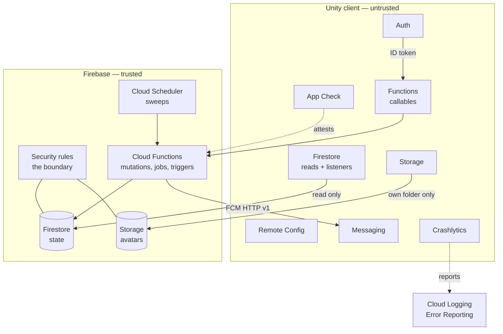
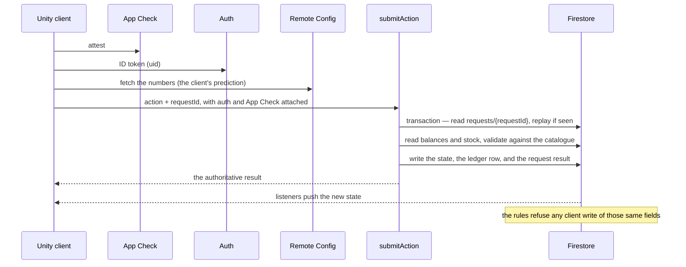

# Farmverse Firebase integration plan

> A plan, not code. What each service in the suite is for, how it is used on both
> sides of the trust boundary, the order it gets built in, and what it costs.
> `firebase-backend.md` says *what replaced what* and where each golden rule is
> enforced; this says *how the suite is wired*.

**Related:** [`firebase-backend.md`](firebase-backend.md) · [`navigation.md`](navigation.md) · [`admin-and-config.md`](admin-and-config.md) · [`realtime.md`](realtime.md) · [`push-notifications.md`](push-notifications.md) · [`metrics-and-analytics.md`](metrics-and-analytics.md)

---

## 1. The one principle

Firebase does not change the architecture rule, it makes it enforceable. The
client is untrusted, and every value it shows is either read from a document the
server wrote or returned by a callable. The suite splits cleanly along that line.

Read it as one sentence: **the client may read Firestore and call Functions, and
may not write anything the server owns.** That is `firestore.rules`, not a
convention.

---

## 2. Firebase Auth — identity

| | |
|---|---|
| **Role** | Replaces server-issued JWTs. The `uid` *is* the player key, which is why every player document is `players/{uid}`. |
| **Client** | `FirebaseAuth`. Anonymous sign-in at first launch (a guest, spec 4), then link Apple or Google. The SDK refreshes the ID token and attaches it to callables and Firestore reads without the game code touching it. |
| **Server** | Functions read `request.auth.uid` from the verified token. A custom claim `admin: true` marks the console. Auth triggers: `onUserCreated` creates the player document and its starter state; `onUserDeleted` purges the player's data — the compliance job. |
| **Rules** | `request.auth.uid == playerId` is the entire ownership check. |
| **Screens** | 4 sign in / create account · 55 account management · 58 delete confirm. |
| **Decisions** | Whether a guest can merge into an existing account on link, the deletion grace period, admin MFA, and whether sign-in is required before the first harvest or only before market writes. |

## 3. App Check — the anti-abuse gate

| | |
|---|---|
| **Role** | Proves the client is a genuine build of the game. This is the operations document's anti-abuse layer, and the only thing that stops a scripted client *before* it reaches a Function. |
| **Client** | Play Integrity on Android, DeviceCheck or App Attest on iOS, and the **debug provider** in the editor. Initialised once, before any other call. |
| **Server** | `enforceAppCheck: true` on every callable (already set in `functions/src`), plus console enforcement on Firestore and Storage. |
| **Rules** | App Check is not expressible in the rules language — enforcement happens at the service, above the rules. |
| **Decisions** | **Rollout order matters.** Start in *monitor* mode, watch the un-attested percentage, then enforce; enforcing blind locks out real players on old devices. Also: the team's debug tokens, and what the player sees when attestation fails — a message, not a dead screen. |

## 4. Cloud Firestore — the state, and the client's read surface

| | |
|---|---|
| **Role** | All game state, plus the projections a client is allowed to read: the leaderboard, world snapshots, and listings. |
| **Client** | Reads and `onSnapshot` listeners. **Offline persistence is enabled** — it is what makes screen 56 and "never punish offline" cheap. |
| **Server** | Functions mutate inside transactions; the client never does. |
| **Rules** | The boundary. No rule lets a signed-in client write a coin, an item count, a ledger entry, a listing or a rank. |
| **Data** | `players/{uid}` with `inventory`, `ledger`, `plots`, `units`, `requests`; `catalogue/{objects,items,properties}`; `listings`; `leaderboard`; `worldSnapshots`; `catalogueChanges`. The shape is in `firebase-backend.md`. |
| **Decisions** | Native mode, and the **region** — chosen once, and it drives both latency and cost. The index list. Above all **listener scope**: an unbounded listener on `listings` is the single biggest cost in the design, so it is capped by category, a limit, and `expiresAt`. Reads dominate the bill, not writes. |

## 5. Cloud Functions — the trusted half

| | |
|---|---|
| **Role** | Every mutation, every scheduled job and every trigger: `submitAction` (idempotent and atomic), `catchUp`, `applyCataloguePatch`, `refreshLeaderboard`, `expireListings`, `onPlayerWrite`. |
| **Client** | Calls callables through the SDK; the ID token and the App Check token ride along. |
| **Server** | Runs with admin credentials, so it bypasses the rules — which is exactly why it is the only writer. |
| **Golden rules** | 1 authority, 2 the request id is a document, 3 one transaction, 4 the ledger row is written with the balance, 5 timers. |
| **Decisions** | **The Blaze plan is required.** Node runtime and region. Cold starts on the first action after idle — min instances fix that at a cost. **Timers are the real decision:** Firebase has no delayed-job queue, so a timer is a stored timestamp materialised on read, plus a **Cloud Scheduler** sweep; exact-time delivery needs **Cloud Tasks**, which is also Blaze. |

## 6. Remote Config — the economy numbers and the knobs

| | |
|---|---|
| **Role** | The numbers (`config/economy.json` emitted as parameters), the runtime knobs (`market_fee_pct`, `ad_daily_cap`, `offline_window_default`), the feature flags (B3TR off at launch), and the gate (`min_client_version`, `maintenance`). |
| **Client** | Fetch on launch, `FetchAndActivate`, refetch when the version changes. |
| **Server** | Functions read the same template through the Admin SDK, so a price cannot differ between the two sides. |
| **Data** | `<objectId>.<level>.<prop>`, `item.<id>.price`, `catalogue.version` — all generated from the one file by `gen_catalogue.py`. |
| **Decisions** | Remote Config is **not a database**: it cannot schedule a change, and it holds no per-player values. So `effective_at` (the "this price changed since you opened the screen" case, spec 77) needs a Function or a document, not a parameter. Names and icons stay bundled or in Addressables; Remote Config carries numbers and flags only. And per spec 6.1 a value on screen still comes from the server's response — Remote Config is for the client's *prediction*. |

## 7. Cloud Messaging — push when the player is away

| | |
|---|---|
| **Role** | The short allow-list from `push-notifications.md`: crops ripe, batch ready, upgrade complete, your listing sold, animals need feed, daily bonus. Nothing else. |
| **Client** | The permission is asked *after* the first harvest, not at launch. Token registration on login. A push that arrives while the app is open becomes a toast plus a bell dot — never a system notification. A tap resolves to a route id. |
| **Server** | A Firestore trigger on the player's notifications sends FCM HTTP v1 through the Admin SDK. The daily cap and quiet hours come from a preferences document, checked before the send. |
| **Decisions** | The APNs auth key and the two config files. FCM has **no native coalescing**, so the "one coalesced push, not one per event" rule is ours to implement in the Function. |

## 8. Cloud Storage — user content only

| | |
|---|---|
| **Role** | Avatars, and nothing else. Every piece of game art is bundled with the build. |
| **Client** | Upload the player's own avatar; read others', which are public in a social game. |
| **Rules** | Writes only into the player's own folder, image content type, under a size limit. |
| **Decisions** | Validate and resize server-side (the **Resize Images** extension), lifecycle rules, and egress cost. No PII in a public bucket. |

## 9. Crashlytics — the health signal

| | |
|---|---|
| **Role** | Crashes and non-fatals, correlated with the screen the player was on. |
| **Client** | Set the user id and custom keys (route id, client version, request id); log non-fatals — a prediction mismatch, a refused action. |
| **Server** | Server-side errors go to Cloud Logging and Error Reporting; the client's go to Crashlytics. |
| **Decisions** | **Symbol upload must be wired into the Unity build**, or the reports are unreadable. Consent (screen 3) may gate reporting. Never put an email or a token in a custom key. |

---

## 10. One action, end to end

The prediction is drawn from Remote Config; the truth is the callable's return and
the listener's push. A mismatch is logged as a non-fatal, which is how drift
becomes visible instead of a silent bug.

---

## 11. Where each golden rule is enforced

| Rule | Enforced by |
|---|---|
| 1. The server is authoritative | `firestore.rules` — no rule accepts a client write of a coin, an item count, a ledger entry, a listing or a rank. Every mutation is a Function. |
| 2. Idempotency keys | `functions/src/shared/idempotency.ts` — the key is a document read first inside the transaction. |
| 3. Trades are atomic | `db.runTransaction`. **Changed:** Firestore has no row locks; it re-reads and retries on contention. |
| 4. Append-only ledger, never below zero | `functions/src/shared/ledger.ts`. **Changed:** Firestore cannot enforce it with a constraint, so the only code that moves coins does. |
| 5. Timers run on the server | `catchUp`, `expireListings`, `refreshLeaderboard`, and the settle-on-read step. |
| 6. No pay-to-win | Nothing sells plots, upgrades or timers. |
| 7. Never an investment | Plots cannot be transferred; no rule would allow it. |
| 8. B3TR behind a flag | A Remote Config flag, off at launch. |
| 9. Visitors are read-only | `worldSnapshots` is a separate document the server writes, and `allowVisitors` is checked in the rules. |
| 10. Security code needs review | `firestore.rules`, `ledger.ts`, `idempotency.ts`, and the App Check rollout. |

---

## 12. Integration order, with a gate per phase

| Phase | Build | Gate |
|---|---|---|
| **0 · project** | Create the project, register the Android and iOS apps, enable Blaze, drop the two config files into the client, install the App Check debug token | the client initialises Firebase |
| **1 · Auth** | Anonymous sign-in, `uid` as the player key, `onUserCreated` | screen 4 works and `players/{uid}` exists |
| **2 · App Check** | Monitor first, then enforce | a callable refuses an unattested client |
| **3 · Firestore + Functions + rules** | Seed the catalogue, `submitAction`, `catchUp`, deploy the rules | plant → harvest → sell round-trips on the emulator, then the real project |
| **4 · Remote Config** | The economy, the version gate, the flags | the price shown equals the price the callable returns |
| **5 · projections and listeners** | Leaderboard, world snapshots, listings, `onSnapshot` | the market updates live and the read cost is bounded |
| **6 · Messaging** | Tokens, preferences, the notification centre, the trigger | a sale pushes, once |
| **7 · Storage** | Avatars | an avatar round-trips |
| **8 · Crashlytics** | Symbols, custom keys, non-fatals | a deliberate crash is symbolicated |
| **9 · ops** | BigQuery export, Cloud Logging alerts | `ledger_mismatch` has somewhere to live |

Phases 0–3 make the loop playable. The **emulator suite** (Auth, Firestore,
Functions, Storage) is what lets phases 3–6 be built and tested without a project
and without a bill.

---

## 13. What already exists, and what this plan adds

**Exists.** `functions/` — the actions, jobs, trigger, ledger, idempotency and farm
rating; `firestore.rules`; `storage.rules`; `firestore.indexes.json`;
`remoteconfig.template.json`; `firebase.json`.

**This plan adds.** The client-side implementation behind the existing interfaces
(`IFarmApi`, `ICatalogueApi`, `ITradingPostApi`, `IVisitorApi`, `IClockApi`,
`ILeaderboardApi`) — one Firebase class each, replacing `ClientApis.Mock()`; the
Firebase project itself; and the Unity SDK wiring for the six client-side services.

**The interfaces do not change.** That is what the api layer was built as a seam
for.

---

## 14. Decisions to confirm

1. **Region and Blaze** — one-way doors for latency and cost.
2. **Timers** — Cloud Tasks (exact, Blaze, priced per task) or settle-on-read plus a Scheduler sweep (cheaper, minutes late at worst)?
3. **App Check** — when to enforce, and the debug-token policy.
4. **Remote Config or a Firestore document** for the economy — Remote Config is the right home for knobs and flags, but a *scheduled* price change may want a document.
5. **Guest policy** — play before sign-in, or sign in at launch?
6. **Avatars** — public-read, and resized server-side?
7. **The `CLAUDE.md` divergences** — it names `/server` and `/db/schema.sql`; this repository has `/functions` and `firestore.rules`.

---

## 15. Risks worth naming now

- **Cost follows reads, not writes.** Listeners on the market are the exposure; scope them.
- **No row locks** (golden rule 3) and **no constraints** (golden rule 4) — both moved into code.
- **No SQL** — reconciliation and reporting become BigQuery.
- **Cold starts** on the first action after idle.
- **App Check** can lock out real devices if enforced too early.
- **Two implementations of the same rules** — the client's prediction and the Functions — so drift is the standing risk, and Crashlytics is where it becomes visible.

---

## 16. Divergences from `CLAUDE.md`

`CLAUDE.md` is binding, and it names a layout this repository does not have. The
divergences are recorded here rather than left to be discovered:

| `CLAUDE.md` says | This repository has |
|---|---|
| `/server` (TypeScript) | `/functions` (TypeScript Cloud Functions) |
| `/db/schema.sql` as the source of truth | `firestore.rules` + `firestore.indexes.json` |
| row locks and DB constraints | Firestore transactions, and invariants enforced in code |
| `/client` | the Unity project at the repository root (still to confirm) |
