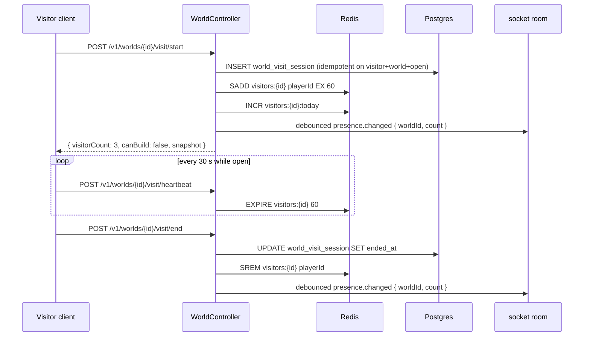
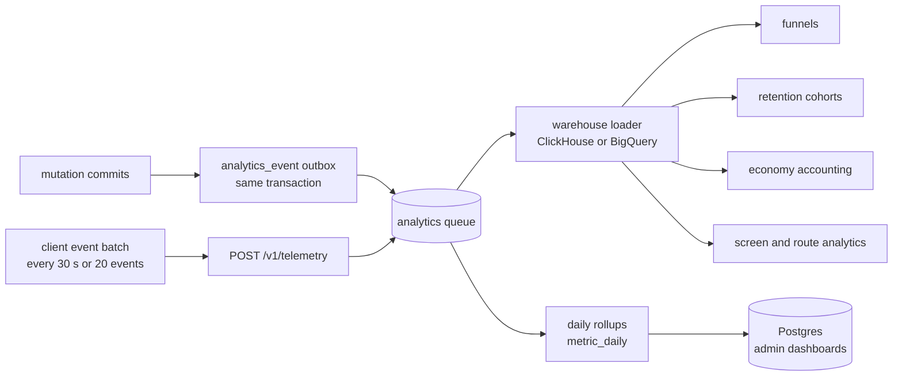

# Farmverse metrics and analytics

> **Superseded in part.** This document describes the NestJS + Prisma backend.
> The backend is now Firebase — see `firebase-backend.md` for what replaced what,
> where each golden rule is enforced, and the three design consequences. The
> reasoning below still holds; the mechanism does not.

**Related:** [`backend-architecture.md`](backend-architecture.md) · [`realtime.md`](realtime.md) · [`admin-and-config.md`](admin-and-config.md) · [`navigation.md`](navigation.md)

Live counters, game analytics and operational telemetry — kept apart, because
conflating them is how a game ends up with a dashboard nobody trusts.

## 1. Three kinds of number, three stores

| Kind | Example | Store | Lifetime | Consumer |
|---|---|---|---|---|
| **Live counters** | visitors in a world right now, players online, active trades | Redis (TTL keys + sets) | seconds | players, the live-ops dashboard, the socket |
| **Game analytics** | tutorial completion, harvests/day, coins minted per source | event outbox → queue → warehouse (ClickHouse/BigQuery) | forever | the team, the economist |
| **Operational telemetry** | latency, error rate, queue depth, settle lag | OpenTelemetry → Prometheus | 15 days | engineers, alerts |

A live visitor count must never be a `COUNT(*)` over a visit table, and a
30-day retention curve must never live in Redis. The three have different write
rates, different lifetimes and different readers.

## 2. Live counters (Redis)

Every counter is a key with a TTL, so a crashed process cannot leave a ghost
count, and every counter is **reconciled** into Postgres on a slow cadence for
history.

| Key | Type | Written by | TTL | Exposed as |
|---|---|---|---|---|
| `online` | SET of playerId | connect / disconnect | member 45 s | "players online" (admin only) |
| `visitors:{worldId}` | SET of playerId | visit session start / end | member 60 s | **"N visitors here now"** (screen 41) |
| `visitors:{worldId}:today` | counter | visit session start | midnight | "visits today" (screen 40, 74) |
| `active_worlds` | SET of worldId | on first visitor | member 60 s | "worlds with visitors" (admin) |
| `plot_units:{plotId}` | counter | unit created / removed | none (rebuilt) | "active crops" (screen 41, 74) |
| `timers_due` | counter | timer scheduled / fired | none | "active timers" (screens 73, 81) |
| `market_active:{itemId}` | counter | listing created / sold / expired | none | market depth (35, 81) |
| `trades_inflight` | counter | order begin / settle | none | admin live view |
| `socket_count:{platform}` | counter | connect / disconnect | member 45 s | capacity (admin) |

Rules:

- **Idempotent membership.** A visit session has an id; `SADD` is idempotent, so
  a reconnect cannot double-count a visitor. The `visitors:{worldId}` set holds
  player ids, not session ids, so a player with two devices counts once.
- **No Postgres on the hot path.** Entering a world writes one Redis set member
  and one `world_visit_session` row; leaving writes one `SREM` and closes the
  row. Nothing polls.
- **Reconciled, not trusted.** A `reconcile-live` job every 60 s recomputes
  `online` and `active_worlds` from the durable session tables and corrects the
  counters, so drift self-heals.
- **Aggregates only.** `GET /v1/metrics/live` returns counts, never identities.

## 3. Game analytics

Server-emitted, authoritative, one taxonomy. Client-side events are limited to
things only the client knows (`screen_view`, `prediction_mismatch`,
`error_shown`) and are marked `src=client` so they can be distrusted separately.

Written **in the same transaction** as the mutation, so an event can never
describe something that rolled back — the same rule as the socket and the push.

### Taxonomy (event → key properties)

| Group | Events |
|---|---|
| session | `session_start`, `resume`, `offline_report_shown`, `session_end` |
| onboarding | `story_seen`, `role_chosen`, `profile_set`, `tutorial_step`, `tutorial_done`, `starter_claimed` |
| production | `tile_tilled`, `seed_planted`, `tile_watered`, `fertilized`, `harvested`, `unit_installed`, `unit_fuelled`, `batch_started`, `batch_collected`, `packed`, `animal_fed`, `animal_collected` |
| economy | `coins_earned` (`source`), `coins_spent` (`sink`), `item_gained`, `item_lost`, `storage_full`, `holding_collected` |
| market | `listing_created`, `listing_sold`, `listing_cancelled`, `listing_expired`, `promoted`, `order_failed` (`reason`) |
| facilities | `upgrade_started`, `upgrade_cancelled`, `upgrade_completed` |
| rewards | `daily_bonus_claimed`, `ad_offered`, `ad_completed`, `ad_failed`, `notification_opened`, `push_sent`, `push_capped`, `push_suppressed` |
| social | `world_visited`, `profile_viewed`, `reported`, `blocked` |
| progression | `rating_changed`, `rank_changed`, `title_reached`, `plot_purchased`, `plot_setup` |
| client | `screen_view` (`route`), `prediction_mismatch`, `error_shown` (`code`), `network_retry` |

`screen_view` carries a **route id from `navigation.md`**, so screen analytics and
the nav map are the same vocabulary — a funnel is a path through the diagram.

Common properties on every event: `player_id`, `world_id`, `plot_id` (nullable),
`client_version`, `platform`, `region`, `src`, `at`, `session_id`, and the
mutation's `request_id` so an event can be traced back to the ledger row.

## 4. Economy accounting — the counts that matter in a farm game

Faucets, sinks, velocity and depth. These are the numbers that tell you whether
the economy is healthy, and they come from `currency_ledger` and
`storage_ledger` — the same tables support sees, so there is one truth.

| Metric | Definition | Why it matters |
|---|---|---|
| **Faucet by source** | `sum(delta) where delta > 0 group by reason` | which activity mints coins (harvest sale, bonus, ad, support grant) |
| **Sink by reason** | `sum(delta) where delta < 0 group by reason` | where coins leave (shop, repair, upgrade, fee) |
| **Net inflation** | faucet − sink per day | the single most important economy line |
| **Coins per active player** | net ÷ DAU | is the loop earning at the intended rate |
| **Item velocity** | units sold ÷ units produced | is anything produced that nobody buys |
| **Market depth** | active listings per item, median ask | is there a real market |
| **Fill rate** | sold ÷ (sold + expired + cancelled) | are listings priced sanely |
| **Price index** | 7-day average per item | feeds screens 19, 35 and the sparkline |
| **Hoarding ratio** | coins held ÷ coins earned (30 d) | are players saving instead of spending |
| **Sink coverage** | sinks ÷ faucets | below 1 forever means inflation |

A daily `economy_daily` rollup stores these, so the economist's console
(`admin-and-config.md` §3) has a chart per catalogue change — publish a price
edit and see net inflation move.

## 5. The counts players may see

Only where the specification shows them, and **never as pressure**:

| Screen | Shows | Source |
|---|---|---|
| 41 Visit world | "N visitors here now", tiles owned, buildings, active crops | live counters + snapshot |
| 40 Seller profile | online dot, rank, farm rating, plots | presence + snapshot |
| 34 Filter | "Online sellers only" | presence |
| 44 Leaderboard | rank, score, "updates every few minutes" | leaderboard snapshot |
| 71 Farm rating | rating, breakdown, rank | rating table |
| 74 Plot detail | tiles used, well buckets, facilities, output today | unit counters + snapshot |
| 81 Empire dashboard | coins earned this week, goods produced, active timers | daily rollups |
| 73 Plot switcher | "3 crops ready", "Oven busy 14 min", "Feed low" | unit state |

**Two guardrails, both from the spec:**

1. **No scarcity or urgency widgets.** A live "5 people are watching this
   listing" badge is *forbidden* by 8.4 ("No scarcity pressure") and 6.1 ("no
   fake urgency"), even though the data exists. Visitor counts are informational
   and only appear where the spec puts them.
2. **No other player's private numbers.** A visit shows tiles, buildings and
   crops; never a balance, inventory or listing price history. Aggregates are
   counts, not identities.

## 6. Operational telemetry

Consolidated from the other documents, in one place so nothing is measured twice:

| Group | Metrics |
|---|---|
| Requests | `http_request_duration_seconds` (p50/p95/p99 by route, **no player or world labels**), `http_errors_total` by code |
| Idempotency | `idempotent_replay_total`, `prediction_mismatch_total` |
| Settle | `settle_lag_seconds`, `settle_batch_size`, `settle_units_transitioned_total` |
| Queues | `bullmq_jobs_waiting`, `_active`, `_failed` per queue, `job_duration_seconds` |
| Realtime | `ws_connected`, `ws_events_emitted_total`, `ws_coalesce_ratio`, `ws_resync_total` |
| Push | `push_sent_total`, `push_opened_total`, `push_capped_total`, `push_failed_total` |
| Market | `trade_settle_seconds`, `trade_failed_total` by reason, `listing_expiry_total` |
| Data | `pg_pool_in_use`, `pg_slow_queries_total`, `redis_evictions_total`, `partition_rows` |
| Integrity | `ledger_mismatch_total` (**must be 0**), `stuck_timer_total`, `orphan_unit_total` |

**Cardinality discipline:** never label a metric with `player_id`, `world_id` or
`item_id` — those belong in the warehouse or Redis, not in a time-series label.
One careless `worldId` label turns a 40-series metric into a 40,000-series one.

## 7. Dashboards, by audience

| Audience | Panels |
|---|---|
| **Engineer** | latency and errors by route, settle lag, queue depths, DB pool, `ledger_mismatch` (paging), deploy markers |
| **Live-ops** | players online, worlds with visitors, active trades, socket count, maintenance state, push cohort, top routes right now |
| **Economist** | net inflation, faucets and sinks stacked, coins per active player, item velocity, market depth, fill rate, price index per item, the effect of each catalogue publish |
| **Product** | onboarding funnel (story → role → profile → tutorial → first harvest → first sale), D1/D7/D30 retention, session length, screen views, feature adoption (facilities, market, plots), push open rate by kind |

## 8. Alerts

| Condition | Severity | Action |
|---|---|---|
| `ledger_mismatch_total > 0` | page | a wallet disagrees with its ledger — stop and reconcile |
| `settle_lag_seconds` p95 > 60 s | page | timers are not being credited |
| `trade_failed_total` > 2 % for 10 min | page | the trade path is broken |
| `push_failed_total` > 2 % | warn | token rot or config |
| `ws_resync_total` rising | warn | the event retention window is too short |
| `stuck_timer_total > 0` for 5 min | warn | a worker is not scheduling |
| net inflation > +5 %/day for 3 days | warn | the economist should look |
| DAU drop > 15 % week over week | warn | product |

## 9. Data model additions

| Table | Fields |
|---|---|
| `analytics_event` | `id` PK, `name`, `player_id`, `world_id`, `plot_id`, `src` (server/client), `props_json`, `request_id`, `session_id`, `at`, partitioned monthly, 13-month retention |
| `world_visit_session` | `id` PK, `world_id` FK, `visitor_player_id` FK, `started_at`, `ended_at`, `last_heartbeat_at`, `client_version`, `@@index([world_id, started_at])`, `@@index([visitor_player_id])` |
| `metric_daily` | `day` PK, `metric`, `value`, `dimension`, `dimension_value` — the rollups the admin dashboards read |
| `economy_daily` | `day` PK, `faucet_json`, `sink_json`, `net`, `dau`, `coins_per_player`, `item_velocity_json`, `fill_rate`, `depth_json` |
| `retention_cohort` | `cohort_day` PK, `d1`, `d7`, `d30`, `players` |

`world_visit_session` also answers "most visited worlds", "visits today" and
"average visit length" from one table — and it is the durable record the live
Redis set is reconciled against.

## 10. Privacy and compliance

- **No PII in analytics.** `player_id` only; emails and device tokens never
  enter the warehouse.
- **Aggregate-only exposure.** The API returns counts for live metrics; only the
  spec's own screens show another player's *name*.
- **Consent-aware.** If analytics consent is declined (screen 3), client events
  are dropped and only server-side economy events are kept — the economy must
  still be measurable, so those stay, keyed on the server's own ids.
- **Retention.** Raw events 13 months, `metric_daily` forever, visit sessions
  90 days, and everything for a deleted account purged with the deletion job.

## 11. Testing

| Layer | Approach |
|---|---|
| Counter correctness | connect 3, disconnect 1 → `visitors` = 2; a reconnecting client does not increment; a duplicate visit session does not double-count |
| Reconciliation | corrupt a Redis counter, run `reconcile-live`, assert it matches the durable tables |
| Event completeness | a test that every mutation route emits exactly one analytics event, in the same transaction (assert no event without a committed row) |
| Economy math | seed a known ledger, assert faucets, sinks, net and fill rate against hand-computed values |
| Cardinality | a lint over the metric registry that fails on any label named `player_id`, `world_id` or `item_id` |
| No-PII | a test that scans event payload schemas for email/token-shaped fields |
| Dashboard-as-code | dashboards and alerts in the repo (Grafonnet or JSON), so a panel change is reviewable |

## 12. Rollout

| Phase | Deliverable |
|---|---|
| 1 | `analytics_event` outbox written in-transaction, plus the OTel/Prometheus baseline and the integrity alerts |
| 2 | Daily rollups (`metric_daily`, `economy_daily`) and the economist dashboard |
| 3 | Live counters: `online`, `active_worlds`, `plot_units`, `timers_due` + `GET /v1/metrics/live` |
| 4 | `world_visit_session` + the visitor counter on screen 41 and the "visits today" line |
| 5 | Warehouse loader, funnels, retention cohorts, `screen_view` route analytics |
| 6 | Presence-driven counts on 34/40, plot status lines on 73, empire rollups on 81 |
| 7 | Cardinality and no-PII lints, dashboards-as-code, load-test the counters |

Phases 1–2 give the team the numbers it needs to make decisions; 3–4 give players
the two counts the specification actually shows them.

## 13. What this does not decide

- **Warehouse choice.** ClickHouse for volume and cheap aggregates, or BigQuery
  for zero-ops. The loader is behind an interface; either works from the same
  event schema.
- **Whether product analytics ships at launch.** The economy and integrity
  metrics are non-negotiable; funnels and cohorts can wait until there is a
  player base to cohort.
- **Third-party SDKs.** Nothing here needs one — the client already posts its own
  telemetry, which avoids a vendor in the app bundle and keeps the taxonomy ours.
