# Farmverse navigation map

Every screen, sheet, dialog, popup, overlay and system screen in the
specification, and how the player moves between them.

Generated view: **72 of the 81 are addressable routes, 9 exist only as dialogs
built inline by another screen, 0 are unimplemented.** Run
`python Tools/art_gen/nav_status.py` for the current table (or `--check` to fail
if a screen loses its implementation).

## Render and accessibility status

Every route has now been rendered in Unity and audited, by
`Farmverse ▸ Capture ▸ Screens` (`Logs/ui-capture/`): one PNG and one layout
report per screen, plus `_summary.txt`.

**68 of the 70 audited screens pass the accessibility gate** (spec 1.9, 6.3).
The two exceptions are a section title at 3.8:1 in 22 Feed and one dialog
caption at 1.1:1 in 25 Food; both sit on a 9-slice frame and need the frame's
inset, not a colour change. `__slicetest` is a diagnostic, not a screen, and is
excluded.

The gate checks what is mechanically checkable and says plainly what it cannot:
every interactive element has a content description and a 48 dp target, warning
and danger are never carried by colour alone, and body text meets 4.5:1
**against the pixel actually painted behind it** - read from the source art at
the label's own position, through the 9-slice, so a dialog title is measured
against the frame it sits on rather than the parchment in the middle. A
deliberate outline is recorded with its numbers rather than passed silently
(spec 1.1 asks for white button labels on a candy ramp with a wood.dark
outline, and WCAG 1.4.3 does not count an outline).

### What the first render pass found

Rendering all 81 at once found nine defects that no amount of reading would
have, and each is fixed:

| Defect | Cause |
|---|---|
| Splash pines, fences and clouds laid out at 0×0, in every dialog too | `FvUi.NewImage` passed a two-class string to `AddToClassList`, which takes one name - so the class matched no selector |
| Splash wordmark invisible | a 4 px USS outline on a 40 px glyph eats into the fill; the glyph rendered as its stroke colour |
| Splash logo missing entirely | `FvMotion` drives opacity from a scheduled callback and the batch clock never advanced |
| Inventory showed "Nothing here yet" with three seed bags in storage | `RenderListState` decided emptiness from `Rows`, but a generated list keeps its rows in `DynamicRows` |
| Bars, key/value rows and empty states unreadable over the farm | they had no card, unlike the rows beside them |
| Menu screens, then dialogs, dimmed in every capture | `CloseTopDialog` removed its slot on a scheduled callback |
| A horizontal scrollbar across the bottom of grid screens | two 148 dp cards do not fit a 296 dp content width |
| Every dialog audited twice | a modal left the screen behind it in the accessibility tree |
| The same contrast finding on 55 screens | the audit measured text against the shell's sky colour, because the real background is a sibling layer |

## How to read it

**Shape = archetype** (the shape a screen is built from):

| Shape | Archetype | Examples |
|---|---|---|
| `[ ]` | screen — dark wood header, list or grid, tab bar | 18 Inventory, 33 Market |
| `([ ])` | system screen — full bleed, no chrome | 1 Splash, 57 Maintenance |
| `[[ ]]` | bottom sheet — rises from the bottom | 12 Seed picker, 53 Language |
| `{{ }}` | dialog — 312/328 wood frame with a sign title | 52 Settings, 60 Facility upgrade |
| `( )` | anchored popup — points at the thing it belongs to | 11 Tile menu, 13 Crop progress |
| `> ]` | overlay — scrim with a coach panel | 8 Guided tutorial |
| `[/ /]` | persistent hub — not a screen, always present | tab bar, top HUD |

**Colour = status:**

- **green** — rendered in Unity and verified (10, 27–30, 44, 47, 52, 58)
- **gold** — built and compiling, not yet seen rendered (9, 11, 12, 13, 14, 20, 31, 32, 45, 48)
- **parchment** — declared as a `ScreenSpec`, compiles and lints clean, needs a visual pass

> Every screen has now been rendered and audited (see above), so the colours
> below record **how each screen is built** rather than whether it has been
> seen: which is what decides how much of its own layout it owns, and therefore
> what is left to do on it.

## The map

```mermaid
flowchart TD
    classDef verified fill:#8BC53F,stroke:#2A7F12,color:#14260a,stroke-width:2px
    classDef built fill:#FFC629,stroke:#8A4B0F,color:#3a2412,stroke-width:2px
    classDef declared fill:#FBEBCB,stroke:#6B3A1E,color:#3a2412
    classDef hub fill:#6B3A1E,stroke:#2A1206,color:#FBEBCB,stroke-width:2px

    subgraph LAUNCH["Part 2a · Launch and onboarding"]
        s1(["1 Splash"]):::declared
        s2(["2 Loading and update check"]):::declared
        s3(["3 Legal and consent gate"]):::declared
        s4(["4 Sign in / create account"]):::declared
        s5>"5 Welcome story"]:::declared
        s6["6 Role selection"]:::declared
        s7{{"7 Profile setup"}}:::declared
        s8>"8 Guided tutorial overlay"]:::declared
        s9{{"9 Starter pack reward"}}:::built
    end

    subgraph FARM["Part 2b · Home and the field"]
        s10["10 Home · landing"]:::verified
        sGP(["Gameplay · your farm"]):::verified
        s11("11 Tile action menu"):::built
        s12[["12 Seed picker"]]:::built
        s13("13 Crop progress popup"):::built
        s14{{"14 Harvest result"}}:::built
        s15["15 Build mode"]:::declared
        s20{{"20 Tool durability and repair"}}:::built
    end

    subgraph MANAGE["Part 3 · Farm management"]
        s16["16 Land expansion map"]:::declared
        s17{{"17 Expansion confirm"}}:::declared
        s18["18 Inventory and storage"]:::declared
        s19[["19 Item detail"]]:::declared
        s21["21 Animal pen view"]:::declared
        s22{{"22 Feed and care"}}:::declared
        s23["23 Processing station"]:::declared
        s24{{"24 Production complete"}}:::declared
        s25{{"25 Food need / eat"}}:::declared
        s26{{"26 Welcome back summary"}}:::declared
    end

    subgraph SHOP["Part 3c · Shop"]
        s27["27 Shop home"]:::verified
        s28["28 Shop · tools"]:::verified
        s29["29 Shop · machinery"]:::verified
        s30["30 Shop · structures and land"]:::verified
        s31{{"31 Purchase confirm"}}:::built
        s32{{"32 Not enough coins"}}:::built
    end

    subgraph MARKET["Part 4a · Marketplace"]
        s33["33 Marketplace browse"]:::declared
        s34[["34 Search and filter"]]:::declared
        s35["35 Listing detail"]:::declared
        s36{{"36 Buy confirm"}}:::declared
        s37{{"37 Purchase success"}}:::declared
        s38["38 Create listing"]:::declared
        s39["39 My listings"]:::declared
        s40["40 Seller profile"]:::declared
        s41["41 Visit world read-only"]:::declared
        s42["42 Transaction history"]:::declared
        s43{{"43 Promote listing"}}:::declared
    end

    subgraph SOCIAL["Part 4b · Ranks and rewards"]
        s44["44 Leaderboard"]:::verified
        s45("45 Player card"):::built
        s46{{"46 Edit profile"}}:::declared
        s47{{"47 Daily bonus"}}:::verified
        s48{{"48 Rewarded ad offer"}}:::built
        s49{{"49 Ad reward result"}}:::declared
        s50["50 Notifications centre"]:::declared
    end

    subgraph SYSTEM["Part 5 · Wallet, settings, system"]
        s51["51 Wallet"]:::declared
        s52{{"52 Settings"}}:::verified
        s53[["53 Language picker"]]:::declared
        s54["54 Help and contact"]:::declared
        s55["55 Account management"]:::declared
        s56{{"56 Connection lost"}}:::declared
        s57(["57 Maintenance / update required"]):::declared
        s58{{"58 Generic confirm and error"}}:::verified
    end

    subgraph FACIL["Part 7 · Facilities, five levels"]
        s59["59 Facilities hub"]:::declared
        s60{{"60 Facility detail and upgrade"}}:::declared
        s61{{"61 Upgrade confirm"}}:::declared
        s62{{"62 Construction in progress"}}:::declared
        s63{{"63 Upgrade complete"}}:::declared
        s64{{"64 Well panel · water"}}:::declared
        s65["65 Warehouse storage panel"]:::declared
        s66{{"66 Capacity full"}}:::declared
        s67["67 Farmhouse · homestead"]:::declared
        s68["68 Market stall manager"]:::declared
        s69["69 Granary and raw storehouse"]:::declared
        s70["70 Cellar · finished goods"]:::declared
        s71["71 Farm rating"]:::declared
    end

    subgraph EMPIRE["Part 8 · Empire, multiple plots"]
        s72["72 Empire map"]:::declared
        s73[["73 Plot switcher"]]:::declared
        s74["74 Plot detail"]:::declared
        s75["75 Shop · new plots"]:::declared
        s76["76 Plot preview and details"]:::declared
        s77{{"77 Plot purchase confirm"}}:::declared
        s78["78 Plot setup · choose a type"]:::declared
        s79{{"79 Welcome to your new plot"}}:::declared
        s80["80 Empire progress and titles"]:::declared
        s81["81 Empire dashboard"]:::declared
    end

    TABS[/"Bottom tab bar · persistent"/]:::hub
    HUD[/"Top HUD · avatar, coins, gear"/]:::hub

    s1 --> s2
    s2 -->|mandatory update| s57
    s2 -->|network fails| s56
    s3 --> s4
    s4 --> s5
    s5 -->|Choose your role| s6
    s5 -->|Skip| s6
    s6 --> s7
    s7 --> s8
    s8 --> s9
    s9 -->|Claim| s10

    TABS --> s18
    TABS --> s27
    TABS --> s10
    TABS --> s33
    TABS --> s44
    HUD -->|avatar| s45
    HUD -->|gear| s52
    HUD -->|coin plus| s51
    HUD -->|plot chip| s73

    s10 -->|Play| sGP
    sGP -->|Back| s10
    sGP -->|tile tap| s11
    sGP -->|hammer| s15
    sGP -->|crate| s18
    sGP -->|Facilities| s59
    sGP -->|water chip / well| s64
    sGP -->|bell| s50
    sGP -->|daily bonus| s47
    sGP -->|rewarded ad| s48
    sGP -->|promotion| s43
    sGP -->|return after 30 min| s26
    s26 --> sGP

    s11 -->|Plant| s12
    s11 -->|growing crop| s13
    s11 -->|Harvest| s14
    s11 -->|missing tool| s20
    s11 -->|farm edge| s16
    s12 -->|Buy seeds| s33
    s14 -->|Sell now| s38

    s15 -->|empty tray| s27
    s16 --> s17
    s17 --> s16
    s18 --> s19
    s18 -->|capacity bars| s65
    s18 -->|Sell| s38
    s19 --> s38
    s20 -->|Buy new| s28
    s21 --> s22
    s21 -->|Buy animals| s33
    s22 -->|No feed| s33
    s23 --> s24
    s23 -->|Buy ingredients| s33
    s24 -->|List for sale| s38
    s25 -->|Buy food| s33

    s27 --> s28
    s27 --> s29
    s27 --> s30
    s28 --> s31
    s29 --> s31
    s29 -->|purchase| s15
    s30 --> s31
    s30 -->|View map| s16
    s30 -->|Browse plots| s75
    s31 -->|balance too low| s32
    s32 -->|Sell something| s38
    s32 -->|Watch a video| s48

    s33 -->|funnel| s34
    s33 -->|row| s35
    s33 -->|Sell| s38
    s34 --> s33
    s35 --> s36
    s35 -->|Visit farm| s41
    s35 -->|View seller| s40
    s36 --> s37
    s37 -->|Go to storage| s18
    s38 --> s39
    s39 --> s43
    s39 --> s68
    s40 -->|Visit farm| s41
    s41 -->|View listings| s40
    s42 --> s51

    s44 -->|row| s45
    s44 -->|You row| s71
    s45 -->|View profile| s40
    s45 -->|self| s46
    s45 --> s71
    s46 --> s45
    s47 --> s10
    s48 --> s49
    s49 --> s10
    s50 -->|sale| s42
    s50 -->|batch ready| s24
    s50 --> s10

    s51 -->|history| s42
    s52 --> s53
    s52 --> s54
    s52 --> s55
    s53 --> s52
    s54 -->|from a receipt| s42
    s55 -->|delete account| s58
    s56 -->|Retry| s56
    s57 -->|Check again| s2
    s58 -->|leave the game| s10

    s59 --> s60
    s59 --> s65
    s59 --> s67
    s59 --> s68
    s59 --> s71
    s59 -->|Add a facility| s30
    s59 -->|Empire map| s72
    s60 --> s61
    s60 -->|already upgrading| s62
    s60 --> s64
    s61 --> s62
    s62 --> s63
    s63 -->|Next upgrade| s60
    s64 -->|Upgrade| s60
    s65 -->|Upgrade| s60
    s65 --> s66
    s66 -->|Upgrade warehouse| s60
    s66 -->|Sell some| s38
    s67 -->|Upgrade| s60
    s67 -->|Add food| s25
    s68 -->|empty slot| s38
    s68 -->|filled slot| s39
    s68 -->|Upgrade stall| s60
    s69 -->|Buy more| s33
    s69 -->|Upgrade| s60
    s70 -->|Sell| s38
    s70 -->|Eat| s25
    s70 -->|Upgrade| s60
    s71 -->|cheapest next actions| s60
    s71 -->|Expand| s16

    s72 --> s73
    s72 --> s74
    s72 --> s75
    s72 --> s80
    s72 --> s81
    s73 -->|switch plot| sGP
    s73 -->|Add plot| s75
    s73 --> s74
    s74 -->|Enter plot| sGP
    s74 -->|Expand tiles| s16
    s74 -->|Facilities| s60
    s75 --> s76
    s76 --> s77
    s76 -->|Back| s75
    s77 -->|Confirm| s78
    s78 -->|Start building| s79
    s79 -->|Let's go| sGP
    s80 -->|Upgrade farmhouse| s67
    s80 -->|Buy a third plot| s75
    s81 -->|Collect| s24
    s81 -->|Buy more| s69
    s81 -->|Fetch water| s70
```



## Rules the map encodes

These come from the specification's navigation map and section 6.1, and are
enforced in code rather than by convention:

1. **The tab bar and HUD are hubs, not screens.** Inventory, Shop, Home,
   Marketplace and Leaderboard persist across tab screens, with **Home in the
   middle**; the HUD (avatar, coins, gear, plot chip) persists across them too.
   A screen cannot remove them.
2. **Home is the landing screen, not the gameplay.** Home carries one call to
   action - **Play** - and Play enters the gameplay, which is the route that
   loads the world scene. Back returns to the landing. Nothing on the landing
   is a game action, so the landing can never change a value.
3. **Back closes the top dialog first, then the screen.** The gameplay returns to
   the landing; the landing never closes the app without `58`.
4. **A dialog dims the screen to 55 percent and keeps the HUD visible but
   dimmed**, so the player never loses their place.
5. **Every purchase and trade funnels through a confirm** (`31` in the shop,
   `36` in the market) and can fall through to `32` when the balance is short.
6. **Every gate names what is missing** rather than dead-ending: a broken tool
   names the tool, a locked facility names the Farmhouse level, a full warehouse
   offers an upgrade.
7. **No dialog stacks above two levels.**
8. **Nothing is reachable only from a notification** — every deep link in `50`
   resolves to a route that also has a normal entry.

## Keeping it honest

`Tools/art_gen/nav_status.py` reads the route ids out of the source and compares
them with the specification's index:

```
python Tools/art_gen/nav_status.py          # the coverage table
python Tools/art_gen/nav_status.py --check  # fail if a screen loses its route
```

Current state: **72 route · 9 inline · 0 missing**.

The 9 inline dialogs are the drift to close: they are built directly by another
screen instead of being registered, so a notification or a receipt cannot link
to them.

| # | Screen | Built by |
|---|---|---|
| 11 | Tile action menu | `HomeScreen` on a tile tap |
| 12 | Seed picker | `HomeScreen` |
| 13 | Crop progress popup | `HomeScreen` |
| 14 | Harvest result | `HomeScreen` |
| 31 | Purchase confirm | `FvDialogs.Confirm`, called by the Shop |
| 32 | Not enough coins | `FvDialogs.Info`, called by the Shop |
| 45 | Player card | `LeaderboardScreen` |
| 48 | Rewarded ad offer | `FvDialogs.RewardedAd`, called by Home |
| 58 | Generic confirm and error | `FvDialogs.Confirm`, called by the router |

Promoting them to specs (they are all dialogs or popups, so they become
`ScreenSpec` entries with parameters) makes the route table the single source of
truth for all 81.
