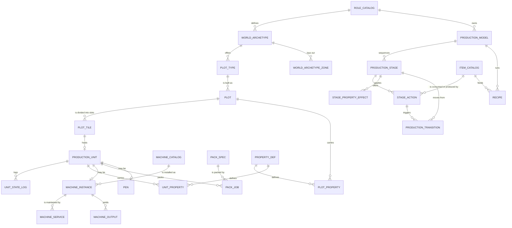
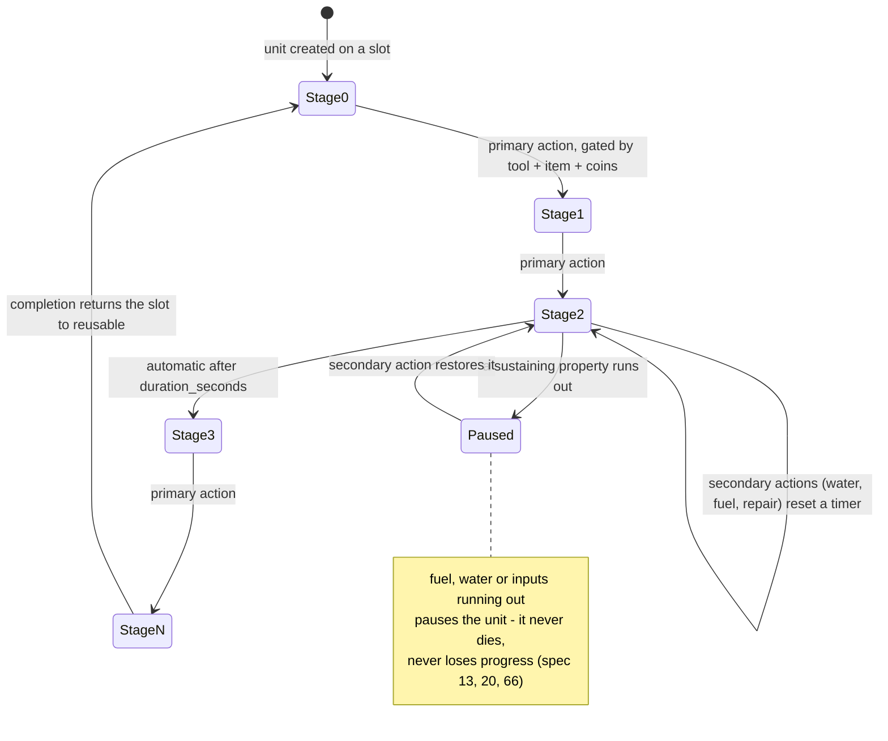
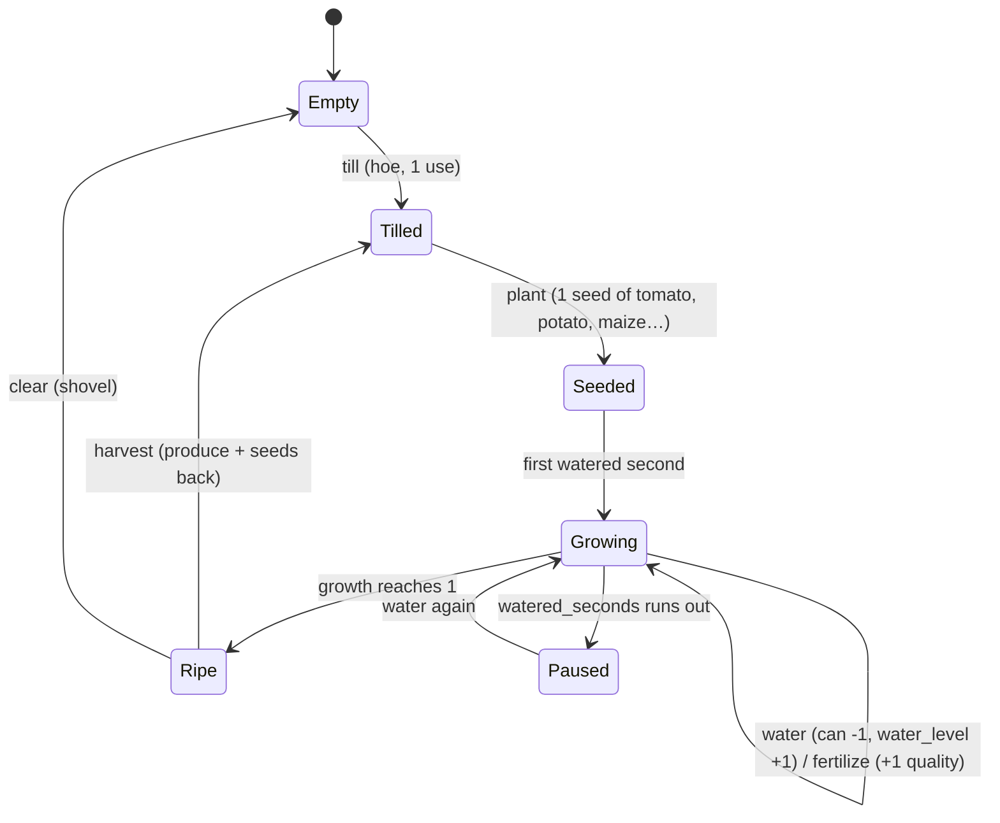
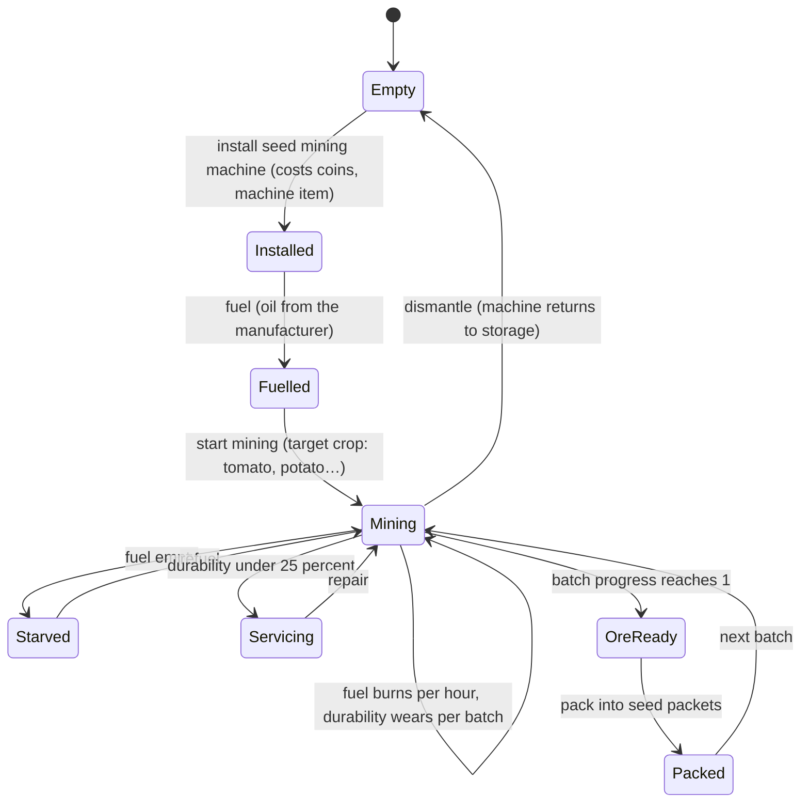
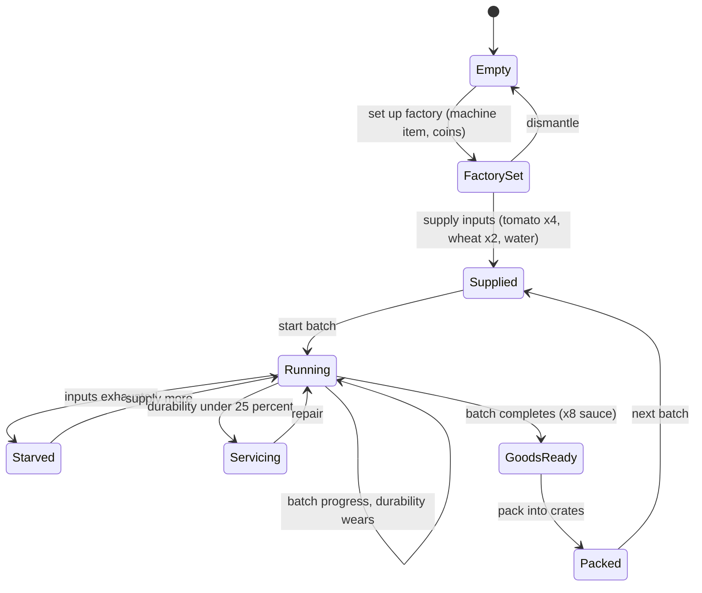
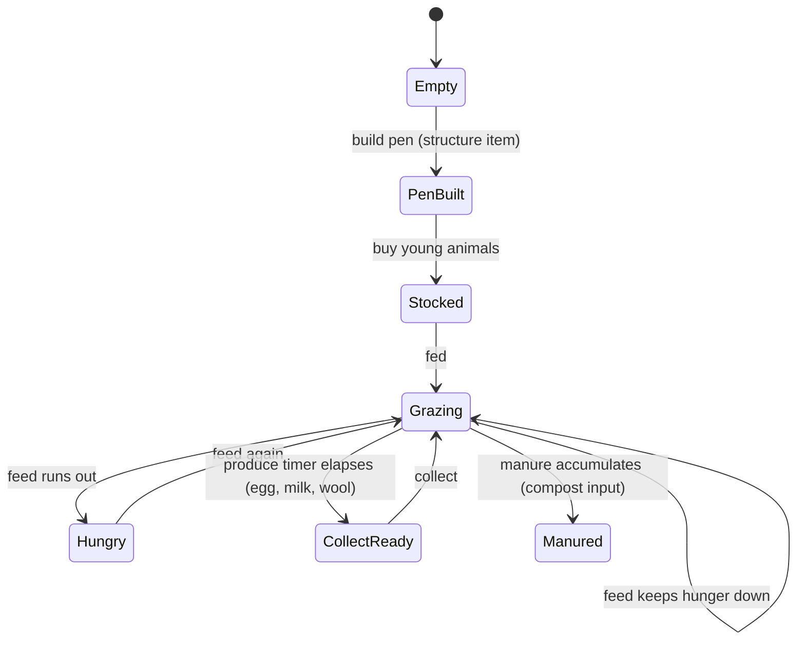

# Farmverse production model — role-generic plots, units, states and properties

**Related:** [`data-model.md`](data-model.md) · [`backend-architecture.md`](backend-architecture.md)

This replaces the flat `plot_tile` design in `data-model.md`. That version baked
the farmer's lifecycle (`empty → tilled → seeded → growing → ripe`) into an enum,
which cannot express what the other worlds do:

| World | What a plot does |
|---|---|
| Farmer | till → seed (tomato, potato…) → grow (water, fertilize) → ripe → harvest |
| Seed miner | install a **seed mining machine** (for tomato, potato…) → fuel → mine → pack |
| Food manufacturer | set up a **factory** (for tomato, potato…) → supply → run → pack |
| Animal rearer | build a pen → stock animals → feed → collect |

So the lifecycle is **data**: a role owns a *production model*, a model owns an
ordered set of *stages*, a stage owns the *actions* available in it, and every
plot and unit carries *typed properties* defined by the same catalogs. Adding a
fifth role becomes rows, not code.

## The four-part abstraction

```
plot_type ──< plot ──< plot_tile (a SLOT: soil | machine_pad | factory_pad | pasture)
                             │
                             └──1 production_unit (what occupies the slot)
                                        │
                                        ├── current_stage_id ──> production_stage ──< stage_action
                                        ├── model_id ──────────> production_model ──< production_stage
                                        └── unit_property ─────> property_def
plot_property ─────────────────────────────> property_def
```

1. **The slot** (`plot_tile`) knows only where it is and what kind of thing can
   sit in it. It has no lifecycle.
2. **The unit** (`production_unit`) is the thing that has a lifecycle: a planted
   field, a mining machine, a factory line, a pen. It points at one model.
3. **The model** (`production_model` → `production_stage` → `stage_action`)
   defines the stages and, per stage, exactly which actions are offered — which
   is what renders the tile action menu (screen 11) for *any* role, from data.
4. **Properties** are typed, bounded and renderable (`property_def`), attached to
   plots and units, so screens 13, 16, 60 and 74 can build their stat panels
   generically instead of hard-coding "growth, water, fertilized".

## 1. Relationships



## 2. The generic state machine

Every role is an instance of this. `stage_action` rows are the edges; the
current stage is `production_unit.current_stage_id`.



## 3. The four concrete lifecycles

### Farmer — `field_crop` on a `soil` slot



### Seed miner — `seed_mining` on a `machine_pad` slot



### Food manufacturer — `food_factory` on a `factory_pad` slot



### Animal rearer — `animal_rearing` on a `pasture` slot



## 4. The same slot in three worlds

This is the table the design exists to make possible — one slot, three
lifecycles, no schema change between them.

| | Farmer | Seed miner | Food manufacturer |
|---|---|---|---|
| `role_catalog.key` | `farmer` | `seed_miner` | `food_manufacturer` |
| `world_archetype` | farmer world | seed miner world | manufacturer world |
| `plot_type.key` | `field` | `mine` | `workshop` |
| `plot_tile.slot_kind` | `soil` | `machine_pad` | `factory_pad` |
| `production_model.key` | `field_crop` | `seed_mining` | `food_factory` |
| stages | empty → tilled → seeded → growing → ripe | empty → installed → fuelled → mining → ore_ready → packed | empty → factory_set → supplied → running → goods_ready → packed |
| primary actions | till, plant, harvest | install, fuel, start, pack | setup, supply, start, pack |
| sustaining actions | water, fertilize | fuel, repair | supply, repair |
| plot properties | fertility, water_access, road_access | ore_richness, seam_depth, power_supply, road_access | pad_count, power_supply, water_access, road_access |
| unit properties | growth, water_level, watered_remaining, fertilized | fuel, ore_grade, batch_progress, durability_pct | batch_progress, inputs_loaded, durability_pct, goods_qty |
| maintenance | tool durability | fuel burn + machine service | machine service |
| output | produce (tomato, potato…) | raw seed material → **seed packets** | processed food → **packed crates** |
| consumes | seeds, water, fertilizer | **fuel (oil pressed by the manufacturer)**, machine parts | crops and raw goods, water, fuel |
| fails into | `Paused` (thirst) | `Starved` (fuel), `Servicing` | `Starved` (inputs), `Servicing` |

The economy this creates is worth noting: the farmer grows oil seeds → the
manufacturer presses them into oil → the miner burns that oil → the miner's seed
packets go back to the farmer. Three roles, one loop, and no role can be played
in isolation.

## 5. Tables

### Roles and worlds

| Table | Fields |
|---|---|
| `role_catalog` | `id` PK, `key` (farmer/seed_miner/food_manufacturer/animal_rearer), `name`, `description`, `unlock_state`, `icon`, `starter_json` |
| `world_archetype` | `id` PK, `role_id` FK, `key`, `name`, `landmark_key`, `ambient_key`, `idle_sound_key`, `tint_token` |
| `world_archetype_zone` | `id` PK, `archetype_id` FK, `zone` (landmark/left/right/foreground/water/homestead/selling_point), `content_key`, `size_scale` — the spec 7.2 layout table as data |
| `plot_type` | `id` PK, `archetype_id` FK, `key`, `name`, `ground_variant`, `landmark_key`, `color_token`, `tile_cap`, `slot_kind`, `default_model_id` FK |

### Production models and their state machines

| Table | Fields |
|---|---|
| `production_model` | `id` PK, `role_id` FK, `key`, `name`, `unit_kind` (tile/machine/pen/factory_line), `slot_kind_required`, `icon`, `is_active` |
| `production_stage` | `id` PK, `model_id` FK, `order_index`, `key`, `name`, `is_terminal`, `is_productive`, `is_pause_state`, `default_duration_seconds`, `icon`, `badge_key`, UNIQUE(`model_id`,`key`) |
| `stage_action` | `id` PK, `stage_id` FK, `key`, `label`, `icon`, `requires_tool_key`, `requires_item_id` FK, `consumes_json`, `produces_json`, `duration_seconds`, `coins_cost`, `needs_fuel`, `is_primary`, `order_index` |
| `production_transition` | `id` PK, `model_id` FK, `from_stage_id` FK, `to_stage_id` FK, `action_id` FK, `is_automatic`, `duration_seconds`, `condition_json` |
| `stage_property_effect` | `id` PK, `stage_id` FK, `property_def_id` FK, `delta_num`, `set_text`, `set_bool`, `per_second` |

`stage_action` is what renders the action menu (screen 11) for every role. A
farmer's `growing` stage offers `water` and `fertilize`; a miner's `mining` stage
offers `fuel`, `repair` and `pack`. Same table, same renderer, no role branching
in the UI.

### Properties

| Table | Fields |
|---|---|
| `property_def` | `id` PK, `key`, `name`, `applies_to` (plot/unit), `value_type` (int/float/bool/enum/json), `min_value`, `max_value`, `unit_label`, `enum_values_json`, `icon`, `display_format`, `sort_index` |
| `plot_property` | `id` PK, `plot_id` FK, `property_def_id` FK, `num_value`, `text_value`, `bool_value`, `json_value`, `updated_at`, UNIQUE(`plot_id`,`property_def_id`) |
| `unit_property` | `id` PK, `unit_id` FK, `property_def_id` FK, `num_value`, `text_value`, `bool_value`, `json_value`, `updated_at`, UNIQUE(`unit_id`,`property_def_id`) |
| `property_effect_log` | `id` PK, `owner_kind` (plot/unit), `owner_id`, `property_def_id` FK, `delta`, `reason`, `at` |

Typed and bounded, so the UI renders a bar for a `1..5` rating, a drop row for
`water_level 0..3`, and a chip for an enum — from `display_format` alone.

### Slots, units and their history

| Table | Fields |
|---|---|
| `plot_tile` | `id` PK, `plot_id` FK, `x`, `y`, `slot_kind` (soil/machine_pad/factory_pad/pasture/water/storage), `terrain_key`, `is_locked`, `farmhouse_level_required`, `unit_id` FK NULL, UNIQUE(`plot_id`,`x`,`y`) |
| `production_unit` | `id` PK, `plot_id` FK, `tile_id` FK UNIQUE, `model_id` FK, `current_stage_id` FK, `crop_id` FK NULL, `machine_id` FK NULL, `level`, `quality`, `started_at`, `finish_at`, `paused`, `pause_reason` (thirst/fuel/inputs/service), `held_qty`, `output_item_id` FK, `output_qty`, `installed_at`, `created_at`, `updated_at` |
| `unit_state_log` | `id` PK, `unit_id` FK, `from_stage_id` FK, `to_stage_id` FK, `action_key`, `request_id` UNIQUE, `actor_player_id` FK, `at`, `note` |

`unit_state_log.request_id` is the same idempotency key as `request_dedupe`, so a
retried "start mining" cannot start two batches.

### Machines, recipes and packing

| Table | Fields |
|---|---|
| `machine_catalog` | `id` PK, `key`, `name`, `model_id` FK, `machine_class` (miner/processor/packer), `slot_kind_required`, `install_seconds`, `fuel_item_id` FK, `fuel_per_hour`, `service_every_batches`, `repair_cost`, `max_level` |
| `machine_instance` | `id` PK, `unit_id` FK, `machine_id` FK, `level`, `status` (idle/running/starved/broken/servicing), `durability_pct`, `fuel_units`, `batches_run`, `last_service_at`, `target_crop_id` FK (the crop being mined or made) |
| `machine_service` | `id` PK, `machine_instance_id` FK, `kind` (install/fuel/repair/service/upgrade/dismantle), `item_id` FK, `qty`, `coins_cost`, `from_pct`, `to_pct`, `at`, `request_id` UNIQUE |
| `machine_output` | `id` PK, `machine_instance_id` FK, `item_id` FK, `qty`, `produced_at`, `collected_at`, `packed_qty` |
| `recipe` | `id` PK, `model_id` FK, `machine_class`, `key`, `name`, `batch_seconds`, `inputs_json` (`[{"item":"tomato","qty":4}]`), `output_item_id` FK, `output_qty`, `unlock_level`, `target_crop_id` FK NULL |
| `pack_spec` | `id` PK, `model_id` FK, `input_item_id` FK, `pack_item_id` FK, `units_per_pack`, `pack_seconds`, `packer_required` |
| `pack_job` | `id` PK, `unit_id` FK, `pack_spec_id` FK, `qty_packs`, `started_at`, `finish_at`, `status` (queued/running/done), `request_id` UNIQUE |

### Pens (the rearer's unit)

| Table | Fields |
|---|---|
| `pen` | `id` PK, `unit_id` FK UNIQUE, `plot_id` FK, `animal_kind`, `capacity`, `level` |
| `pen_animal` | `id` PK, `pen_id` FK, `animal_catalog_id` FK, `name`, `hunger` 0-100, `happiness` 0-100, `fed_until`, `state`, `acquired_at` |
| `animal_catalog` | `id` PK, `key`, `kind`, `model_id` FK, `feed_per_day`, `produce_item_id` FK, `produce_seconds`, `young_variant_item_id`, `manure_per_day` |

## 6. How this drives the screens

| Screen | What the model gives it |
|---|---|
| 6 Role selection | `role_catalog` + `world_archetype` — the cards, and which roles are `coming_soon` |
| 10 Home | `plot_tile` + `production_unit` + `unit_property` — the field renders slots and their stage art generically |
| 11 Tile action menu | `stage_action` for the unit's current stage, filtered by tool, item and coins — **the same renderer for every role** |
| 13 Crop progress | `unit_property` (`growth`, `water_level`) + `production_stage.default_duration_seconds` for the time left |
| 14 Harvest result | `stage_action.produces_json` of the action just run, plus `crop_catalog.seed_return` |
| 16 Land expansion | `plot_property` — fertility, water, roads as typed 1–5 ratings |
| 21 Animal pen | model `animal_rearing`, a `pen` unit, `pen_animal` state |
| 22 Feed and care | `animal_catalog.feed_per_day` + `feed_catalog` |
| 23 Processing station | model `food_factory`, a `machine_instance`, `recipe.inputs_json`, and a queue of `pack_job` rows |
| 59–71 Facilities | unchanged, but which facilities exist comes from `role_catalog` + `facility_catalog.role_required` |
| 74 Plot detail | `plot_property` for the stat tiles, `production_unit` for the facility list |
| 78 Plot setup | `plot_type` rows for the archetype, and `slot_kind` decides what the tiles become |
| 72–81 Empire | `plot_type.color_token` and `landmark_key` per archetype |

## 7. What changed from the first draft

| Was | Now | Why |
|---|---|---|
| `plot_tile.state` enum (`empty/tilled/seeded/growing/ripe`) | `plot_tile.slot_kind` + `production_unit.current_stage_id` | the stage list differs per role, so it must be data |
| `plot_tile.crop_id`, `growth`, `watered_*`, `fertilized` | `unit_property` rows | a miner has `fuel` and `durability`, not `water_level`; a factory has `inputs_loaded` |
| `crop_catalog` as the only production catalog | `production_model` → `production_stage` → `stage_action`, with `crop_catalog` as the *farmer's* parameter set | one mechanism, four roles |
| `machine_catalog` separate from the tile lifecycle | `machine_instance` attached to a `production_unit` | the machine *is* the unit in a mining or factory plot |
| hard-coded quality/durability columns | `property_def` + `unit_property` | the same value renders as a bar, a chip or a row depending on `display_format` |

`crop_catalog` survives, but its role narrows: it is the parameter set the
farmer's `field_crop` model reads (grow time, yield, water need), and
`machine_instance.target_crop_id` points at it for the miner and the
manufacturer, so all three roles speak the same crop vocabulary.
