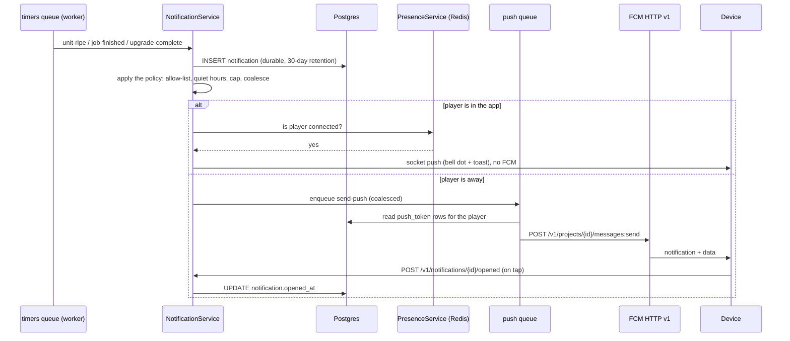
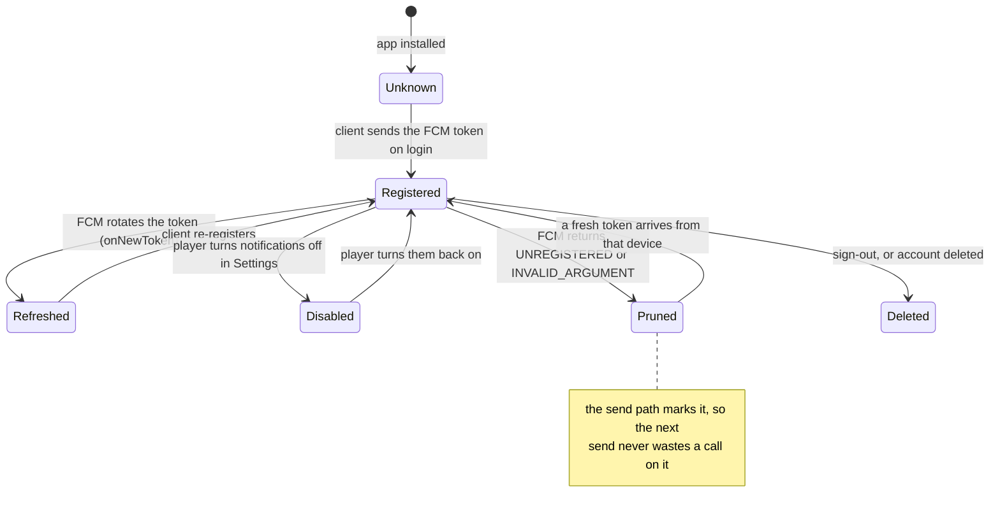
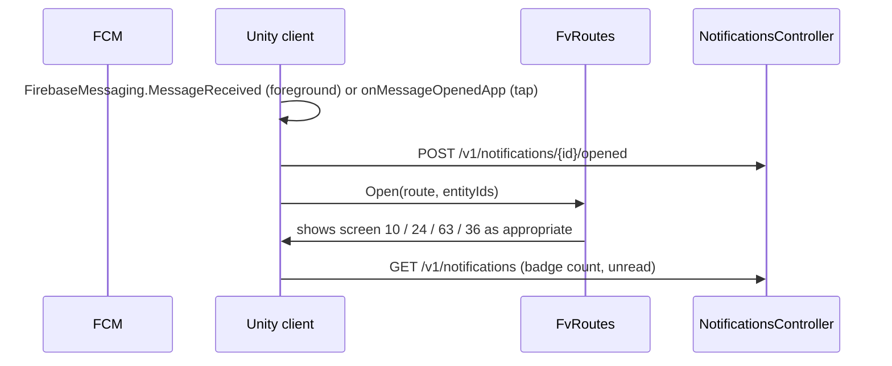

# Farmverse push notifications — Firebase Cloud Messaging

> **Superseded in part.** This document describes the NestJS + Prisma backend.
> The backend is now Firebase — see `firebase-backend.md` for what replaced what,
> where each golden rule is enforced, and the three design consequences. The
> reasoning below still holds; the mechanism does not.

**Related:** [`backend-architecture.md`](backend-architecture.md) · [`realtime.md`](realtime.md) · [`admin-and-config.md`](admin-and-config.md)

How push fits the backend in `backend-architecture.md`. FCM is the transport;
the interesting part is **which events are allowed to interrupt a player**, and
that policy comes straight from the specification's tone rules (6.1, 8.4) and the
notification centre (50).

## 1. Policy before plumbing

The spec constrains push harder than any technical decision here:

| Rule | Source | Consequence |
|---|---|---|
| "No fake urgency, no countdown-pressure offers" | 6.1 | no "your bonus expires in 5 minutes" pushes, ever |
| "Alerts without nagging. A plot's attention dot and the dashboard replace repeated pop-ups" | 8.4 | one coalesced push, not one per event |
| "Ads: only the rewarded format, only by choice, never interrupting" | 6.1 | **no ad pushes at all** |
| "Push notifications (opt-in in Settings) reuse the same message strings" | 50 | one message catalogue, shared with the in-app inbox |
| "The game continues while the player is away" | 10, 26 | pushes report progress, they never demand action |
| "Keep the list to the last 30 days" | 50 | retention, and the same window for push analytics |

So the allow-list is short and every entry is *the player's own farm making
progress*:

| Event | Pushes? | Coalesced with | Quiet hours | Cap/day |
|---|---|---|---|---|
| Crops ripe | yes | other plots | yes | counts toward 3 |
| Batch ready (machine) | yes | other machines | yes | counts toward 3 |
| Upgrade complete | yes | construction + plot setup | yes | counts toward 3 |
| Your listing sold | yes | other sales | no (it is income) | counts toward 3 |
| Animals need feed | yes | other pens | yes | counts toward 3 |
| Well refilled / storage full | **no** | — | — | in-app dot only |
| Daily bonus available | yes, max 1/day | — | yes | 1 |
| Ad reward ready | **no** | — | — | in-app only |
| Maintenance / update required | yes | — | no | 1 per event |
| Promotions, offers, "come back!" | **no** | — | — | never |

**Three pushes per player per day**, hard cap, enforced server-side before the
send. If a fourth event would push, it waits and joins the next day's window, or
is dropped — the in-app centre still has it, which is the point.

## 2. Architecture: the row is the truth, the push is a courtesy



Ordering matters: **the row is written first**. If FCM is down, misconfigured or
the token is stale, the player still sees it in the bell — the push is
best-effort by construction, never the record.

## 3. Token lifecycle



Rules:

- **Many devices per account, one token per device.** `push_token` is keyed on
  `device_id`; an account may have several. A send fans out to all *enabled*
  tokens, and the `notification_id` in the payload lets the second device
  dedupe.
- **Token refresh is client-driven.** The Unity SDK's `TokenReceived` callback
  posts the new token; the server upserts by `device_id` and clears `enabled`.
- **Pruning is reactive.** FCM's per-message error codes are the signal:
  `UNREGISTERED` → delete the row; `INVALID_ARGUMENT` → disable and log;
  `SENDER_ID_MISMATCH` → config alarm (wrong Firebase project).
- **Sign-out deletes the token** for that device, so a shared phone does not leak
  the previous player's farm.

## 4. Payload design

Two shapes, deliberately:

**User-visible game event — `notification` + `data`.** iOS will not reliably show
a silent push, so anything the player should *see* carries an APNs alert block.
FCM builds both platforms from one message.

```json
{
  "message": {
    "token": "<device token>",
    "notification": {
      "title": "Your farm is ready",
      "body": "3 crops are ready and a batch of flour finished."
    },
    "data": {
      "notificationId": "918273",
      "kind": "coalesced_farm",
      "route": "home",
      "entityIds": "812,815,901",
      "serverTime": "1767225600",
      "collapseKey": "farm-ready"
    },
    "android": {
      "priority": "normal",
      "collapse_key": "farm-ready",
      "notification": { "channel_id": "farm_progress", "sound": "default" }
    },
    "apns": {
      "headers": { "apns-priority": "5" },
      "payload": { "aps": { "sound": "default", "thread-id": "farm-ready" } }
    }
  }
}
```

**Silent sync — `data` only.** Used to nudge a client that is backgrounded to
settle early (so the bell is fresh when it opens), never to show anything:

```json
{ "message": { "token": "...", "data": { "kind": "settle", "route": "home" },
  "android": { "priority": "normal" },
  "apns": { "headers": { "apns-priority": "5", "apns-push-type": "background" },
            "payload": { "aps": { "content-available": 1 } } } } }
```

Four payload rules:

1. **`collapseKey` per concern** (`farm-ready`, `sale`, `upgrade`) so a newer
   push replaces a stale one in the tray instead of stacking.
2. **`route` is a real route id** from `Docs/navigation.md` — the same ids
   `FvRoutes.Open` already resolves, so a tap lands in the right screen and the
   rule "nothing is reachable only from a notification" stays true.
3. **`notificationId`** is the durable row's id, so the client can mark it read
   and dedupe a repeat delivery.
4. **No secrets, no prices, no balances in the payload.** A push is displayed on
   a lock screen; "Your Maize sold for 132" is fine (the spec's own copy), a
   coin balance is not.

## 5. Deep link → screen



Foreground handling is explicit: **a push that arrives while the app is open is
not displayed as a system notification.** It becomes a toast plus a bell dot, so
a player mid-harvest is never interrupted by a banner about their own farm.

## 6. Client integration (Unity)

| Step | Detail |
|---|---|
| SDK | `FirebaseMessaging` from the Firebase Unity SDK; `google-services.json` (Android) and `GoogleService-Info.plist` (iOS) as project assets — **never** a service-account key in the client |
| Permission | Android 13+ `POST_NOTIFICATIONS` runtime request; iOS `RequestPermission(AuthorizationOptions)`; ask **after** the first harvest, not at launch, so the ask has context |
| Token | `TokenReceived` → `POST /v1/devices/push-token`; also read `FirebaseMessaging.TokenAsync` on login in case it rotated while the app was closed |
| Channels | Android channel `farm_progress` (default importance) and `announcements`; a low-importance channel is what stops a farm update from looking like an alarm |
| Foreground | `MessageReceived` → toast + bell dot, no system notification |
| Tap | `MessageOpenedApp` → resolve `route`; `GetInitialMessage()` handles a cold start from a tap |
| Settings | the Notifications toggle in Settings (52) writes `device.notifications_enabled`; when the OS permission is denied, the toggle opens system settings instead of pretending to work |
| Localisation | the server sends the localised string using `device.locale`, so the OS-rendered title and body match the in-app inbox |

## 7. Data model additions

`push_token` already exists in `data-model.md`; push adds four tables.

| Table | Fields |
|---|---|
| `push_token` | `device_id` PK, `player_id` FK, `token`, `platform` (android/ios), `enabled`, `last_ok_at`, `last_error`, `updated_at` |
| `notification_pref` | `player_id` PK, `enabled`, `quiet_hours_start`, `quiet_hours_end`, `timezone`, `daily_cap`, `sent_today`, `day`, `updated_at` |
| `push_delivery` | `id` PK, `notification_id` FK, `token_id` FK, `message_id`, `state` (queued/sent/delivered/failed/pruned), `error_code`, `attempts`, `sent_at`, `opened_at` |
| `push_cohort` | `day` PK, `region`, `sent`, `opened`, `capped`, `suppressed_foreground` — the "are we nagging?" dashboard |

`push_delivery` is what makes the policy measurable: it records how many sends
were *suppressed* because the player was in the app, how many were capped, and
which events actually get opened.

## 8. Queues and jobs

| Queue | Job | Trigger | Retry |
|---|---|---|---|
| `push` | `send-push` | a notification row is created and the player is away | 5, backoff 5/15/60 s, then dead-letter |
| `push` | `coalesce-push` | repeatable 60 s | 3 — groups same-day, same-concern events into one message |
| `push` | `prune-tokens` | repeatable daily | 2 — deletes `Pruned` tokens older than 30 days |
| `push` | `reset-caps` | repeatable daily per region | 3 — clears `sent_today` at local midnight |
| `push` | `announce` | admin action | 3 — sends to the `announcements` topic (opt-in only) |

`send-push` is rate-limited per queue so a mass upgrade-complete event (a
patch day, say) cannot storm FCM, and every job is idempotent on
`(notification_id, token_id)` so a retry cannot double-notify.

## 9. Metrics and alerts

| Metric | Why |
|---|---|
| `push_sent_total` by kind | volume per event type |
| `push_opened_total` by kind | **the nagging test** — an event with a low open rate and a high cap contribution is a candidate to drop |
| `push_suppressed_foreground_total` | proves the "never interrupt" rule is working |
| `push_capped_total` | how often the 3/day cap binds |
| `push_failed_total` by error code | config problems (`SENDER_ID_MISMATCH`) and token rot |
| `push_token_pruned_total` | expected churn baseline |
| `fcm_latency_seconds` p95 | delivery health |

Alert on `SENDER_ID_MISMATCH` (immediate), on a pruned-token spike (a client
regression rotating tokens), and on `push_failed_total` above 2 percent.

## 10. Testing

| Layer | Approach |
|---|---|
| Sender | inject the FCM client behind `PushSender`; integration tests assert the exact payload shape, including `collapse_key` and APNs headers |
| Policy | table-driven tests over the allow-list: quiet hours, the 3/day cap, coalescing, foreground suppression |
| Token lifecycle | simulated FCM error codes drive `Registered → Pruned → Deleted` |
| Deep links | every `route` a push can carry is asserted to exist in the route table — the same check `nav_status.py` runs for screens |
| Device | a hidden debug screen in the app to trigger each push kind, so a tester sees the real OS notification and the tap path |
| No-FCM path | the `notify` flow must pass with the sender stubbed to fail — the bell still updates |

## 11. Rollout

| Phase | Deliverable |
|---|---|
| 1 | Firebase projects (dev/prod), Android + iOS apps registered, APNs auth key uploaded, `google-services.json` and `GoogleService-Info.plist` in the Unity project |
| 2 | `push_token` registration + the Settings toggle wired to `device.notifications_enabled` |
| 3 | The notification row + in-app centre (screen 50) — push disabled by feature flag |
| 4 | `send-push` for **sales only** (highest signal, lowest nag risk), behind a flag |
| 5 | Timer events with coalescing, quiet hours and the daily cap |
| 6 | `push_cohort` dashboard and the open-rate review; drop any event that fails it |

Shipping push in that order means the first thing a player ever receives is
"your maize sold", which is welcome — rather than "come back and play".

## 12. What I cannot do for you here

- **Create the Firebase project, register the apps, and upload the APNs auth
  key** — that needs your Firebase console and your Apple developer account.
- **Add the Unity SDK and the two config files** — they are binary/asset drops,
  and the project currently has no Firebase packages installed.
- **Apple specifics**: an APNs `.p8` key with the Key ID and Team ID, and the
  `aps-environment` entitlement in the Xcode project, which Unity generates only
  at build time.

What I *can* do next: the `PushSender` interface plus an FCM HTTP v1
implementation with the payload builders and the policy engine, the four tables
as Prisma models, and the policy tests — all runnable against a stubbed sender
without a Firebase project existing yet.
