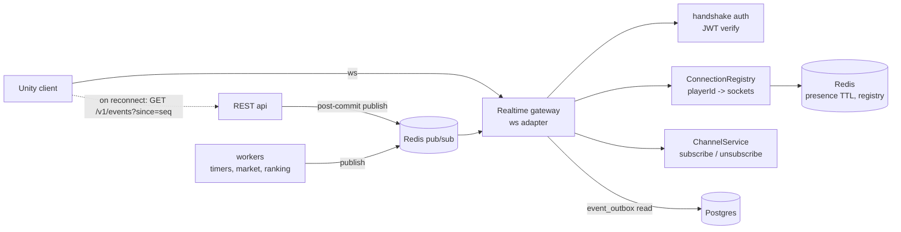
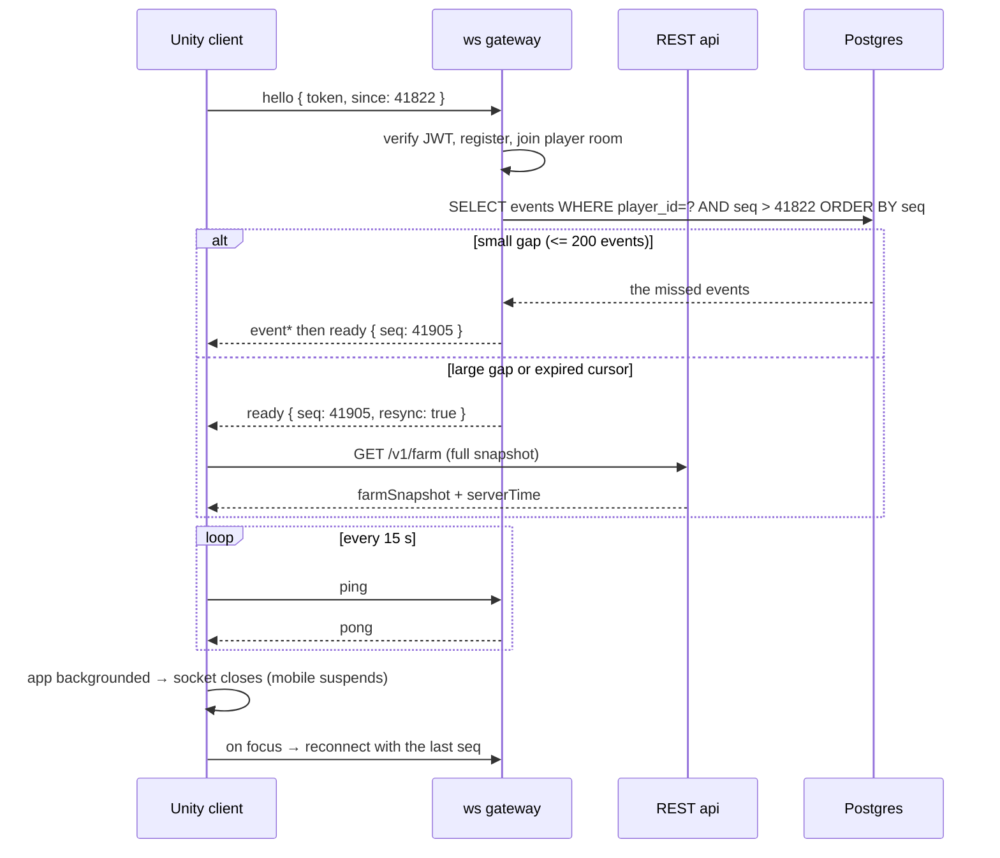

# Farmverse realtime — WebSockets

> **Superseded in part.** The backend is now `backend/server` (Fastify, Postgres, Redis,
> BullMQ) running the rules in `backend/game`; see `architecture/13-near-web3-plan.md`.
> The reasoning below still holds; the mechanism does not.

**Related:** 

What is live, what is deliberately not, and how the socket stays an optimisation
rather than a dependency. Reads with `architecture/13-near-web3-plan.md` (services, queues,
Redis); the same events also go out as push notifications when the
player is away).

---

## 1. Scope: what is actually realtime

Derived from the specification, not from ambition:

| Screen / rule | Realtime need | Transport |
|---|---|---|
| 50 Notifications | sale, batch ready, rank change, upgrade complete | socket when open, FCM when away |
| 33 Marketplace | **"prices refresh live on screen; a listing that sells while open shows 'Sold' and greys out"** | socket (explicit requirement) |
| 34 Filter | **"Online sellers only"** | presence |
| 44 Leaderboard | "ranks update at least every few minutes" | snapshot + a rank-change event |
| 35/40/45 | seller online dot, rank on a player card | presence + snapshot |
| 36 Buy confirm | "on a network drop, the dialog shows 'Checking your order' and polls" | REST poll, with an optional `order.settled` socket event |
| 52/57 | maintenance scheduled, version gate | socket announcement |
| 43 Promote | a promotion taking effect | snapshot on refetch |

### What is deliberately **not** realtime

| Thing | Why not |
|---|---|
| Farm growth, timers, well refill, construction | the client derives these from stored timestamps + `serverTime`; streaming them would be thousands of messages per player per minute for zero new information |
| Inventory, storage, wallet | patched from the mutation's own response envelope |
| Visit world (41) | the spec is explicit: "content loads from a server snapshot, so owners are never interrupted" |
| Leaderboard scores | a snapshot every couple of minutes; a per-second leaderboard is a trap |
| Trades | REST with a locked transaction; the socket only reports the *outcome* |
| Chat | does not exist — the spec mentions "chat-free mentions" (45) |
| Ads | rewarded only, and never interrupt (6.1) |

The game has **no high-frequency channel**: no movement, no chat, no live farm
state. That is what makes a modest socket design sufficient — and worth stating,
because it is the difference between 200 messages/second and 200,000.

---

## 2. The principle: events are durable and sequenced; the socket is a courtesy

Same shape as push, for the same reason:

```
mutation commits → INSERT event_outbox(player_id, seq, kind, payload)   [durable]
                        │
                        ├── player connected?  → publish to room player:{id}   [live]
                        └── player away?       → enqueue FCM push              [best-effort]
```

Every event has a **row** and a **monotonic per-player `seq`**. Consequences:

- A dropped socket loses *latency*, never information. The client reconnects and
  asks `GET /v1/events?since={seq}`.
- Delivery is at-most-once and out of order is impossible to miss: the client
  detects a `seq` gap and catches up from the durable log.
- If Redis pub/sub dies, sockets go quiet and refetch-on-focus still works.

This is why the socket never carries game state — only *invalidation*.

---

## 3. Transport: raw `ws`, not socket.io

| | `@nestjs/platform-ws` + our envelope | socket.io + Redis adapter |
|---|---|---|
| Unity client | `System.Net.WebSockets` — no dependency | needs a socket.io client (community, AOT/IL2CPP friction) |
| Rooms / reconnect / ack | we write ~150 lines | built in |
| Payload overhead | bare JSON | socket.io framing |
| IL2CPP/AOT risk | none | real |

**Recommendation: raw `ws`.** The Unity client is the constraint — socket.io's
protocol is not plain WebSocket, and the Unity ecosystem's socket.io clients are
the weakest link in an otherwise clean stack. We need server→client push, a
subscribe call and an ack; that is a small protocol, and owning it removes a
dependency from the client.

If the client ever hosts a socket.io client comfortably, switching is a
server-side swap behind the same `RealtimeService` interface.

### The protocol

Client → server (the only three messages):

```json
{ "t": "hello",     "token": "<jwt>", "since": 41822 }
{ "t": "sub",       "channels": ["market:Crops", "item:12"] }
{ "t": "ack",       "seq": 41830 }
```

Server → client:

```json
{ "t": "ready",  "seq": 41822, "channels": ["player:4412"] }
{ "t": "event",  "seq": 41823, "kind": "listing.sold",
  "at": 1767225600, "data": { "listingId": 9012, "itemId": 12, "qty": 12, "price": 6 } }
{ "t": "pong",   "at": 1767225600 }
```

**No mutations over the socket.** Every write stays on REST, because that is
where the idempotency interceptor, the transaction boundary, the rate-limit guard
and the audit trail live. A socket mutation would bypass all four. This is a
rule, not a preference.

---

## 4. Architecture



- **Rooms** are Redis channels: `player:{id}`, `market:{category}`,
  `item:{itemId}`, `ranks:{scope}:{period}`, `presence`, `announcements`.
- **Fan-out** goes through Redis pub/sub, so any api pod can deliver an event
  published by any worker. No sticky sessions required for correctness.
- **Post-commit only.** Publishers are the same post-commit side effects already
  listed in the server's call registry, so a socket event can never announce
  something that rolled back.

---

## 5. Presence

Presence is a product feature here (the "online sellers only" filter, seller
dots), so it must be cheap and honest:

- `SET presence:{playerId} {connectionId} EX 45`, refreshed by a `ping` every
  15 s; expiry is the disconnect detector, so a killed process leaves no ghost.
- The `presence` room gets a debounced `presence.changed { playerId, online }`
  on the **first** connect and the **last** disconnect only — not per socket, and
  not per heartbeat.
- `player.last_active_at` in Postgres is updated at most once a minute, so
  presence does not hammer the primary.
- Guests are present but never shown as sellers until linked (spec 4).

---

## 6. Coalescing: the market ticker must not flood

A popular item can change dozens of times a second. Emitting per change would be
the single biggest load source in the game, so the market channels are
**buffered and merged**:

```
listing_event → Redis hash buffer (item:{id}) → flush every 500 ms
   → one event: { kind: "market.tick", itemId: 12,
                  lowest: 9, sold: 3, delisted: 1, promoted: 1 }
```

The client re-renders from the merged tick. A 200-changes/second item becomes two
messages per second, and the player cannot tell the difference. The `listing.sold`
event for a listing the player is *looking at* (screen 35) is sent immediately
and individually, because that one has to grey out instantly.

---

## 7. Reconnect and resume



Backoff: 1 s → 2 → 4 → 8 → 15 s with jitter, capped, and a token refresh before
each attempt so an expired JWT does not loop forever.

`event_outbox` retention is **7 days**; an older cursor forces a full snapshot,
which is the correct fallback and keeps the table bounded.

---

## 8. Security

- **Handshake auth**: JWT verified before the socket is accepted; a failure closes
  with a typed code the client can distinguish (expired vs banned vs maintenance).
- **Channel authorisation**: a player may join `player:{ownId}` and public market
  channels only. `presence` is read-only. `announcements` is read-only.
- **Connection limits**: max 2 sockets per player (phone + editor), max 8 per IP,
  with a Redis counter and a 60 s block on abuse.
- **Client → server budget**: 20 messages/minute per socket; anything above that
  closes the connection. Since the only client messages are hello/sub/ack, this
  is generous and makes the socket useless as a flood vector.
- **No PII in events.** Same rule as push payloads: ids, quantities and prices —
  never balances, emails or tokens.

---

## 9. Failure modes, and what the player sees

| Failure | Effect | Player experience |
|---|---|---|
| Redis pub/sub down | no live events | bell updates on next focus/resume; market refreshes on pull-to-refresh |
| A worker dies | no timers published | the settle sweep catches up within 5 s |
| Socket dropped (mobile suspend) | events missed | reconnect + `since` catch-up, or a snapshot if the gap is large |
| Gateway pod restart | all sockets on it drop | clients reconnect to another pod with backoff |
| `event_outbox` pruned past the cursor | cursor expired | a full snapshot resync |
| Backpressure on a hot item | coalesced ticks | nothing visible |

Every row is a *degradation*, never a *divergence* — which is the whole point of
sequencing the events.

---

## 10. Data model additions

| Table | Fields |
|---|---|
| `event_outbox` | `id` PK, `player_id` FK, `seq` bigint, `kind`, `payload_json`, `at`, `delivered_at`, UNIQUE(`player_id`,`seq`), `@@index([player_id, seq])`, partitioned monthly, 7-day retention |
| `player_seq` | `player_id` PK, `last_seq` bigint — the per-player counter (or a Postgres sequence per shard) |
| `realtime_session` | `id` PK, `player_id` FK, `connection_id`, `transport`, `started_at`, `ended_at`, `close_reason`, `resumed_from_seq` — observability and reconnect-rate analysis |

Presence stays in Redis only; `session.last_seen_at` already covers the durable
"last seen" the offline window needs.

---

## 11. Metrics

| Metric | Why |
|---|---|
| `ws_connected` (gauge, by platform) | capacity |
| `ws_events_emitted_total` by kind | load attribution |
| `ws_coalesce_ratio` (changes in : events out) | proves the market buffer is working |
| `ws_reconnects_total` and `ws_resume_gap_events` | client network quality |
| `ws_resync_total` | cursor expiries — a rising trend means the retention window is too short |
| `ws_backpressure_dropped_total` | should be ~0; a spike means a hot channel needs a longer flush |
| `ws_client_messages_total` | a spike means a client is misbehaving |
| `presence_flaps_total` | flapping presence looks like a bug to players |

Alert on `ws_resync_total` rising, on a reconnect rate above 5 percent per
minute, and on any `ws_client_messages_total` anomaly.

---

## 12. Testing

| Layer | Approach |
|---|---|
| Protocol | contract tests for `hello`/`sub`/`ack`/`event`, including malformed frames and unknown kinds |
| Resume | synthetic gap: kill a socket, mutate, reconnect with `since`, assert exactly the missed events and no duplicates |
| Cursor expiry | assert a stale cursor yields `resync: true` and that the snapshot matches a fresh `GET /v1/farm` |
| Coalescing | 200 changes in a second on one item → assert ≤ 3 events out and a correct merged payload |
| Presence | connect two sockets for one player, drop one → no `presence.changed`; drop both → exactly one offline event |
| Redis down | with pub/sub stopped, assert REST reads and refetch-on-focus still return correct state |
| Load | 10k concurrent sockets, 1k events/s, measure p95 latency and backpressure |
| Auth | expired JWT, banned player, maintenance mode, and a token for another player's room are all refused |

---

## 13. Unity client integration

| Concern | Note |
|---|---|
| Transport | `System.Net.WebSockets` (`ClientWebSocket`) with a JSON envelope; no third-party client |
| AOT | keep the message types plain and pre-registered; avoid reflection-based serialisation on IL2CPP |
| Lifecycle | connect on login/resume, close on `OnApplicationPause(true)`, reconnect with `since` on `OnApplicationPause(false)` |
| Editor | domain reload drops the socket; reconnect from `FarmverseApp.OnEnable` (already the shell's entry point) |
| Threading | receive on a background task, marshal events onto the main thread before touching UI |
| Foreground pushes | a `notification.new` event while open becomes a toast + bell dot, never a system notification — the same rule as push |
| Clock | every event carries `at`, and `ready` carries `serverTime`, so timers stay correct across a reconnect |

---

## 14. Rollout

| Phase | Deliverable |
|---|---|
| 1 | `event_outbox` + `player_seq` + `GET /v1/events?since=` and the envelope |
| 2 | ws gateway with handshake auth, `hello`/`sub`/`ack`, and `notification.new` only |
| 3 | Unity client: connect, reconnect, resume, toast + bell dot; push disabled for foreground players |
| 4 | Presence + `presence.changed`, and the "online sellers only" filter in 34 |
| 5 | Market channels with coalescing, `listing.sold` immediate for the viewed listing |
| 6 | Rank changes, maintenance/version announcements, `order.settled` |
| 7 | Load test, backpressure tuning, dashboards |

Phase 2–3 replace FCM for foreground players, which is the highest-value step:
it stops the game from pushing a notification about the screen the player is
already looking at.

---

## 15. What this does not decide

- **Whether a dedicated realtime service is worth splitting out.** Start inside
  `api`; split only if socket connections dominate the pod's memory. The
  `RealtimeService` interface makes that a deployment change.
- **Multi-region.** Redis pub/sub is single-region; a second region needs a
  cross-region bus or regional gateways with their own Redis. Deferred until
  there is a player base that needs it.
- **Voice or chat.** Not in the spec, and adding either would change this design
  substantially — chat needs ordering guarantees, moderation and history that the
  current event log does not provide.
