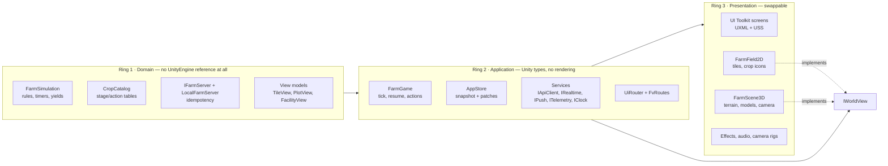
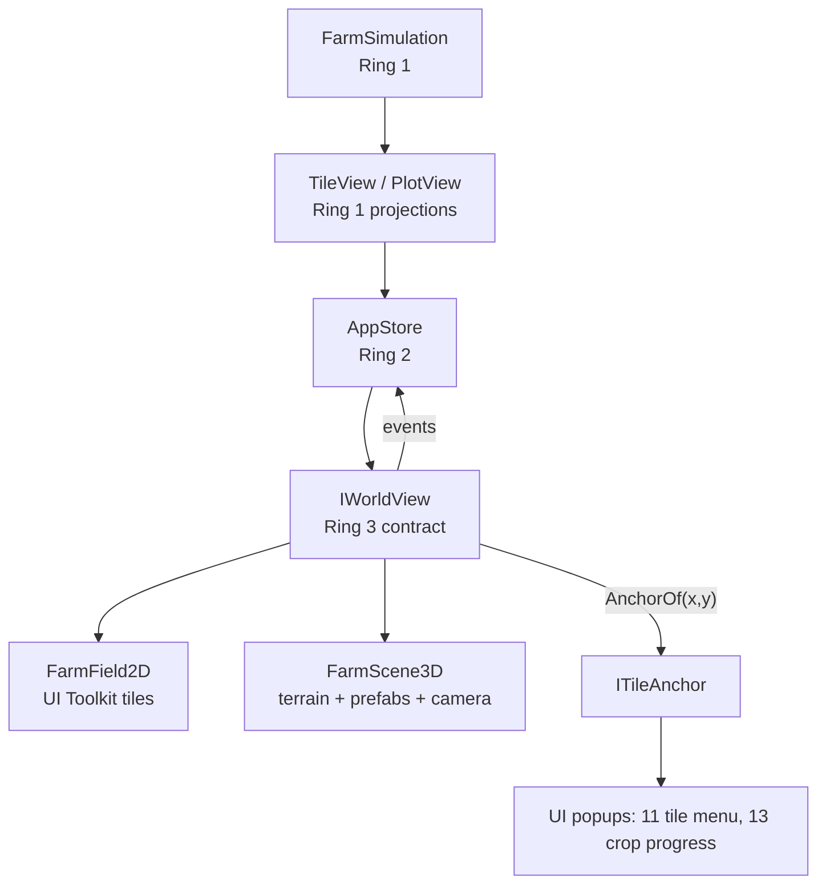
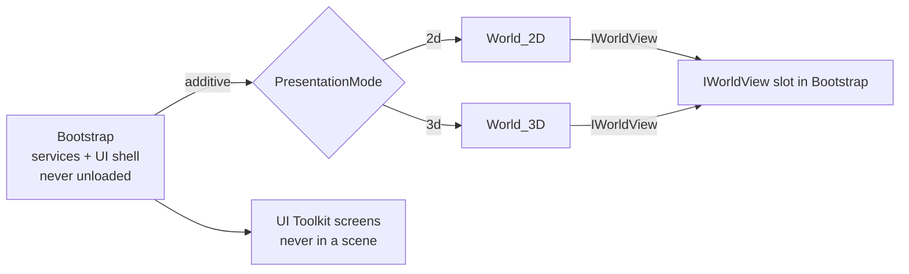
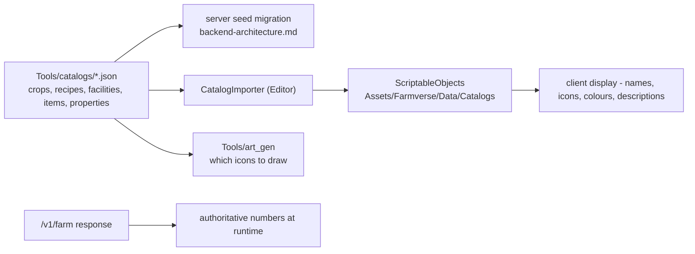
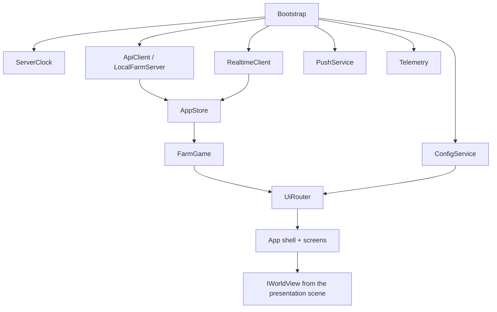

# Farmverse Unity project structure

**Related:** [`navigation.md`](navigation.md) · [`production-model.md`](production-model.md) · [`metrics-and-analytics.md`](metrics-and-analytics.md)

How the Unity project is organised so that **the 2D field can be replaced by 3D
scenes without touching the game logic, the UI, or the server contract**. This is
a plan for a project that will run for years and ship 81 screens, so the
structure is about seams and compile times, not about where a file feels nice.

---

## 1. The one principle: three rings, and only the middle one knows about Unity



**Ring 1 must not reference `UnityEngine`.** That is not a style preference: it is
what lets the entire economy be unit-tested in milliseconds, what already lets
`dotnet run --project Tools/game_test` verify 54 rules with no editor, and what
makes the rules shareable with the TypeScript backend. It is enforced by an
assembly definition, so a stray `using UnityEngine` fails the build.

**Ring 3 is the only ring the 3D upgrade touches.**

---

## 2. Assemblies (assembly definitions)

Today the project is one `Assembly-CSharp` and one `Assembly-CSharp-Editor`. At 81
screens that means every edit recompiles everything. Split it:

| Assembly | Contains | References | Unity API? |
|---|---|---|---|
| `Farmverse.Domain` | rules, catalogs, view models, `IFarmServer` | *nothing* | **no** |
| `Farmverse.Services` | `IApiClient`, `HttpApiClient`, `IRealtimeClient`, `IPushService`, `ITelemetry`, `IClock`, `IStorage` | Domain | yes |
| `Farmverse.Game` | `FarmGame`, `AppStore`, ticking, action dispatch | Domain, Services | yes |
| `Farmverse.UI` | `FvUi`, `UiRouter`, `FvScreen`, components, theme binding | Domain, Game | yes (UI Toolkit) |
| `Farmverse.UI.Spec` | `FvSpec`, `FvArchetype`, `FvRoutes`, all `FvSpecs*` | Domain, UI | yes (UI Toolkit) |
| `Farmverse.Presentation.Core` | `IWorldView`, `ITileAnchor`, shared presentation types | Domain | yes |
| `Farmverse.Presentation.Field2D` | the current 2D field | Domain, Game, Presentation.Core | yes |
| `Farmverse.Presentation.World3D` | the future 3D world | Domain, Game, Presentation.Core, URP | yes |
| `Farmverse.Audio` | music, sfx, haptics (spec 1.8) | Domain | yes |
| `Farmverse.Editor` | art importer, setup, capture, audits, catalog importer | all | editor only |
| `Farmverse.Tests.EditMode` | domain rules, config, catalog validation | Domain, Game | yes (test) |
| `Farmverse.Tests.PlayMode` | UI flows, navigation, accessibility audit | all | yes (test) |

**The acyclic rule:** `Domain → Services → Game → UI → Spec`, and presentation
assemblies sit beside `UI`, never inside it. `Presentation.*` may not reference
`UI.Spec`; the router asks the presentation for an anchor position, it does not
know what the presentation is.

---

## 3. Folder structure

```
Assets/
  Farmverse/
    Domain/                          # asmdef: Farmverse.Domain, no Unity
      Production/                    # FarmSimulation, TileState, WellState, ToolState
      Catalogs/                      # CropCatalog, MachineCatalog, FacilityCatalog
      Economy/                       # Wallet, StorageState, LedgerEntry, pricing
      Server/                        # IFarmServer, LocalFarmServer, ActionResult
      ViewModels/                    # TileView, PlotView, UnitView, FacilityView
      SelfTest/                      # FarmSelfTest (54 checks)
    Services/
      Api/                           # IApiClient, HttpApiClient, envelope, patches
      Realtime/                      # IRealtimeClient, WsRealtimeClient, event kinds
      Push/                          # IPushService, FcmPushService, permission flow
      Telemetry/                     # ITelemetry, analytics taxonomy, screen_view
      Platform/                      # IClock, IStorage, IConnectivity, IHaptics
    Game/
      FarmGame.cs                    # tick, resume, action dispatch
      AppStore.cs                    # snapshot + patch application
      ConfigService.cs               # client projection of /v1/config
      CompositionRoot.cs             # builds and injects everything (no singletons)
    UI/
      Components/                    # FvUi, FvTitle, FvDialogs, ChipRow, ...
      Router/                        # UiRouter, FvScreen, route table
      Theme/                         # tokens binding, text scale, RTL, reduce motion
      Accessibility/                 # FvA11y metadata + the runtime audit
      Styles/                        # tokens.uss, components.uss, screens.uss,
                                     # shell.uss, spec.uss, generated_art.uss
      FarmverseTheme.tss
    UI.Spec/                         # FvSpec, FvArchetype, FvRoutes, FvSpecs*
    Presentation/
      Core/                          # IWorldView, ITileAnchor, PresentationMode
      Field2D/                       # FarmField2D (today), tile sprites, anchors
      World3D/                       # FarmScene3D (later), prefabs, camera rig
      Effects/                       # shared FX contracts (harvest pop, coin fly)
    Audio/
      Music/  Sfx/  Ui/  Mixers/     # loops, one-shots, snapshots (spec 1.8)
    Art/                             # authored + generated art
      UI/                            # GENERATED by Tools/art_gen — do not hand-edit
        icons/  frames/  buttons/  components/  ornaments/  field/  avatars/  scene/
        manifest.json
      Characters/                    # 12 avatars, 3 role portraits, guide, shopkeeper
      Environment/                   # ground tiles, trees, river, rocks, clouds
      Props/                         # barn, shed, well, coop, shelter, fences
      Machinery/                     # mill, oven, oil press, compost bin (+5 levels)
      Crops/                         # 8 crops x 4 growth stages
      Animals/                       # chicken, cattle, sheep (rigs)
      Fx/                            # confetti, dust, sparkle, water pour
      Textures/                      # tileable materials, biome atlases
    Audio/                           # (above)
    Data/
      Catalogs/                      # ScriptableObjects generated from Tools/catalogs
      Config/                        # client config SO, default game_config mirror
      Localization/                  # message_string tables per locale
    Prefabs/
      UI/                            # shared UI prefabs if any move off UXML
      World/                         # 3D prop prefabs (later)
    Resources/                       # TEMPORARY: UXML + fonts (see §9 migration)
      UI/Screens/                    # Home.uxml, Shop.uxml, ... (moving to Addressables)
      Farmverse/Fonts/               # Lilita One, Nunito x3, OFL licences
    Scenes/
      Bootstrap.unity                # services + UIDocument + composition root
      Presentation_Field2D.unity     # additive: the 2D field
      Presentation_World3D.unity     # additive: the 3D world (later)
      Dev_Sandbox.unity              # art/prop inspection
    Settings/                        # URP assets (existing)
    Tests/
      EditMode/                      # domain, catalogs, config, view models
      PlayMode/                      # navigation, UI flows, a11y audit
Tools/                               # outside Assets — never shipped
  art_gen/                           # the Python generator + linters + capture
  catalogs/                          # JSON catalogues: the single source for
                                     # server seeds AND client ScriptableObjects
  game_test/                         # dotnet console harness for the domain
Docs/                                # this documentation set
```

---

## 4. The 3D seam — the part that decides whether this is a rewrite

The presentation is reached through one interface. Nothing in `UI`, `Game` or
`Domain` may name a 2D or 3D type.



```csharp
/// Ring 3 contract. The 2D field implements it today; a 3D scene implements it
/// later. Nothing above this line knows which one is running.
public interface IWorldView
{
    void Bind(AppStore store, PlotView plot);
    void Unbind();

    // interaction: the view reports taps, it never decides what they mean
    event Action<TileRef> TileTapped;
    event Action<TileRef> TileLongPressed;
    event Action<TileRef> TileHovered;

    // where a popup should point, in screen space, for either renderer
    bool TryGetAnchor(TileRef tile, out Rect screenRect);
    bool TryGetAnchor(FacilityRef facility, out Rect screenRect);

    // camera
    void FocusTile(TileRef tile, bool animate = true);
    void FocusFacility(FacilityRef facility, bool animate = true);
    void SetPlot(PlotView plot);
    void SetTimeOfDay(TimeOfDayBand band);      // morning/day/evening/night
    void SetMode(PresentationMode mode);        // Explore | Build | Visit

    // one-shot feedback, implemented with sprites now and particles later
    void PlayHarvest(TileRef tile, int quality);
    void PlayCoinFly(int amount, Vector2 fromScreen);
    void PlayUpgradeComplete(FacilityRef facility);

    // 3D-only concerns, ignored by 2D
    float Zoom { get; set; }
    void SetReadOnly(bool readOnly);            // visit world (41)
}
```

**Why this shape survives the upgrade:**

| Need | 2D today | 3D later | Contract |
|---|---|---|---|
| Tile tap | `PointerUpEvent` on a tile element | raycast onto a collider | `TileTapped` |
| Popup placement | the tile element's `worldBound` | camera `WorldToScreenPoint` | `TryGetAnchor` |
| Camera | none | orbit rig, drag-pan, pinch-zoom 0.7–1.6× (spec 10) | `FocusTile`, `Zoom` |
| Harvest feedback | crop sprite pops, icons fly | particles + physics | `PlayHarvest` |
| Role world | flat placeholder still | landmark, silo, workshop (spec 7.2) | `SetPlot(PlotView)` |
| Time of day | four background tints | four lighting palettes (spec 10) | `SetTimeOfDay` |
| Visit mode | tint + no action menu | read-only camera bounds | `SetReadOnly` |

**The view models are the real seam.** Both renderers consume the same
`TileView` / `PlotView` / `FacilityView`, which are Ring 1 projections of the
server model — so a tile's *stage*, *crop*, *growth*, *water* and *held* count are
read identically by a sprite and by a 3D prefab. The 3D work is then art plus a
camera, not a data migration.

---

## 5. Scenes

| Scene | Loaded | Contains |
|---|---|---|
| `Bootstrap.unity` | always, first, **never unloaded** | composition root, services, `UIDocument` + PanelSettings, the app shell, audio root |
| `World_2D.unity` | additive, one at a time | the 2D field, in a panel of its own, sorted below the UI |
| `World_3D.unity` | additive, one at a time | terrain, prefabs, camera rig, lighting - the 3D work fills it in |
| `Dev_Sandbox.unity` | dev only | one of every prop/facility level for inspection |



`WorldSceneService` loads the world scene for the current mode when the gameplay
starts (Home's **Play** call to action), shows the loading screen (screen 2
already exists) during the load, and hands the resulting `IWorldView` to the
gameplay screen. Two details are load-bearing: the world is made the **active
scene**, because skybox, ambient light and the lighting settings come from the
active scene rather than from Bootstrap; and if no world scene is available - the
editor before Setup has generated one, or a headless test - the service falls back
to a field in the app's own panel, so the game is never unplayable. `PresentationMode` comes from client config,
so switching 2D↔3D is a config flag, not a branch in game code — and both can be
compared side by side during the upgrade.

**Screens are not scenes.** All 81 screens are one `UIDocument` (built by
`FarmverseApp`, mostly in code); that is why navigation is a router and not
`SceneManager.LoadScene`. Only the *world* is a scene, and only the gameplay
enters one.

---

## 6. Catalogs: one source, two consumers

The server seeds and the client display data must not drift, so they come from
one file each:



The rule: **the ScriptableObject supplies how a crop looks and what it is called;
the server supplies what it costs and how long it takes.** A client that shows a
price from a ScriptableObject is a bug — which is exactly the drift the backend
doc's `prediction_mismatch` metric watches for.

---

## 7. Runtime object graph

No singletons, no `FindObjectOfType`. One composition root builds everything, so
tests can build a headless graph:



`LocalFarmServer` implements the same `IFarmServer` as the future
`HttpFarmServer`, so the whole game runs offline today and against the backend
later — the seam is already in place and tested by `FarmSelfTest`.

---

## 8. Testing and verification (already partly built)

| Harness | What it protects | Where |
|---|---|---|
| `FarmSelfTest` (54 checks) | the economy rules | Ring 1, runs in EditMode **and** via `dotnet run` |
| `Tools/game_test` | the same rules, no editor | outside Unity |
| `lint_ui.py` | USS syntax, properties, url/resource targets, class references | `Tools/art_gen` |
| `lint_uxml.py` | UXML well-formedness | `Tools/art_gen` |
| `nav_status.py` | every screen still has a route | `Tools/art_gen` |
| `FarmverseCapture` | renders all screens + a hit-test probe | Editor |
| **`FvA11yAudit`** (to build) | labels, 48 dp targets, contrast, colour-only state | Editor + PlayMode |
| `CatalogValidator` (to build) | the economy invariants from `admin-and-config.md` §2 | EditMode + server CI |
| Mermaid check | every diagram in `Docs/` parses | `Tools/art_gen` |

Two structural tests worth adding, both cheap:

- **Ring purity**: a test that asserts `Farmverse.Domain` has no reference to
  `UnityEngine` (an asmdef cannot reference it, so a test asserting the compiled
  assembly's references is a belt-and-braces check).
- **No unlabelled interactive element**: the a11y audit already walks the tree;
  make it fail the build for any pickable element without a role and label.

---

## 9. Things I would change in what already exists

Being explicit, because the current state was built for a 5-screen slice:

| Now | Change | Why |
|---|---|---|
| one `Assembly-CSharp` | split per §2 | compile time and enforced seams |
| UXML + fonts under `Resources/` | move to Addressables (or a registry SO with direct references) | `Resources` bloats every build and cannot be unloaded; 81 screens will grow it further |
| `FarmverseApp` builds the shell *and* the graph | keep the shell, move graph construction to `CompositionRoot` | testability, and the 3D scene needs to be injected too |
| `FarmField` in `UI/Farm/` | rename `FarmField2D` and move to `Presentation/Field2D` | the 2D/3D split must be visible in the tree |
| popups anchored by the screen that opened them | ask `IWorldView.TryGetAnchor` | the only way popups work in 3D |
| generated art mixed with authored art | `Art/UI/` marked generated, plus a header note in each PNG's importer settings and a README | nobody should hand-edit a file the generator overwrites |
| `MockData` in the shipped assembly | move to `Tests` or `LocalFarmServer` | mock data must not ship |
| no `Tests/` folder | add EditMode + PlayMode assemblies | the rules already have 54 checks that deserve a home |

---

## 10. Conventions

**Code.** One type per file, file name = type name. `I`-prefixed interfaces.
Namespaces mirror folders (`Farmverse.Domain.Production`). No `MonoBehaviour` in
Ring 1. Async only at the service boundary; the game loop is synchronous over the
local store.

**Assets.** The spec's convention (1.10): lowercase with underscores and a type
prefix — `ui_btn_primary_pressed`, `ic_crop_maize_48`, `tex_wood_plank_a`,
`mdl_barn_l3`, `rig_chicken`, `sfx_harvest_pop`, `mus_farm_loop`. Generated art
keeps the generator's names and is never renamed.

**USS.** `fv-` prefix for components, `fv-img--` for generated art classes (never
hand-written), `.screen-{id}` for a screen root. New colour, radius or spacing
means a new token first (spec 6.3).

**UXML.** One file per screen under `Resources/UI/Screens` (later Addressables),
`name` attributes only for zones the controller queries.

**Scenes.** `Bootstrap` never changes after the first week; presentation scenes
are disposable.

**Git.** LFS for `*.png` (at 3x these add up), `*.psd`, `*.fbx`, `*.wav`,
`*.ogg`. `Tools/art_gen/out/` and `Logs/ui-capture/` stay ignored.

---

## 11. The 3D upgrade checklist

What stays untouched: Ring 1 entirely, `Game`, `Services`, `UI`, `UI.Spec`, the
router, all 81 screens, the theme, the a11y layer, the server contract.

What gets built:

| Step | Work |
|---|---|
| 1 | `Presentation.World3D` assembly + `Presentation_World3D.unity` + a `FarmScene3D : IWorldView` that renders *placeholder* cubes for tiles |
| 2 | Prove the seam: run all 81 screens and the full loop against the cube world with zero changes outside `Presentation.*` |
| 3 | Terrain: ground tiles, river edge, dirt path, fences (spec 7.2 template) |
| 4 | Landmarks per role: barn, silo + collection shed, workshop + chimney, cottage, market stall |
| 5 | Crops: 8 × 4 growth stages, plus the ripe bounce and gold sparkle (spec 10) |
| 6 | Facilities: 5 visual levels each, level shields, construction scaffolds (spec 7.2, 62) |
| 7 | Animals: 3 rigs with idle/eat/walk |
| 8 | Camera rig: 3/4 top-down, drag-pan, pinch-zoom 0.7–1.6×, fly-over on plot switch (spec 73) |
| 9 | Time of day: four lighting palettes following the real clock (spec 10) |
| 10 | FX: harvest pop, coin fly, dust, sparkle, water pour (spec 7.5) |
| 11 | Performance: LODs, GPU instancing on tiles and crops, 60 fps target with a 30 fps thermal fallback (spec 10) |
| 12 | Addressables groups per biome and role, then retire the 2D scene behind the flag |

The gate is step 2: if the cube world runs the whole game without a change
outside `Presentation.*`, the architecture held.

---

## 12. Build order

| Phase | Deliverable |
|---|---|
| 1 | Assembly definitions + folder move + the Ring-purity test (no behaviour change) |
| 2 | `IWorldView` + `FarmField2D` implementing it + popups anchored through it |
| 3 | `CompositionRoot` + `AppStore` + `IClock` + `ITelemetry` stubs |
| 4 | `CatalogImporter` and `Tools/catalogs/*.json` |
| 5 | `Tests/EditMode` (move `FarmSelfTest` in) + `Tests/PlayMode` (navigation) |
| 6 | `FvA11yAudit` in the capture tool, wired as a gate |
| 7 | Addressables migration off `Resources/` |
| 8 | `Presentation.World3D` with placeholder cubes — **the seam proof** |
| 9 | 3D art, camera, FX, performance |
| 10 | Retire the 2D scene, or keep it as a low-end fallback |

Phases 1–2 are cheap now and expensive later: every screen added before the
`IWorldView` seam exists is a screen that has to be revisited when the 3D scene
lands.
