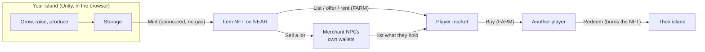
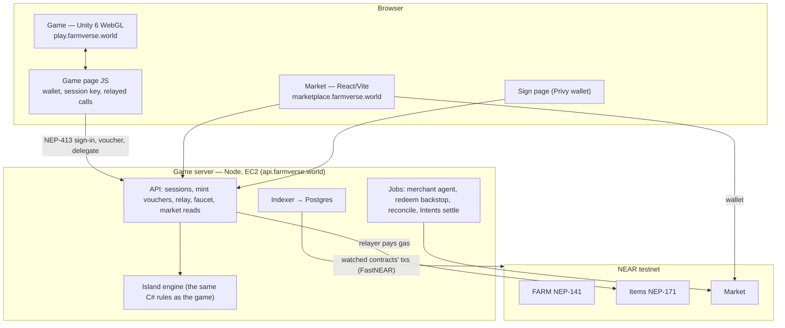

# Farmverse

A cosy island farming game in the browser where **anything you make can leave the game and come back**. You
grow, raise and build on your island; a stack of wheat, a barn or a worker can be **minted** into an item you own
on NEAR, traded for **FARM** on a player market or sold to merchant NPCs who run their own wallets, and
**redeemed** back onto any player's island. Players sign in with email or Google and never pay gas.

Built for **NEAR HACKATHON**, track **`games` — Games With Real Economies**. Runs on **NEAR testnet**.

| | |
|---|---|
| **Video** | https://youtu.be/h634e96a_DE (trailer) |
| **Play** | https://play.farmverse.world |
| **Market** | https://marketplace.farmverse.world |
| **Website** | https://farmverse.world |
| **API** | https://api.farmverse.world (`/v1/config`, `/healthz`) |
| **Game Server** | https://server.farmverse.world (`/v1/config`, `/healthz`) |
| **What changed during the hackathon** | [`pre-hackathon...near-hackathon`](https://github.com/devarogundade/Farmverse/compare/pre-hackathon...near-hackathon) |

## Achievements

- **Partnership with [Cleanmate DAO](https://cleanmatedao.com)**, opening Farmverse to their community of over
  **2,700 users**. Cleanmate sponsors the B3TR coupon rewards in Farmverse.

---

## Contents

1. [Achievements](#achievements)
2. [For judges: try it in 10 minutes](#for-judges-try-it-in-10-minutes)
3. [The story](#the-story)
4. [The game loop](#the-game-loop)
5. [The economy: what lives on NEAR](#the-economy-what-lives-on-near)
6. [How it fits the Games track](#how-it-fits-the-games-track)
7. [Architecture](#architecture)
8. [Run it yourself](#run-it-yourself)
9. [What was built during the hackathon](#what-was-built-during-the-hackathon)
10. [Known limits](#known-limits)
11. [Next steps](#next-steps)

---

## For judges: try it in 10 minutes

Desktop browser recommended. Every step says what to do and what you should see.

| # | Do | You should see |
|---|---|---|
| 1 | Open **play.farmverse.world** | An install screen (Download → Unpack → Start, with MB left). The first visit downloads ~55 MB; later visits open from the browser cache in seconds. |
| 2 | Tap **Play as guest** | You're on your own island in a few seconds: no wallet app, no sign-up. The page makes a NEAR account for you (its key stays in this browser; Settings → **Save your farm** shows it). Prefer an account? **Sign in** → **Email or Google**, or any NEAR testnet wallet (Meteor, HOT, MyNearWallet, Intear). |
| 3 | Play for two minutes: build two **fields** (20 coins each), plant **wheat**, wait ~60 s, harvest, then walk into the farmhouse to unload | 12 wheat in the farmhouse (6 a field). Crops, animals and factories all work like this: start, wait, collect. |
| 4 | Tap the **FARM** pill (top bar) → **Get 100 test FARM** | 100 test FARM arrives in your wallet (once a day). New accounts also got a little test NEAR at sign-in. |
| 5 | **Storage** → wheat → 10 → **Mint as NFT** | The steps tick off. Only goods your farm was seen making can be minted, so the wheat you just grew mints and anything you started with doesn't. The first time, approve one restricted key in your wallet; after that, mints and redeems need **no popup and no gas** (our relayer pays). |
| 6 | **Storage → NFTs** tab | Your new NFT with an **NFT** tag. **Sell on market** opens it on the marketplace, already signed in as **Your farm** (a guest too); **Redeem** puts the goods back in your farmhouse. |
| 7 | Open **marketplace.farmverse.world** and buy or list something | Listings rendered in 3D (goods, buildings, 40 Genesis Farmhands in their outfits). Prices in FARM. Signed in as **Your farm** or with Email or Google, buying, listing and delisting cost **no NEAR**: our relayer pays the gas and the small storage deposits. |
| 8 | Market → **Town** | **Market Town**: four merchant NPCs (Bea, Ruth, Tomas, Ivy) with their own NEAR accounts, what they hold, what they pay, and each merchant's own note on **why** the price moved, written by a private model on **NEAR AI Cloud** and marked *Verified by NEAR AI* when its signature checks out. The formula sets the price; the model only explains it. |
| 9 | Market → **Hire** → **Hire a Farmhand** | Rent a worker NFT by the day. While hired it walks and works on your island in its outfit; its owner collects the FARM it earns. |
| 10 | Open **marketplace.farmverse.world/#/buy-farm** (*Get FARM with any token*, also linked from the buy dialog when you're short of FARM) | A live NEAR Intents (1Click) quote: pay USDC/ETH/SOL/BTC from any chain, receive FARM. On testnet this is a quote only (Intents has no testnet); orders go live on mainnet. |

> **Minting waits on new farms.** To stop bots minting from throwaway farms, a farm must be a few hours old before
> it can mint (admin setting "Hours before a new farm can mint"). For the judging window it is set to **0**, so a new
> account can mint at once. Mints also need a lot of at least 10 and cost a small coin fee, both shown in the sheet.

Contracts on testnet (written by `chain/scripts/deploy-testnet.sh`, see [chain/deploy/testnet.env](chain/deploy/testnet.env)):

| Contract | Account | Standard |
|---|---|---|
| FARM token | `farm.flatemail9253.testnet` | NEP-141 + NEP-145 + NEP-148 |
| Items (everything mintable) | `items.flatemail9253.testnet` | NEP-171/177/178/199/297 + drops |
| Market (listings, offers, rentals) | `market.flatemail9253.testnet` | NEP-178 approvals, NEP-141 payments |
| Merchants | `bea`, `ruth`, `tomas`, `ivy` `.flatemail9253.testnet` | plain accounts run by the agent |

---

## The story

You wash up on a small island with a farmhouse, a field and a few coins. The island grows as you do, in three
chapters over 100 levels:

1. **The Homestead (levels 1–20).** Fields, a chicken coop, a windmill, a barn, a bakery. From level 4 the
   **zombie nights** begin: raiders come for your goods, so you build an army house and train defenders.
2. **The Valley and the Sea (21–54).** The island grows a river valley, a lake and hills; the sea opens fishing.
   Boss zombies start raiding: the Footballer, then the Clerk who comes for your coins. From level 30 a beaten boss
   is **cured** and becomes one of your townsfolk.
3. **The Town on the Plateau (55–100).** Mountains, a waterfall and a ruined town rise from the sea. You rebuild
   it — police station, school, clinic, library, bank, town hall — while the Mime and the Tourist raid at night.
   At level 100 you cure the **Zombie Mayor** and the island is whole.

Around that sits a living economy: **Market Town**, where four merchants buy and sell what islanders make, and
the **Farmhands**, named workers who travel between islands as NFTs.

---

## The game loop

Written the way the track asks for it: what a player does every 30 seconds, every 5 minutes and every session.

| Every ~30 seconds | Every ~5 minutes | Every session |
|---|---|---|
| Harvest and replant fields (wheat 60 s … tomato 150 s), collect eggs (40 s) and milk (60 s), start a factory job (flour, croissants, yogurt …). | Fill a customer order or the freight train for coins and materials; sell to a shop; level up and unlock a building. | Fight the night's zombie raid; claim the Farm Pass tier; **mint** what you have too much of and **sell** it on the market or to a merchant; **redeem** what you bought; hire or rent out Farmhands. |

The on-chain part is optional: the whole game is free to play without ever minting. The chain matters when you
want to **own, move or sell** something.



---

## The economy: what lives on NEAR

| Piece | How it works | Where |
|---|---|---|
| **FARM** | Fixed supply of 1,000,000,000 minted once to a treasury; the contract has no mint function and no owner role. On testnet its account still holds the deploy key (see [Known limits](#known-limits)). Testers get 100 FARM a day from a faucet. | [chain/contracts/farm_token](chain/contracts/farm_token/src/lib.rs) |
| **Mint** | The game server checks the island holds the goods **and that it was seen making them** (no more than its fields, animals and machines could make in that time, by the game's own C# rules), takes them out, and signs a voucher. The player's session key submits `mint_with_voucher`; our relayer pays the gas (NEP-366 meta-transaction). Daily mint allowance and a coin fee act as a sink. | [backend/server/src/mint](backend/server/src/mint/mint.ts), [items contract](chain/contracts/items/src/lib.rs) |
| **Redeem** | Burns the NFT and credits the goods, building, pass or deed to the holder's island. One use only. | same |
| **Market** | Listings, **offers** on a token or on "any wheat, 100 or more", and **rentals** of Farmhands (escrowed; the worker's earnings wait in its own balance). 5 % fee to the treasury, studio royalty on resales. | [chain/contracts/market](chain/contracts/market/src/lib.rs) |
| **Merchant NPCs** | Each merchant is its own NEAR account with its own FARM. Every 10 minutes the agent reads its stock and the last 24 h of sales, sets prices, keeps standing offers and lists what it holds. Pricing: `base × √(target/stock) × (1 + 10 % per recent sale, max +50 %)`, kept within 0.5–2× base, sells at +25 %. When a price moves, the merchant explains it in its own voice through NEAR AI Cloud (TEE inference); the answer's signature and the node's GPU attestation are checked before the page calls it verified. | [`quote()` in merchants.ts](backend/server/src/chain/merchants.ts), [merchantVoice.ts](backend/server/src/chain/merchantVoice.ts) |
| **Farmhands** | 500 Genesis workers, generated from a seed (rarity, outfit, specialty, traits). They work on whichever island holds or rents them and keep their level when traded. 40 are minted and listed now. | [chain/scripts/farmhands.mjs](chain/scripts/farmhands.mjs), [crew rules](Assets/Farmverse/Runtime/Domain/Gameplay/IslandEconomy.Crew.cs) |
| **Scarcity** | Studio drops with on-chain caps (Farm Pass 2,000, Builder's Pass 1,000, 1,000 Genesis land deeds that open a wild plot; gem packs and the Starter Pack are open editions), golden crops (a 1 % harvest, worth 25×), burns on redeem. | [drops.rs](chain/contracts/items/src/drops.rs) |
| **Sponsored calls** | Players sign NEP-366 delegate actions; the relayer sends them and pays gas and deposits. It accepts only our contracts and a short list of calls (mint, redeem, pay with FARM, approve the market, list, delist, rent out, storage), each with a deposit cap, per-account limits and an overall daily deposit cap. | [relay.ts](backend/server/src/chain/relay.ts) |
| **Indexer** | Follows only the watched contracts' transactions (FastNEAR transactions API) into Postgres, which the market reads. | [backend/server/src/chain](backend/server/src/chain/txsource.ts) |

The whole plan, with every decision and its reason: [Docs/architecture/15-game-market-economy-plan.md](Docs/architecture/15-game-market-economy-plan.md)
and its [checklist](Docs/architecture/15-checklist.md).

---

## How it fits the Games track

The track: *"Build NPCs with wallets, player-owned markets and economies that evolve without a dev patch. Judged on
the game loop, not the token — bonus if players never notice the chain."*

| Track idea | Farmverse | Status |
|---|---|---|
| NPCs with wallets | Bea, Ruth, Tomas and Ivy: own accounts, own FARM, an agent loop that prices from stock and demand, and a NEAR AI Cloud model that explains each move in the merchant's own voice (verified, private inference). Farmhands earn FARM into their own balance while rented. | Live |
| Player-owned markets | Listings, offers (per token and per item), rentals, merchant offers, studio drops with on-chain caps. | Live |
| Economy that evolves without a patch | Merchant prices move with stock and sales; scarcity from capped drops, fixed Genesis sets, burns on redeem, golden crops; a coin fee and daily cap on minting. | Live |
| Players never notice the chain | The words players see are "Mint", "Redeem" and "FARM". **Play as guest** (a NEAR account made in the browser, one tap) or Email or Google sign-in (Privy NEAR wallet). Mints and redeems are gasless after one approval (session key + NEP-366 relayer). On the market a guest farm signs in as **Your farm** (its key never leaves the game's page), and guests and Email or Google players buy and list without NEAR. | Live |
| Social login | "Email or Google" wallet in the game and the market (Privy, created through our server). | Live |
| NEAR Intents | *Get FARM with any token* via 1Click: real quotes now; orders need mainnet (Intents has no testnet). | Quotes only on testnet |
| NEP-245 multi-token | Goods are NEP-171 tokens that carry a quantity ("Wheat ×250"). A NEP-245 contract would make stacks fungible and splittable. | Not done (next step) |
| A broke merchant closes until someone invests | Merchants can run low on FARM and stop buying, but there is no close/invest mechanic. | Not done |
| Fast-forward a week of trading | Not built; prices move on the real 10-minute tick. | Not done |

---

## Architecture



| Path | What |
|---|---|
| `Assets/Farmverse` | the game (Unity 6, UI Toolkit). Shared rules in `Runtime/Domain` run in the game and on the server |
| `backend/server` | API, WebSocket, jobs, indexer, relayer, faucet, merchant agent (Fastify, Prisma/Postgres, Redis, BullMQ) |
| `backend/game` | game rules shared by the server and its tests |
| `contracts/` | the one source of the client/server contract (zod → generated C#) |
| `chain/` | NEAR contracts (Rust, near-sdk 5), sandbox tests, testnet scripts |
| `web/` | marketplace, admin and landing sites (React, Vite, three.js) |
| `deployment/` | EC2 deploy (`deploy.sh`) and Vercel deploy (`vercel.sh`) |
| `tools/` | codegen, headless C# tests, Blender model export |
| `Docs/architecture` | the design documents |

---

## Run it yourself

```bash
npm ci && npm test                                              # contracts, game rules, server
cd chain && cargo test && scripts/build.sh                      # NEAR contracts (Linux/WSL)
cargo test -p farmverse-chain-tests                             # sandbox tests on a local NEAR node
dotnet build tools/dotnet/Farmverse.TestHost -c Release         # headless C# game-rule tests
```

[CI](.github/workflows/ci.yml) runs all of these on every push, plus the server's database tests against Postgres,
Redis and the running C# island engine (`npm --prefix backend/server run test:db`).

- **Contracts on your own testnet account:** `MASTER=you.testnet bash chain/scripts/deploy-testnet.sh`, then
  `chain/scripts/upgrade-testnet.sh`, `drops.sh`, `merchants.sh` and `node chain/scripts/farmhands.mjs`.
- **Server:** start Postgres and Redis and copy `backend/server/.env.example` to `.env`, as in
  [backend/server/README.md](backend/server/README.md), then `npm --prefix backend/server run dev`. Deploying to a
  server: [deployment/README.md](deployment/README.md).
- **Sites:** `npm --prefix web run dev:market` (and `dev:landing`, `dev:admin`).
- **Game:** open the project in Unity 6, **Farmverse ▸ Set Up Boot Scene**, then Play; **Farmverse ▸ Web ▸ Build**
  makes the WebGL build. The store art packs are not in git (see below), so a clone builds without their models.

---

## What was built during the hackathon

Farmverse existed before NEAR HACKATHON as a **mobile Unity 6 game with a Firebase backend** (farming, production,
levels, raids, the island). That state is the tag **`pre-hackathon`** ("Baseline: Farmverse before NEAR
HACKATHON"). Everything after it is hackathon work:
[compare `pre-hackathon...near-hackathon`](https://github.com/devarogundade/Farmverse/compare/pre-hackathon...near-hackathon).

**Why the baseline is dated 4 Nov.** The mobile game had no git history: it lived as files on disk. This repository
was created on 4 Nov with `git init`, and its first commit is that project as it stood, tagged `pre-hackathon`. The
web + NEAR plan ([Docs/architecture/13-near-web3-plan.md](Docs/architecture/13-near-web3-plan.md)) was the next commit, 25 seconds later.
You can check that the baseline holds no hackathon work: it has no `chain/`, `web/` or `backend/server/`, no NEAR or
wallet code, and its backend is still Firebase.

Built in the window:

- the **web version** (Unity WebGL, the install screen, the size work that took it from 119 MB to 52 MB);
- a **new backend** (Node, Postgres, Redis, BullMQ) replacing Firebase, with the island engine running the game's
  own C# rules server-side;
- all **NEAR contracts** (FARM, items with drops, market with offers and rentals) and their tests;
- **mint and redeem** from the game, **sponsored fees** (session keys + NEP-366 relayer), the **faucet**;
- the **marketplace**, **admin** and **landing** sites, 3D models for every mintable item;
- **merchant NPC agents**, **Farmhands** (generation, crew rules, rentals), golden crops, land deeds, the Farm Pass
  for FARM;
- **social login** (Privy NEAR wallet), **NEAR Intents** quotes, the **indexer**;
- **guest farms on the market** (a key bridge on the game's origin signs for the market; the key never leaves it)
  and **sponsored market calls**;
- **merchant notes from NEAR AI Cloud**, verified before they're marked so;
- **earned-stock mint checks** (shared C# rules) and **CI** that runs the unit, database/engine and NEAR sandbox
  tests.

**Libraries and services:** near-sdk-rs and near-contract-standards, near-api-js, @hot-labs/near-connect, Privy
(`@privy-io/js-sdk-core`, `@peerfolio/privy-near-connect`), NEAR Intents 1Click API, NEAR AI Cloud, FastNEAR (RPC, transactions
API, neardata), Fastify, Prisma, BullMQ, React, Vite, three.js / react-three-fiber, Unity 6, Blender.

**Art and audio:** 3D models from ithappy asset packs, a purchased mobile game UI kit and licensed music. These are
paid assets and are **not in the repository**; the deployed game and sites include them.

**AI tools:** much of the code was written with AI coding agents (Claude Code), directed and reviewed by the team.

---

## Known limits

What a careful reader should know about the build as it stands, so nothing here reads stronger than the code.

- **The island is still trusted to the browser.** The game uploads its own save and the server keeps it after a
  growth check ([islands.ts](backend/game/src/game/islands.ts)). A mint can only take goods the server saw appear
  between two of its copies, capped by what the earlier island's fields, animals and machines could make in that
  time ([IslandEarned.cs](Assets/Farmverse/Runtime/Domain/Gameplay/IslandEarned.cs)); goods in a first upload never
  mint. A forger who builds a farm in the save and keeps uploading can still mint what those buildings could
  honestly make, within the daily allowance. Buildings and land aren't covered by this check. Making islands
  server-authoritative is the first item in Next steps.
- **Testnet keys.** Each contract account still holds the full-access key it was deployed with, so the code can be
  upgraded, and the owner of items and market is one key, not a multisig. FARM's code has no mint and no owner
  role; the key is what remains. The server's voucher signer, relayer and merchant keys are environment variables.
- **Gasless needs an in-page wallet.** Guests (**Your farm**) and Email or Google players get sponsored market
  calls; extension and redirect wallets (Meteor, HOT, MyNearWallet, Intear) sign and pay as usual. The relayer pays
  deposits too, so it caps them per call, per account per day and for everyone per day.
- **Supply.** Caps are per drop. Gem packs and the Starter Pack are open editions, and the studio minter can mint
  outside a drop.
- **NEAR Intents** gives real quotes; orders and settlement switch on with mainnet.
- **NEAR AI verification** checks each merchant note's signature, that the signing key is in NEAR AI's attestation
  report, and NVIDIA's GPU attestation. The Intel TDX quote isn't checked yet, and the page says so.

---

## Next steps

- **NEP-245 for goods:** one multi-token contract, so stacks of wheat are fungible and can be split or merged.
- **Merchants that can go broke:** a merchant out of FARM closes its stall until players invest in it, and earns
  them a share when it trades again.
- **Fast-forward view:** replay a week of merchant trading in about a minute, to watch prices react.
- **Server-authoritative islands:** every island action checked by the server's island engine, not only mints
  and redeems.
- **Mainnet:** a contract audit, a multisig owner, server keys in a KMS, then live *Get FARM with any token*
  orders through NEAR Intents.

---

## License

The code is [MIT](LICENSE). The fonts in `web/shared/public/fonts` (Lilita One, Nunito) keep their own SIL Open Font
License. The paid art, UI kit and music are not in this repository and are not covered.
